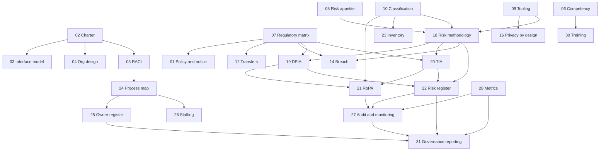

# PGF-00 — Privacy Governance Framework: Framework Overview

*Privacy Governance Framework (PGF) · Release 1.0.0-rc.2 · Authors: Alexey Neyman and Val Khvatov · Regulatory reference date: 26 October 2026*

> **Status and use.** This is a release candidate. PGF is a set of templates and worked examples. It is not a law, a standard, a certification scheme or legal advice, and adopting it does not by itself make an organisation compliant with any law. The worked example concerns a fictional organisation, PanEuropean Bank AG. All of its names, figures, dates and records are illustrative.

## Abstract

The Privacy Governance Framework (PGF) is a set of 31 governance documents, organised in four levels:
1. strategic documents;
2. policies and standards;
3. the process model;
4. control, reporting and improvement.

Each document has a reusable template (Part A) and a worked example for a fictional pan-European retail bank (Part B). A process model of 23 processes, in governing, core and supporting groups, connects the documents to day-to-day operation.

PGF is built on four design choices:
- statutory legal-compliance gates are kept separate from managerial risk decisions;
- the Data Protection Officer remains independent, while an executive programme owner and accountable Processing Owners take the decisions;
- each fact has one authoritative register ("no duplicate registers"), and the data-governance documents are designed as overlays on an existing data-governance programme;
- the calculation of privacy risk is separate from the governance decision about which risk is acceptable.

The GDPR is the baseline. Adaptation guidance is given for Canada (PIPEDA and Québec's private-sector Act), with headline notes for the United Kingdom and Switzerland. A conceptual crosswalk relates PGF to the NIST Privacy Framework 1.0, ENISA engineering guidance and Canadian accountability guidance.

## 1. Audience and scope

**Intended readers:**
- Data Protection Officers and privacy leads;
- executives and boards who oversee a privacy programme;
- risk, audit and compliance functions;
- data-governance and engineering teams that implement privacy controls;
- researchers and educators studying privacy governance.

**In scope:**
- governance of personal-data processing in a medium or large organisation, especially one operating in several jurisdictions;
- programme structure, mandates and decision rights;
- policies;
- risk methodology, including a specialised module for privacy-enhancing technologies (PETs);
- process ownership;
- monitoring and reporting.

**Out of scope or interface only:**
- information-security controls — PGF relies on the organisation's security programme;
- sector-specific regimes such as DORA (financial entities) and the EU AI Act — interfaces only, not full programmes;
- full legal analysis for any specific jurisdiction;
- certification.

## 1a. Positioning

- **What PGF is.** PGF is an operational implementation toolkit. It links legal requirements and risks to processes, roles, decisions, evidence and worked examples.
- **How it relates to NIST.** It complements the risk-based NIST Privacy Framework. NIST is not merely declarative: its Core, Profiles and Implementation Tiers define outcomes and let an organisation select priorities. PGF can help to implement a chosen NIST profile; it does not replace NIST, and its crosswalk is at category level.
- **Three kinds of rule.** Each rule in PGF is one of the following:
  - an applicable legal obligation;
  - an internal rule the organisation adopts (labelled as internal policy where it is stricter than the law);
  - an illustrative default to be calibrated.
- **Proportionality.** Adoption is modular and proportionate. The organisational form, roles and resources scale with the organisation; PGF requires neither a new post nor a new committee, nor every technical test in every context. Applicable legal duties apply from the start regardless of how much of PGF has been adopted (Section 4).
- **Canadian programme examples.** Compact departmental programme overviews such as those of the Canada Revenue Agency and of Innovation, Science and Economic Development Canada are useful examples of the same idea. They concern federal institutions; PGF claims no conformity with them.

## 2. Design principles

1. **Lawfulness before risk.** A legal compliance gate (G-L) runs before any risk decision. It covers lawful basis, conditions for special-category and criminal-offence data, purpose compatibility, transparency, automated decisions, transfer tools and statutory deadlines. No risk appetite, committee decision, metric or opinion can cure a failure.
2. **Independent DPO; accountable decision-makers.**
   - The **controller** is accountable.
   - **Executive Management** decides; the **Governing Body** oversees.
   - An **Executive Privacy Programme Owner (EPPO)** runs the programme.
   - **Processing Owners** take decisions about their processing within delegated limits.
   - The **DPO** advises, monitors, gives advice on every DPIA, cooperates with the supervisory authority and may escalate. The DPO does not authorise processing or accept risk.
   - **Independent Internal Audit** provides assurance.
3. **Statutory gates are explicit:**
   - DPIA triage (G-DPIA);
   - prior consultation for residual high risk (G-36);
   - transfer equivalence with suspension (G-TIA);
   - breach recording and notification on separate GDPR, financial-sector and Canadian tracks.
4. **Calculation is separate from decision.**
   - Document 18 calculates risk on two tracks: risk to individuals' rights and freedoms, and organisational consequences.
   - Document 8 decides what is acceptable and who may accept it.
   - Organisational consequences never offset risk to individuals.
5. **PET metrics are evidence, not legal conclusions.** Anonymity is a contextual legal conclusion (GDPR Recital 26). Pseudonymised, synthetic, encrypted and federated data are distinct states. Differential-privacy claims must state the privacy unit, adjacency relation, accountant and composition.
6. **One authoritative record per fact.** Views, extracts and linked evidence records are allowed, and so are independent statutory records required by law.
7. **Overlay, not duplication.** Data classification, retention and inventory (Documents 10, 11 and 23) are written as privacy overlays on an existing corporate data-governance programme.
8. **Single source for law and tooling.** Document 7 states which requirement applies where. Document 9 is the only connection point to tooling, and the governance core does not depend on any product.

## 3. Architecture

### 3.1. Four levels

| Level | Purpose | Documents |
|---|---|---|
| 1 — Strategic documents | Mandate, structure, roles, applicable law, risk appetite, tooling strategy | 01–09 |
| 2 — Policies and standards | Rules and methods for specific privacy domains, plus the core registers | 10–23 |
| 3 — Process model | How the work is performed and who owns each process | 24–26 |
| 4 — Control, reporting and improvement | Assurance, metrics, review and board reporting | 27–31 |

### 3.2. Dependencies (simplified)

## 4. Quick start — minimum viable adoption

For an organisation that needs a working programme before it adopts all 31 documents:

1. **Mandate and roles.** Adopt the Charter (02) and the RACI (05). Designate the EPPO, the Processing Owners and, where required, the DPO.
2. **Know your law and your processing.** Fill the Regulatory Applicability Matrix (07) and the RoPA (21), then start the Data Inventory (23).
3. **Decide what is acceptable.** Adopt the Risk Appetite Statement (08) with the gates G-L, G-DPIA and G-36.
4. **Operate the statutory processes:** DPIA (19), data subject rights (15), breach response (14), transfers and TIA (12, 20), and vendors (17).
5. **Publish the notice** (01, external part) and train staff (30).
6. **Close the loop.** Set up monitoring and an independent audit (27), a minimal metrics set (28) and board reporting (31).

The other documents add depth: classification, retention, consent, privacy by design, the PET methodology, the process map, the staffing model and the review cycle. Their full documentation can be adopted in phases as the programme matures.

**Phased adoption does not postpone legal duties.** From the start of any processing, the organisation must already:
- apply retention and deletion rules;
- obtain valid consent, and handle its withdrawal, where consent is the lawful basis;
- build data protection by design and by default into any new processing before it launches (Art. 25).

The documents only formalise these duties. Similarly, Document 18 must be in place before any decision or release that relies on its method.

## 5. Document register

For each document: its **purpose**, its key **contents**, and its **relationships** to other documents.

### Level 1 — Strategic documents

**01 Privacy Policy and Notice**
- **Purpose:** the organisation's top-level data protection policy (01A, internal), together with the external privacy notice for a data-subject domain such as customers (01B).
- **Contents:**
  - data protection principles (GDPR Art. 5);
  - controller and DPO identification;
  - purposes with lawful bases and Art. 9 conditions;
  - Art. 13/14 disclosures, including the source of the data and whether providing it is required;
  - automated decision-making and profiling, with meaningful information about the logic;
  - the right to object;
  - recipients, transfers and retention;
  - data subject rights;
  - the right to complain.
- **Relationships:** draws on the Charter (02) and the Regulatory Applicability Matrix (07). Other domain notices must not conflict with it.

**02 Privacy Governance Charter**
- **Purpose:** establishes the programme — its objectives, mandate, governance bodies, decision rights and boundaries. It is the parent document of the model.
- **Contents:**
  - definitions of the roles (controller, Executive Management, Governing Body, EPPO, Processing Owner, DPO, Internal Audit);
  - what is governed and who governs (Section 4);
  - roles, mandates and decision rights, including the Processing Owner mandate (Section 8);
  - the governance tiers — Oversight / Management / Execution, with the DPO and the Processing Owner outside the tiers (Section 9; detailed in Document 04);
  - DPO independence and escalation;
  - the governance gates;
  - the programme's processes.
- **Relationships:** parent of Documents 03, 04 and 05. Frames all other documents.

**03 Privacy Governance Interface and Integration Model**
- **Purpose:** defines interfaces with other corporate functions so that privacy does not duplicate them. The functions are enterprise risk, InfoSec, data governance, Legal, AI governance, IT, HR, Procurement, Finance and, where applicable, sector regimes (for financial entities, DORA ICT risk and incident reporting).
- **Contents:** principles for identifying interface points; an interface map; the "no duplicate registers" rule; a conflict-resolution matrix.
- **Relationships:** sets the external boundaries applied by Documents 08, 10, 14 and 17.

**04 Privacy Organisational Design Strategy**
- **Purpose:** the strategic decision on the privacy function's position, sourcing, size and budget. The EPPO need not be a new post. Insourcing the DPO is a policy choice, since the GDPR allows a DPO on a service contract.
- **Contents:** positioning; reporting lines, including the DPO's direct access to the highest management level; insourcing and outsourcing; headcount and scaling; budget; roadmap.
- **Relationships:** operationalised by Document 26; draws on Document 06.

**05 Privacy RACI Matrix**
- **Purpose:** the single source of truth on responsibility for every process in the process map, allocated by the nature of each decision.
- **Contents:**
  - role list, including the EPPO and the Processing Owner;
  - allocation principles;
  - RACI tables for governing, core and supporting processes, the sub-processes of the process map and the statutory activities;
  - escalation rules, including the recording of reasons when DPO advice is not followed.
- **Relationships:** projected into Document 25 and operationalised in 26. Escalation thresholds come from 08.

**06 Privacy Role Competency Framework**
- **Purpose:** the qualification requirements for each privacy role, expressed vendor-neutrally.
- **Contents:**
  - competency profiles;
  - independence requirements;
  - periodic requalification, including AI literacy where relevant;
  - for the DPO, expertise maintained with resources provided by the organisation.
- **Relationships:** feeds Document 30; used by 26.

**07 Regulatory Applicability Matrix**
- **Purpose:** maps jurisdictions and sectors to the applicable requirements, so that other documents reference them instead of restating them.
- **Contents:**
  - applicability principles;
  - jurisdictions and frameworks, including the competent supervisory authorities under the one-stop-shop;
  - a jurisdiction × requirement matrix;
  - adjacent regimes (DORA, AI Act, NIS2, AML, consumer credit, ePrivacy);
  - a Canadian applicability map (PIPEDA, Québec);
  - pending changes, kept distinct from law in force.
- **Relationships:** input to Documents 01, 12, 14, 17, 19 and 20.

**08 Privacy Risk Appetite Statement**
- **Purpose:** the governance decision on which residual risk is acceptable and who may accept it, once the legal compliance gate has been passed.
- **Contents:**
  - the risk appetite statement;
  - severity and likelihood scales;
  - tiers mapped to the statutory high-risk test;
  - acceptance authority by tier (Critical is not acceptable);
  - conditional acceptance with an expiry date;
  - an optional cumulative disclosure budget (lifetime ledger per source population);
  - escalation.
- **Relationships:** supplies scales and authority to Documents 18–20 and 22. Applied in the process map (24) and reported through 31.

**09 Privacy Automation and Tooling Strategy**
- **Purpose:** which calculations and processes should be automated, and the tool-neutral criteria tooling must meet. It is the only connection point between PGF and any product.
- **Contents:**
  - automation principles;
  - selection and approval criteria: reproducibility, evidence integrity, exit and continuity, and, for financial entities, DORA ICT third-party requirements;
  - the tool-agnostic governance boundary;
  - the technology implementation package;
  - re-certification based on documented testing.
- **Relationships:** aligned with Documents 04, 07, 12 and 17.

### Level 2 — Policies and standards

**10 Data Classification Policy (data-governance overlay)**
- **Purpose:** the privacy dimension of the corporate classification.
- **Contents:**
  - personal-data categories: non-personal, personal, special category (Art. 9), criminal-offence data (Art. 10), vulnerable data subjects;
  - inferred sensitive data;
  - the pseudonymised state;
  - handling rules;
  - declassification only through a documented legal determination.
- **Relationships:** feeds Documents 18, 21 and 23.

**11 Data Retention and Disposal Policy (data-governance overlay)**
- **Purpose:** retention by category, purpose, basis, trigger and jurisdiction, with disposal on expiry.
- **Contents:**
  - retention principles;
  - a matrix with explicit legal sources and exceptions (no blanket "longest period");
  - scoped legal holds with a defined release;
  - disposal;
  - derived data.
- **Relationships:** draws on Documents 10 and 21; interacts with 15 and 12.

**12 Cross-Border Data Transfer Policy**
- **Purpose:** rules and mechanisms for transfers outside the EEA.
- **Contents:**
  - what counts as a transfer, including remote access;
  - transfer tools;
  - a recipient → mechanism → basis matrix;
  - TIA triggers;
  - supplementary measures;
  - suspension where equivalence cannot be ensured.
  - PET-based joint processing is not an automatic exemption.
- **Relationships:** triggers Document 20; recorded in 21.

**13 Consent Management Policy**
- **Purpose:** requirements for consent where consent is the lawful basis — form, recording, withdrawal and renewal. Consent does not reduce the severity of harm.
- **Contents:** consent standards; age of consent; recording; withdrawal and its propagation; Canadian meaningful-consent and express-consent variants.
- **Relationships:** draws on Documents 01, 07 and 10.

**14 Data Breach Response Policy**
- **Purpose:** from security event to personal-data-breach determination.
- **Contents:**
  - **every** breach is recorded;
  - risk assessment of likelihood and severity;
  - notification to the competent supervisory authority (within 72 hours of awareness where required) and to individuals (where the risk is high);
  - processor duties;
  - a separate DORA track for financial entities;
  - Canadian variants: real risk of significant harm and records of all breaches; the Québec register.
  - The controller decides on DPO advice; disagreement is escalated.
- **Relationships:** uses severity concepts from Document 18 and deadlines from 07.

**15 Data Subject Rights Policy**
- **Purpose:** operational fulfilment of rights.
- **Contents:**
  - rights and their legal restrictions, including those under anti-money-laundering law;
  - identity verification;
  - one-month deadlines with extension;
  - Art. 22 safeguards and explanations;
  - notification of recipients;
  - Canadian access variants.
- **Relationships:** draws on Documents 01, 05 and 10; feeds 27 and 28.

**16 Privacy by Design and by Default Policy**
- **Purpose:** embedding data protection in design and in default settings across the development lifecycle.
- **Contents:** Art. 25 design requirements; default settings; legacy systems; a pre-launch gate that includes DPIA triage; illustrative engineering mechanisms.
- **Relationships:** draws on Documents 09, 10, 18 and 19.

**17 Vendor and Third-Party Privacy Risk Policy**
- **Purpose:** managing processors, joint controllers and independent controllers.
- **Contents:**
  - due diligence;
  - the complete Art. 28(3) contract checklist;
  - the sub-processor chain;
  - assistance and notification duties;
  - deletion and return;
  - Art. 26 arrangements;
  - for financial entities, DORA ICT third-party requirements.
- **Relationships:** draws on Documents 03, 10 and 18; feeds 22.

**18 Privacy Risk Assessment Methodology**
- **Purpose:** the calculation core.
- **Contents:**
  - risk to individuals' rights and freedoms, with broad harm types and a likelihood based on threats, controls and exposure;
  - organisational consequences on a separate track;
  - a specialised PET assessment module, with integrated scoring and documented observations, for de-identified, synthetic and aggregate releases;
  - composition across repeated releases;
  - versioned risk calculation projects;
  - evidence packs.
- **Relationships:** takes its scales from Document 08; used by 14, 19, 20 and 22.

**19 DPIA Methodology and Template**
- **Purpose:** DPIA triage and procedure.
- **Contents:**
  - triage under Art. 35(1), (3) and (4) and the nine WP248 criteria;
  - DPO advice on every DPIA;
  - a rights-and-freedoms assessment;
  - prior consultation where high risk remains;
  - the interface with the AI Act fundamental-rights impact assessment;
  - the report structure.
- **Relationships:** uses Document 18 and the authority table of 08; records in 21 and 22.

**20 Transfer Impact Assessment Methodology**
- **Purpose:** assesses the destination's laws and practices — enforceable rights and redress, and access by public authorities — together with supplementary measures and re-evaluation.
- **Contents:**
  - triage;
  - the legal assessment module;
  - the risk calculation, as a secondary input;
  - the decision: do not start, or suspend, where equivalence cannot be ensured;
  - a Québec variant for communication outside Québec.
- **Relationships:** triggered by Document 12; a DPIA (19) may be needed in parallel.

**21 Record of Processing Activities (RoPA)**
- **Purpose:** the Art. 30 register, in controller and processor variants.
- **Contents:** the mandatory field set; the lifecycle of records; the demarcation from the data inventory.
- **Relationships:** records results from Documents 19 and 20; draws technical fields from 23.

**22 Privacy Risk Register**
- **Purpose:** the lifecycle of privacy risks above Low.
- **Contents:** inherent, residual and target risk; treatment; conditional acceptance with expiry; Art. 36 status; alignment with the enterprise risk register.
- **Relationships:** fed by Documents 17, 19 and 20; source for 27 and 31.

**23 Data Inventory and Data Flow Maps (data-governance overlay)**
- **Purpose:** privacy metadata on the corporate data catalogue, and flow maps.
- **Contents:** catalogue fields; flow maps covering jurisdictions, remote access and recipients; update rules; lineage of derived datasets.
- **Relationships:** source of technical fields for Document 21; triggers Document 20.

### Level 3 — Process model

**24 Privacy Governance Process Map**
- **Purpose:** the complete process model.
- **Contents:** 23 processes in three groups, with the Document 05 sub-rows and seven added sub-processes; a value chain per group; a step-by-step event-driven decomposition with triggers, inputs and outputs, participants, gates and metrics (metric identifiers from Document 28). The hierarchy is inspired by the APQC Process Classification Framework; no PCF levels or identifiers are claimed.

| Group | Processes |
|---|---|
| Governing (G1–G9) | G1 Privacy Strategy · G2 Risk Limits and Methodology (G2.1, G2.2) · G3 Maintaining and Reviewing the RACI Model · G4 Regulatory Monitoring (G4.1 Regulator Engagement, Inquiries and Inspections; G4.2 Public-Authority and Law-Enforcement Access Requests) · G5 Policies and Standards (G5.1 Privacy Notice and Transparency Management) · G6 Compliance Monitoring and Assurance (G6.1, G6.2a, G6.2b) · G7 Metrics and KPIs · G8 Governance Reporting (G8.1, G8.2) · G9 Processing Owner Mandate Designation |
| Core (C1–C5) | C1 Risk Calculation Project Development · C2 Data Request and Transformation, including DPIA and prior consultation (C2.1 AI Act Classification and FRIA Interface; C2.2 Children's Data Safeguards; C2.3 Legitimate-Interest Assessment and Joint-Controller Arrangements) · C3 Data Subject Rights · C4 Cross-Border Data Transfer · C5 Consent Management |
| Supporting (S1–S9) | S1 Data Classification · S2 Retention and Disposal (S2.1, S2.2) · S3 Data Inventory · S4 Record of Processing Activities (RoPA) · S5 Privacy Risk Register · S6 Vendor and Third-Party Due Diligence (S6.1, S6.2; S6.3 Corporate Transactions (M&A)) · S7 Incident and Breach Management (S7.1–S7.5) · S8 Staff Training and Awareness (S8, S8.1) · S9 Operating the Automation Tooling |

**25 Process Owner Register**
- **Purpose:** a board- and audit-facing projection of who is accountable for each process and sub-process. It is derived from the RACI (05) and the process map (24) and is not an independent source of truth.
- **Contents:** register rows per process and sub-process; the register of Processing Owner mandate holders designated by Executive Management (Section 10).

**26 Operational Role and Staffing Model**
- **Purpose:** maps roles to positions.
- **Contents:** job descriptions; assignments; vacancy and succession; appointment and removal.
- **DPO safeguards:** no penalty for performing DPO tasks; no automatic suspension for a lapsed certificate.

### Level 4 — Control, reporting and improvement

**27 Privacy Audit and Monitoring Programme**
- **Purpose:** the DPO's compliance monitoring under Art. 39, kept separate from the independent assurance provided by Internal Audit, which reports to the Audit Committee.
- **Contents:** verification criteria by level; schedule; non-conformity classification; independence; data sources.

**28 Privacy Metrics Dashboard**
- **Purpose:** operational and target metrics, each with a defined denominator, zero-case handling and cut-off.
- **Statutory deadlines:** a missed statutory deadline is always escalated, even when the aggregate metric is green.

**29 Policy Review Cycle**
- **Purpose:** review frequency; ad hoc triggers, including regulatory changes recorded in Document 07; change classification; approval by Executive Management or its delegate; versioning.

**30 Privacy Awareness and Training Programme**
- **Purpose:** baseline training for all staff; role-specific programmes; training for management bodies and Processing Owners; coverage of contractors; frequency; tracking; escalation.

**31 Governance Reporting Template**
- **Purpose:** reporting to Executive Management and the Governing Body.
- **Contents:** metrics drawn only from Document 28; the High-risk profile, including the status of prior consultations; audit, incident and decision status; decisions requested.

## 6. Process model in brief

Every privacy decision follows the same path:
1. Trigger: an initiative, a request, an incident or a regulatory change.
2. Classification and inventory (Documents 10, 21, 23).
3. Legal compliance gate (G-L).
4. DPIA triage (G-DPIA) and, where needed, a DPIA with DPO advice.
5. Calculation (Document 18).
6. Prior-consultation test (G-36), evaluated for every DPIA; consultation of the competent supervisory authority where high risk remains.
7. Decision by the single authorised decider (Document 8).
8. Records: RoPA, risk register and evidence pack.
9. Monitoring and reporting.

Transfers add the transfer-equivalence gate (G-TIA). Breaches follow Document 14, with a separate track for each notification regime.

## 7. Standards and regulatory crosswalk (summary)

See [STANDARDS_CROSSWALK.md](STANDARDS_CROSSWALK.md). In brief:
- **GDPR / EDPB.** The architecture covers the controller's core obligations: lawfulness, transparency, rights, design, processors, records, breaches, DPIA, DPO and transfers.
- **NIST Privacy Framework 1.0.** PGF maps conceptually to all five functions:
  - Identify-P, Govern-P and Control-P in substance;
  - Communicate-P in part;
  - Protect-P through the interface with the security programme.
- **ENISA.** The pseudonymisation and data protection engineering reports inform the PET module and privacy by design.
- **Canada.** PGF maps to the programme elements of *Getting Accountability Right with a Privacy Management Program*, with PIPEDA and Québec variants. Other Canadian regimes are named as extensions.

These are conceptual mappings, not claims of conformity.

## 8. Limitations

- **Not validated empirically.** The risk methodology (Document 18) has not been independently validated against real incidents or attacks. The PET thresholds are defaults for discussion and must be calibrated by each adopter.
- **Jurisdictional depth.** The GDPR is the baseline.
  - Canadian content is adaptation guidance at programme level, not a complete legal analysis.
  - UK and Swiss notes are headline only.
  - Other jurisdictions are not covered.
- **Law changes.** The text reflects the law as of **26 October 2026**. Proposals mentioned, such as the EU Digital Omnibus and Canada's Bill C-36, are not law. Adopters must track changes through Documents 07 and 29.
- **Corporate law.** The worked example uses a German two-tier board; other corporate forms need the governance mapping adapted.
- **Security and sector regimes** are covered through interfaces only.
- **No external peer review** has been carried out on this release candidate.

## 9. How to cite

> Neyman, A., & Khvatov, V. (2026). *Privacy Governance Framework (PGF): A Four-Level Model for Enterprise Privacy Governance* (Version 1.0.0-rc.2). DOI pending.

To cite a specific component: "PGF-18 Privacy Risk Assessment Methodology, in Neyman & Khvatov (2026)".

## 10. Competing interests and provenance

- **Provenance.** The internal source set from which this release is derived ("ver.2") was prepared in the context of **Realm Inveo Inc.**, which develops privacy-engineering software. Earlier internal drafts used that software as the illustrative implementation in the worked examples.
- **Named implementation example.** Templates and governance remain tool-neutral. Part B identifies PAMOLA as the Bank's implementation profile, including separately integrated systems. The deployment and results are illustrative, not a product benchmark or capability certification. No product is required to adopt PGF.
- **Affiliations.** Author affiliations are not stated in this release candidate.

## 11. Licence

**Proposed:** CC BY 4.0 for the text and templates; MIT for the build scripts. No licence is in effect until the rights holders confirm it.

## 12. References

**Legislation and case law (selection)**
- Regulation (EU) 2016/679 (GDPR).
- Regulation (EU) 2022/2554 (DORA), with Delegated Regulations (EU) 2024/1772 and 2025/301.
- Regulation (EU) 2024/1689 (AI Act), as amended by the AI Omnibus (in force 27 July 2026).
- Regulation (EU) 2024/1624 (AMLR).
- Personal Information Protection and Electronic Documents Act (Canada).
- Act respecting the protection of personal information in the private sector (Québec, P-39.1).
- German Stock Corporation Act (AktG), §111.
- CJEU:
  - C-311/18 *Schrems II*;
  - C-453/21 *X-FAB*;
  - C-413/23 P *EDPS v SRB*;
  - C-634/21 *SCHUFA*;
  - C-203/22 *Dun & Bradstreet Austria*;
  - C-487/21 *Österreichische Datenschutzbehörde*.

**Guidance**
- EDPB / WP29:
  - WP248 rev.01;
  - WP243 rev.01;
  - WP216;
  - Guidelines 05/2020, 07/2020, 01/2022, 9/2022, 05/2021, 4/2019 and 01/2025;
  - Recommendations 01/2020;
  - Guidelines 02/2026 on anonymisation (public-consultation draft);
  - Coordinated Enforcement Framework report on DPOs (2024).
- ENISA:
  - *Pseudonymisation techniques and best practices* (2019);
  - *Data Protection Engineering* (2022).
- Canadian regulators:
  - OPC / OIPC Alberta / OIPC BC, *Getting Accountability Right with a Privacy Management Program*;
  - OPC breach reporting guidance.
- NIST: Privacy Framework 1.0; NISTIR 8062; SP 800-226; SP 800-188.

## 13. Document history (PGF)

| Release | Date | Notes |
|---|---|---|
| 1.0.0-rc.1 | 2026-10-26 | First public release candidate. Rewritten from the internal ver.2 overview. Adds: abstract; design principles; quick start; process summary; crosswalk summary; limitations; how to cite; competing interests; references. Document register updated to the corrected governance model. Integration pass: Document 24 process names and sub-processes (G4.1, G4.2, G5.1, C2.1–C2.3, S6.3) listed; Charter sections and governance tiers named; G-36 shown before the decision in the process path; Document 25 entry completed. |
