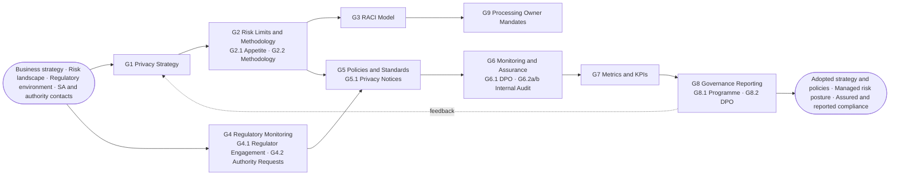
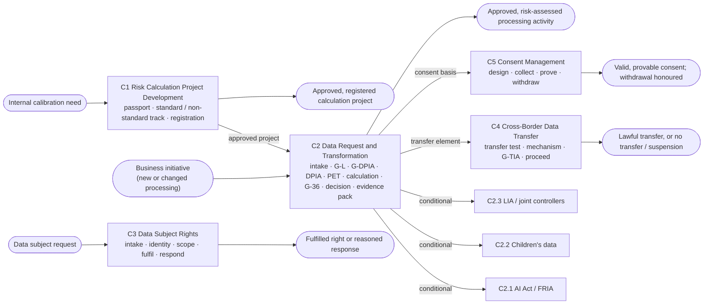
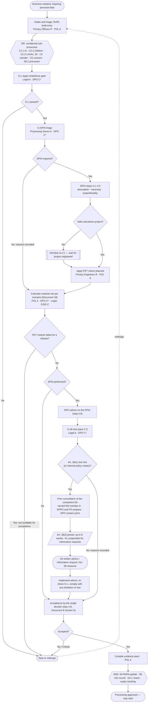
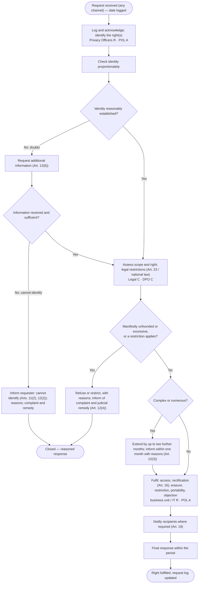
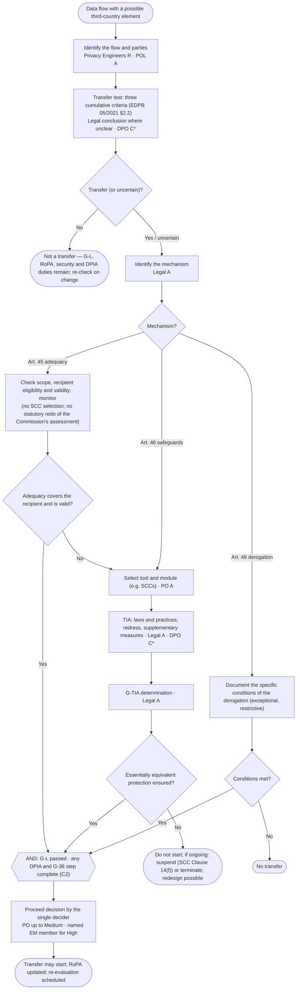
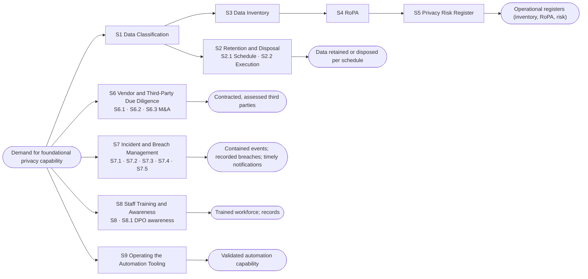
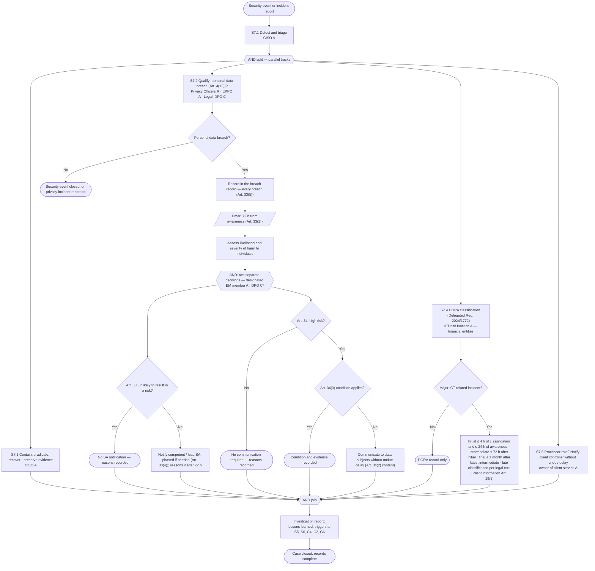

# PGF-24 — Privacy Governance Process Map

*Privacy Governance Framework (PGF) · Level 3 — Process Model · Release 1.0.0-rc.1 · Regulatory reference date: 26 October 2026*

> **Status and use.** Part A is a reusable template. Part B is a worked example for a fictional organisation (PanEuropean Bank AG); all names, figures, dates and records in Part B are illustrative. Nothing in this document is legal advice or a statement about any real organisation, product or provider.

# About This Document

The Privacy Governance Process Map is Document 24 of the Privacy Governance Framework (PGF). It is the complete process model of privacy governance: the composition of the process groups (Level 0), one value chain per process group (Level 1), and a step-by-step decomposition of each of the 23 processes and their sub-processes (Level 2) — purpose, triggers, inputs and outputs with their suppliers and consumers, participants with their RACI references, mandatory gates, tools, metrics and relationships.

The map implements the Charter's commitment that privacy governance is carried out through processes embedded in the organisation's overall process model (Document 2, Section 11). It does not invent roles: the allocation of responsibility for every process and sub-process is taken from the RACI Matrix (Document 5), whose process list and sub-rows are authoritative for this map. The mandatory gates G-L, G-DPIA, G-36 and G-TIA are applied with the wording of the Editorial and Governance Rules (Section 4.2), identical across Documents 5, 8, 12, 14, 16, 18, 19, 20, 22, 24 and 31.

# How to Use This Document

Part A is a drafting template. Bracketed text in bold italics marks a placeholder. Callouts marked **Guidance** are removed from the adopted document. Part B instantiates every process and sub-process for a fictional pan-European retail bank as at 26 October 2026 and traces the bank's recurring worked cases through the key flows (C2, C3, C4 and S7).

> **Guidance.** Before adapting this map, confirm that the Charter (Document 2), the Interface and Integration Model (Document 3) and the RACI Matrix (Document 5) have been adopted, at least in draft. Without established roles (EPPO, Processing Owner, DPO, Privacy Operations Lead, Legal, CISO and others) and an allocation of responsibility for each process, there is nothing to populate the map with. This document fixes the composition and relationships of the processes; Document 5 fixes who does what.

# Table of Contents

**Part A — Template**  
Glossary of Terms  
1. Privacy Governance Process Model  
2. Level 0 — Composition of the Process Groups  
3. Notation and Conventions  
4. Governing Processes (G1–G9)  
5. Core Processes (C1–C5)  
6. Supporting Processes (S1–S9)  
7. Relationship to Other Framework Documents  
8. Review and Amendment  
9. Approval  
**Part B — Worked Example: PanEuropean Bank AG**  
B1. Role Mapping and Fictional Document History  
B2. Level 0 at PanEuropean — Owners and Deciders  
B3. Level 1 at PanEuropean  
B4. Process Cards at PanEuropean (G1–S9 and sub-processes)  
B5. Worked Traces of the Key Flows (C2, C4, S7, C3)  
B6. Review and Approval  
**Normative Basis and References**  
**International Adaptation**  
**Document History (PGF)**

# Part A — Template

**Privacy Governance Process Map — *[Legal name of organisation]***

*Effective date: [DD Month YYYY] · Version: [x.x] · Document owner: [Executive Privacy Programme Owner (EPPO)] · Adopted by: [Executive Management] (Governing Body informed)*

***Version History***

| Version | Date | Changes |
| :---- | :---- | :---- |
| ***[1.0]*** | ***[DD Month YYYY]*** | ***[First version of the document]*** |
| ***[x.x]*** | ***[DD Month YYYY]*** | ***[Brief description of material changes]*** |

## Glossary of Terms

| Term | Definition / Reference |
| :---- | :---- |
| Process group | One of the three groups of the model: governing (G1–G9), core (C1–C5) and supporting (S1–S9) (Document 2, Section 11). |
| Process | One of the 23 numbered processes of the model. Numbering is stable; new activities are added as sub-processes. |
| Sub-process | A part of a process with its own Accountable role or its own trigger. Sub-rows of Document 5 (for example G6.2a, S7.3) and the sub-processes added by this map (Section 2.3) keep the parent's number. |
| Level 0 / Level 1 / Level 2 | Level 0 — composition of the process groups; Level 1 — the value chain of each process group; Level 2 — the step-by-step decomposition of each process. Operational work instructions (Level 3 of implementation) are kept outside this document. |
| Process owner | The role that is Accountable ("A") for the process or sub-process in Document 5. There is no separate "owner badge": where Document 5 splits a process into sub-rows with different Accountable roles, each sub-process has its own owner and the card names them. |
| Mandatory gates | G-L (legal compliance), G-DPIA (DPIA triage), G-36 (prior consultation test) and G-TIA (transfer equivalence, branched by mechanism), with the wording of Document 5, Section 5, and Document 2, Section 11. |
| Single decider | The one effective decision-maker named in a decision record under the delegation in force (Document 8, Section 5): Processing Owner up to Medium (with EPPO concurrence at Medium); one named member of Executive Management for High; Critical is not acceptable. |
| Evidence pack | The traceable record of a calculation and decision (Document 18, Section 4.5), identified `EVP-YYYY-NNNN`. |

## 1. Privacy Governance Process Model

**Privacy governance is implemented through processes, not declarations.** At ***[Organisation name]*** privacy governance is implemented by embedding privacy governance processes into the organisation's overall process model (Document 2, Section 11). The privacy processes do not form an isolated loop: they are part of the organisation's unified process map, grouped into governing, core and supporting process groups, with explicit interface points to adjacent corporate domains. Section 8 of each process card records the nature of each interface.

| Adjacent corporate domain | Intersects with PGF processes |
| :---- | :---- |
| Enterprise risk management | G2.1 — corporate risk appetite framework; S5 — corporate risk register (Document 3, Section 3.1) |
| Data management | S1 — data governance and classification; S3 — data catalogue and architecture (Document 3, Section 3.3) |
| Legal and compliance | G4 — regulatory change management; G4.1 — supervisory relations; G4.2 — requests from authorities (Document 3, Section 3.4) |
| AI governance and model risk | C2.1 — AI system classification, AI Act deployer and provider duties, FRIA (Document 3, Section 3.5) |
| Enterprise performance management | G7 — corporate KPI and scorecard framework |
| Corporate governance | G8 — reporting to Executive Management and the Governing Body; G6.2 — internal audit (Document 3, Sections 3.10–3.11) |
| Records management | S2 — enterprise records and information management |
| Procurement and outsourcing | S6 — third-party and vendor risk management, outsourcing register (Document 3, Sections 3.8, 3.15) |
| Information security | S7.1 — security incident and crisis management (Document 3, Section 3.2) |
| ICT risk and operational resilience (financial entities) | S7.4 — DORA incident classification and reporting (Document 3, Section 3.14) |
| IT service management | S9 — operation of corporate applications (Document 3, Section 3.6) |
| Client relationship | C3, C5, G5.1 — customer channels, complaints, notices (Document 3, Section 3.9) |

**The external context ("process clients").** The processes operate for external clients of four types. Their requests and deliverables are unfolded in the Level 1 chains (Sections 4–6).

| Process client | Initiates | Receives | Processes |
| :---- | :---- | :---- | :---- |
| Competent supervisory authority (SA) | Inquiries, investigations, inspections, complaints forwarded for handling, responses to prior consultations | Breach notifications (Art. 33), prior-consultation submissions (Art. 36), responses to inquiries and orders, the DPO's contact details (Art. 37(7)) | G4.1, C2 (G-36), S7.3 |
| Financial supervisor (financial entities only) | Supervisory requests on ICT risk | DORA incident reports (never a GDPR notification) | S7.4 |
| Data subject | Requests to exercise rights, consent decisions, complaints | Fulfilled rights, notices, breach communications (Art. 34) | C3, C5, G5.1, S7.3 |
| Business sponsor | An initiative or need for processing | A decision on the initiative after the gates, with an evidence pack | C2, C4, S6 |
| Public authority (other than the SA) | Requests for disclosure of personal data | A legally assessed response limited to what is required | G4.2 |

**A process with an internal trigger.** Risk Calculation Project Development (C1) has no external client: it is triggered by the internal need to configure the risk-calculation method for a new or changed class of processing (Document 18, Section 4). Its result is a ready-to-use, approved Risk Calculation Project for the other core processes, primarily C2. It is kept in the core group because it is part of the end-to-end decision path of C2 (Document 5, Section 5.1).

**Classification basis.** The hierarchy of this model — process group → process → sub-process → activity — is inspired by the APQC Process Classification Framework (PCF) hierarchy, which is available under APQC's licence terms. This document does not map its processes to PCF element identifiers and makes no claim of PCF conformance; an organisation that needs such a mapping records the PCF identifiers in a separate column of Section 2.

**Three levels of decomposition.** Section 2 fixes the composition (Level 0). Sections 4–6 each open with the Level 1 value chain of the process group, followed by a Level 2 card for each process and sub-process: purpose, triggers and business value; owner and decision rights with references to Document 5; inputs and their suppliers; outputs and their consumers; the step-by-step flow (Event-Driven Process Chain, written as a table and, for the key flows, also as a diagram); participants; gates; tools; metrics; and relationships with other processes.

## 2. Level 0 — Composition of the Process Groups

### 2.1 Processes and Document 5 sub-rows

| Group | Code | Process (sub-rows of Document 5) | Process owner (A, Document 5) | Card |
| :---- | :---- | :---- | :---- | :---- |
| Governing | G1 | Privacy Strategy | EPPO | 4.2 |
| Governing | G2 | Risk Limits and Methodology — G2.1 Setting Risk Limits (Privacy Risk Appetite, Document 8); G2.2 Risk Assessment Methodology (Document 18) | G2.1 EPPO (adoption: Executive Management); G2.2 EPPO (decision: Privacy Risk Committee) | 4.3 |
| Governing | G3 | Maintaining and Reviewing the RACI Model | EPPO | 4.4 |
| Governing | G4 | Regulatory Monitoring | EPPO | 4.5 |
| Governing | G5 | Policies and Standards | EPPO | 4.6 |
| Governing | G6 | Compliance Monitoring and Assurance — G6.1 Compliance Monitoring and DPO-Organised Audits; G6.2a Internal-Audit Charter, Risk-Based Audit Plan and Significant Plan Changes; G6.2b Independent Assurance Opinion | G6.1 DPO; G6.2a/G6.2b Chief Audit Executive | 4.7 |
| Governing | G7 | Metrics and KPIs | EPPO | 4.8 |
| Governing | G8 | Governance Reporting — G8.1 Programme Reporting; G8.2 DPO Report to the Highest Management Level | G8.1 EPPO; G8.2 DPO | 4.9 |
| Governing | G9 | Processing Owner Mandate Designation | EPPO (designation decided by Executive Management) | 4.10 |
| Core | C1 | Risk Calculation Project Development | Privacy Operations Lead (standard track); EPPO (non-standard track; decision: Privacy Risk Committee) | 5.2 |
| Core | C2 | Data Request and Transformation | Activity-level (Document 5, Section 5.2): intake — Privacy Operations Lead; G-L — Legal; DPIA — Processing Owner; acceptance — single decider | 5.3 |
| Core | C3 | Data Subject Rights | Privacy Operations Lead (Art. 22(3) review: Processing Owner; complaints to the DPO: DPO) | 5.7 |
| Core | C4 | Cross-Border Data Transfer | Activity-level (Document 5, Section 5.4): identification — Privacy Operations Lead; TIA and G-TIA — Legal; tool and proceed decision — Processing Owner (High: named Executive Management member) | 5.8 |
| Core | C5 | Consent Management | Processing Owner (proof of consent: Privacy Operations Lead) | 5.9 |
| Supporting | S1 | Data Classification | Head of Data Governance | 6.2 |
| Supporting | S2 | Retention and Disposal — S2.1 Retention Schedule; S2.2 Retention and Disposal Execution | S2.1 EPPO; S2.2 Processing Owner | 6.3 |
| Supporting | S3 | Data Inventory | Privacy Operations Lead | 6.4 |
| Supporting | S4 | Record of Processing Activities (RoPA) | Privacy Operations Lead | 6.5 |
| Supporting | S5 | Privacy Risk Register | EPPO | 6.6 |
| Supporting | S6 | Vendor and Third-Party Due Diligence — S6.1 Vendor Privacy Due Diligence; S6.2 Engaging a Processor or Recipient | S6.1 Privacy Operations Lead; S6.2 Processing Owner | 6.7 |
| Supporting | S7 | Incident and Breach Management — S7.1 Security Event Detection, Triage and Containment; S7.2 Personal Data Breach Qualification and Recording; S7.3 GDPR Notification Decision; S7.4 DORA Major ICT-Related Incident Reporting; S7.5 Processor Extension | S7.1 CISO; S7.2 EPPO; S7.3 designated Executive Management member; S7.4 head of the ICT risk function; S7.5 owner of the client service | 6.9 |
| Supporting | S8 | Staff Training and Awareness — S8 Staff Training; S8.1 DPO Awareness-Raising | S8 EPPO; S8.1 DPO | 6.10 |
| Supporting | S9 | Operating the Automation Tooling | Privacy Operations Lead | 6.11 |

### 2.2 Diagnostic test for the process groups

1. **Governing processes** set the rules, limits and accountability for all other processes. Their Accountable role sits at management level — normally the EPPO, with adoption by Executive Management — or, for the statutory and assurance activities that belong to other roles by their nature, the DPO (G6.1, G8.2) or the Chief Audit Executive (G6.2a, G6.2b). If the Accountable role of a candidate governing process is an execution-level role, the process is operational and belongs in another group.
2. **Core processes** run end to end across several roles, from an external trigger (or, for C1, the internal calibration need of C2) to an outcome that matters to an external process client. They are the only processes that Document 5 details down to activity level (Document 5, Section 5); their gates appear as explicit steps.
3. **Supporting processes** serve several governing and core processes and have no external client of their own (S7.3 and S7.4 deliver statutory notifications, but on behalf of the core and governing processes). Under the asset-owner principle (Document 3, Section 2), the Responsible role often belongs to an adjacent corporate function.

> **Guidance.** The 23 processes and their grouping are the framework's reference structure. Any deviation — adding, merging or removing a process — is justified by the diagnostic test, recorded in Document 5 within the same review cycle, and reflected in the Process Owner Register (Document 25). New activities are added as sub-processes with the parent's number, so that cross-references remain stable.

### 2.3 Sub-processes added by this map

The following activities, missing from the internal ver.2 map, are added as sub-processes. Each has its own card.

| Code | Sub-process | Parent | Owner (A) | Basis in Document 5 | Card |
| :---- | :---- | :---- | :---- | :---- | :---- |
| G4.1 | Regulator Engagement, Inquiries and Inspections | G4 | EPPO for the controller's response (decision by Executive Management where the response commits the controller); DPO for its own cooperation and contact-point tasks | Statutory rows "Cooperation with and contact point for the SA" and "Controller response to SA inquiries, investigations and orders" | 4.5.1 |
| G4.2 | Public-Authority and Law-Enforcement Access Requests | G4 | Legal | Document 5, row G4.2; Document 3, Section 3.4 | 4.5.2 |
| G5.1 | Privacy Notice and Transparency Management (Arts. 12–14) | G5 | EPPO (notice content for a processing activity: Processing Owner) | Document 5, rows G5.1 | 4.6.1 |
| C2.1 | AI Act Classification and FRIA Interface | C2 | Processing Owner (preparation: AI governance function) | Statutory row "AI Act deployer duties / FRIA — interface" | 5.4 |
| C2.2 | Children's Data Safeguards | C2 | Processing Owner | Document 5, Section 5.2, row C2.2 | 5.5 |
| C2.3 | Legitimate-Interest Assessment and Joint-Controller Arrangements | C2 | LIA: Legal (as part of G-L); Art. 26 arrangement: Processing Owner | Statutory row "Joint-controller arrangement (Art. 26)"; G-L row | 5.6 |
| S6.3 | Corporate Transactions (M&A): Privacy Due Diligence and Data Migration | S6 | Processing Owner of the transaction (lead: EPPO) | Document 5, row S6.3 | 6.8 |

### 2.4 Statutory activities of Document 5 and where they appear on the map

| Statutory activity (Document 5, Section 6) | Where on the map |
| :---- | :---- |
| DPO designation, removal and communication of contact details (Art. 37(1), (7)) | G9 relationships; G4.1 (contact details to the SA) |
| DPO resources, access and independence (Art. 38) | G3; G8.2 |
| Cooperation with and contact point for the SA (Art. 39(1)(d)–(e)) | G4.1; C2 (G-36); S7.3 |
| Controller response to SA inquiries, investigations and orders | G4.1 |
| Joint-controller arrangement (Art. 26) | C2.3 |
| AI Act deployer duties and FRIA — interface | C2.1 |
| Data subject contacts and complaints addressed to the DPO (Art. 38(4)) | C3 |

## 3. Notation and Conventions

* **Level 1** value chains are given as Mermaid flowcharts (left to right) followed by a stage table.
* **Level 2** flows are written as Event-Driven Process Chain (EPC) tables. Each row is one element: **E** — event (a state reached); **F** — function (an activity, with its performing role); **X** — exclusive (XOR) gateway; **A** — parallel (AND) split or join; **O** — inclusive (OR) split; **I** — interface to another process (with the return event); **T** — timer (statutory clock). Decisions are taken in the function that precedes a gateway; a gateway follows a function, never an event. Every branch ends in an event.
* The key flows — C2, C3, C4 and S7 — are also drawn as Mermaid flowcharts. Where the diagram and the table differ, the table prevails.
* **RACI references** cite the Document 5 row (for example "Document 5, row S7.3") or activity (for example "Document 5, Section 5.2, G-36"). Notation: A — Accountable; R — Responsible; D — Approve/Decide where different from A; C — Consulted; C\* — mandatory consultation (advice sought and recorded; never approval); I — Informed.
* **DPO confidentiality (Art. 38(5); WP243 rev.01, §2.6).** Where the EPPO or anyone else is "I" or "C" on a step performed by the DPO, this never means automatic disclosure of the content of a request made to the DPO or of the requester's identity; need-to-know, redaction or aggregate reporting apply, and the DPO decides how its own work is distributed.
* **Tools** are named by function (for example "risk-calculation platform", "incident management system"); Document 9 is the single connection point to specific tooling.
* **Metrics** are named here with their Document 28 identifiers (M-…); their definitions, denominators, treatment of zero cases and cut-off rules are kept in the Privacy Metrics Dashboard (Document 28, Section 6.10). Metrics on statutory deadlines are reported per case: a missed statutory deadline is a breach of obligation and is escalated even when an aggregate KPI stays green.

## 4. Governing Processes (G1–G9)

### 4.1 Level 1 — value chain of the governing processes

The governing processes are detailed by Document 5, Section 4, at process and sub-row level. The chain runs from the business strategy, risk landscape and regulatory environment to an approved, monitored and reported privacy programme.

| Stage | Process | Business input | Business output |
| :---- | :---- | :---- | :---- |
| Direction | G1 | Business strategy, risk landscape | Adopted privacy strategy |
| Limits and method | G2.1, G2.2 | Corporate risk appetite, precedents | Adopted Privacy Risk Appetite; approved methodology |
| Accountability | G3, G9 | Organisational change | Current RACI model; designated Processing Owners |
| Rules and external relations | G4, G4.1, G4.2, G5, G5.1 | Regulatory change; SA and authority contacts | Assessed impact; responses to authorities; adopted policies and notices |
| Assurance | G6.1, G6.2a, G6.2b | Operations to be assured | DPO monitoring findings; audit plan; independent opinion |
| Measurement and reporting | G7, G8.1, G8.2 | Section 7 metrics of all processes | Dashboard; programme report; DPO report |

### 4.2 G1 — Privacy Strategy

**Purpose.** Converts business strategy and the evolving risk landscape into an adopted direction for the privacy programme over a horizon of a year or more, so that privacy does not develop reactively behind incidents or regulator requests, but has a direction that can be referenced when setting priorities and budget.

**Triggers:** scheduled annual strategy cycle; material change in the risk landscape or regulatory environment; request from Executive Management or the Governing Body.  
**Business value:** a predictable, adopted direction for the privacy programme instead of disjointed reactive decisions.

**Owner and decision rights.** A — EPPO; R — Privacy Operations Lead; D — Executive Management adopts; C — DPO, Legal, CISO, ***[ERM]***; I — Governing Body committee, all roles (Document 5, row G1).

| Input | Document | Supplier |
| :---- | :---- | :---- |
| **Business strategy and risk landscape** | Corporate strategy and risk reporting (outside the framework) | Executive Management |
| Assessed regulatory impact | Regulatory Applicability Matrix (Document 7); G4 impact memos | Legal; Privacy Officer(s) |
| Current Privacy Risk Appetite | Privacy Risk Appetite Statement (Document 8) | EPPO |
| Prior-period programme performance | Privacy Metrics Dashboard (Document 28); DPO report (G8.2) | Privacy Operations Lead; DPO |

| Output | Document | Consumer |
| :---- | :---- | :---- |
| **Adopted privacy strategy** | Privacy strategy | Privacy Operations Lead (operationalises it); all process owners |
| Proposals to update the mandate and scope of the model | Privacy Governance Charter (Document 2) | EPPO (G5) |
| Input for reviewing the organisational model | Organisational Design Strategy (Document 4) | EPPO (G3) |

| # | Type | Element | Performed by (RACI) |
| :---- | :---- | :---- | :---- |
| 1 | E | Business strategy and risk landscape received | — |
| 2 | F | Analyse strategic privacy implications | Privacy Operations Lead (R) |
| 3 | E | Implications assessed | — |
| 4 | F | Draft privacy strategy; seek advice | EPPO (A); DPO, Legal, CISO (C) |
| 5 | E | Draft strategy with recorded advice | — |
| 6 | F | Adopt strategy (decide whether it changes the Charter or the appetite) | Executive Management (D) |
| 7 | X | Charter or Board-level appetite affected? | — |
| 8a | E | Yes: amendment proposal passed to G5 / G2.1 (Governing Body consent only where its rules reserve it) | — |
| 8b | E | No: privacy strategy adopted | — |
| 9 | F | Inform the Governing Body committee and all roles | EPPO (A) |
| 10 | E | Strategy communicated | — |

**Participants.** EPPO — accountable; drafts and submits. Privacy Operations Lead — prepares analysis; operationalises the strategy. Executive Management — adopts. DPO — advises (its advice is recorded; it does not approve). Legal, CISO, ERM — consulted. Governing Body committee — oversight.

| Tool | Type | Role in the process |
| :---- | :---- | :---- |
| Privacy Governance Charter (Document 2) | Standard | Mandate and boundaries within which the strategy is formed |
| Privacy Metrics Dashboard (Document 28) | System / register | Prior-period performance |
| Regulatory Applicability Matrix (Document 7) | Register | Regulatory context |

| Metric | Kind | Unit | Direction | Why it matters |
| :---- | :---- | :---- | :---- | :---- |
| M-G1-01 — Time from trigger to adopted strategy | Process | days | Decrease | Strategy does not lag behind the triggering event |
| M-G1-02 — Share of cycles completed on schedule | Process | % | Increase | Discipline of the planning cycle |
| M-G1-03 — Unscheduled strategy revisions in the year | Outcome | count | Decrease | Durability of the previous strategy |
| M-G1-04 — Share of strategic priorities delivered on schedule | Outcome | % | Increase | Realism of the adopted direction |

| Related process | Nature of the relationship |
| :---- | :---- |
| G2.1 Risk Limits | The strategy is the frame of reference for the appetite |
| G4 Regulatory Monitoring | Supplies assessed regulatory impact |
| G5 Policies and Standards | The strategy sets policy priorities |
| G7 Metrics and KPIs | Supplies prior-period metrics |
| G8.1 Programme Reporting | The adopted strategy is reported to the Governing Body |
| G3 RACI Model | Strategic decisions changing the organisational model trigger a RACI review |

### 4.3 G2 — Risk Limits and Methodology (G2.1, G2.2)

**Purpose.** G2.1 converts the organisation's risk appetite into the Privacy Risk Appetite Statement — tiers, the severity-led residual-risk matrix, acceptance authority and any cumulative disclosure budget (Document 8). G2.2 maintains the Privacy Risk Assessment Methodology — factors, metrics, thresholds and the PET Assessment Module (Document 18). Together they give the core processes an unambiguous, pre-adopted rule for who may accept which residual tier, without escalating every case.

**Triggers:** scheduled review (Document 29); material change in the corporate risk appetite; accumulation of decisions that call the tiers or thresholds into question; new PET or attack class; adoption of relevant guidance.  
**Business value:** known, predictable rules for residual-risk decisions; low-risk initiatives proceed without delay.

**Owner and decision rights.** G2.1: R — EPPO, ***[ERM]***; A — EPPO; D — Executive Management (Governing Body consent only where its rules reserve it); C — DPO, Legal, CISO, Processing Owners; I — Governing Body Risk Committee, Privacy Operations Lead (Document 5, row G2.1). G2.2: R — Privacy Operations Lead, ***[ERM]***; A — EPPO; D — Privacy Risk Committee; C — DPO, Legal, CISO; I — Executive Management, Independent Internal Audit (Document 5, row G2.2).

| Input | Document | Supplier |
| :---- | :---- | :---- |
| **Corporate risk appetite and priorities** | Corporate risk appetite statement (outside the framework) | Executive Management / ***[CRO]*** |
| Precedents of residual-risk decisions | Privacy Risk Register (Document 22) | Privacy Operations Lead |
| Adopted privacy strategy | G1 output | EPPO |
| Calibration evidence, new PET or attack classes, guidance changes | Document 18 review record; G4 impact memos | Privacy Operations Lead; Privacy Engineer(s) |

| Output | Document | Consumer |
| :---- | :---- | :---- |
| **Adopted Privacy Risk Appetite** (tiers, matrix, acceptance authority) | Document 8 | Single deciders in C2 and C4; Privacy Operations Lead |
| **Approved methodology** (factors, metrics, thresholds, gates) | Document 18 | C1 (project configuration); C2 (calculation) |
| Alignment record with the corporate risk appetite | Corporate risk register (outside the framework) | ***[ERM]*** |

| # | Type | Element | Performed by (RACI) |
| :---- | :---- | :---- | :---- |
| 1 | E | Review trigger for appetite or methodology received | — |
| 2 | F | Analyse precedents, calibration evidence and guidance; decide which instrument is affected | EPPO (A); Privacy Operations Lead (R) |
| 3 | X | Appetite (G2.1), methodology (G2.2) or both? | — |
| 4 | F | G2.1: draft tiers, matrix and acceptance authority; align with corporate appetite | EPPO, ***[ERM]*** (R); DPO, Legal, CISO, Processing Owners (C) |
| 5 | E | Draft appetite with recorded advice | — |
| 6 | F | G2.1: adopt the Privacy Risk Appetite Statement | Executive Management (D); Governing Body consent only where reserved |
| 7 | E | Privacy Risk Appetite adopted | — |
| 8 | F | G2.2: draft methodology changes, including sensitivity analysis of cut-points | Privacy Operations Lead (R); DPO, Legal, CISO (C) |
| 9 | E | Draft methodology change prepared | — |
| 10 | F | G2.2: decide on the methodology change | Privacy Risk Committee (D); EPPO (A) |
| 11 | E | Methodology approved (Executive Management informed; adoption of Document 18 as a document under G5) | — |
| 12 | A | Join: inform C1, C2, C4 and S5 owners | — |
| 13 | E | Current limits and method in force | — |

**Participants.** EPPO — accountable for both sub-processes. Privacy Operations Lead — prepares methodology changes. ERM — aligns with the corporate appetite. Executive Management — adopts the appetite. Privacy Risk Committee — decides methodology changes (management level; the DPO attends as a non-voting adviser). DPO, Legal, CISO, Processing Owners — consulted. Governing Body Risk Committee — oversight.

| Tool | Type | Role in the process |
| :---- | :---- | :---- |
| Privacy Risk Assessment Methodology (Document 18) | Methodology | Scales to which the tiers are pegged |
| Privacy Risk Register (Document 22) | Register | Source of precedents |
| Interface and Integration Model (Document 3, Section 3.1) | Standard | Consistency with the corporate risk appetite |

| Metric | Kind | Unit | Direction | Why it matters |
| :---- | :---- | :---- | :---- | :---- |
| M-G2-01 — Time since the last appetite / methodology review | Process | days | Decrease | Currency relative to the review cycle (Document 29) |
| M-G2-02 — Share of reviews started on schedule | Process | % | Increase | Planned rather than reactive review |
| M-G2-03 — Share of residual-risk decisions requiring a documented deviation from the authority table | Outcome | % | Decrease | Fit of the tiers to practice |
| M-G2-04 — Cases where ERM disagreed with the privacy tiers | Outcome | count | Decrease | Misalignment with the corporate appetite |

| Related process | Nature of the relationship |
| :---- | :---- |
| G1 Privacy Strategy | Frame of reference |
| C1 Risk Calculation Project Development | Uses the methodology's parameter space and the weight corridor at the "standard configuration?" gate |
| C2 Data Request and Transformation | Applies the authority table at the acceptance step |
| C4 Cross-Border Data Transfer | Applies the authority table at the proceed decision (only after G-TIA passes) |
| S5 Privacy Risk Register | Supplies precedents |
| G8.1 Programme Reporting | Appetite and methodology changes are reported |
| Enterprise risk management | The privacy appetite is a domain-level refinement of the corporate appetite; it creates no separate decision track |

### 4.4 G3 — Maintaining and Reviewing the RACI Model

**Purpose.** Keeps the single source of truth for accountability (Document 5) current whenever the organisational structure or the set of processes changes, so that what Document 5 records and what the organisation actually does never diverge.

**Triggers:** organisational change (new role, restructuring); addition or change of a process or sub-process on this map; scheduled annual review.  
**Business value:** at any time it is unambiguous who is responsible for each privacy decision; no "no man's land" during escalation or audit.

**Owner and decision rights.** R — Privacy Operations Lead; A — EPPO; D — Executive Management; C — DPO, Legal, Processing Owners; I — all roles (Document 5, row G3).

| Input | Document | Supplier |
| :---- | :---- | :---- |
| **Organisational or process change** | Organisational Design Strategy (Document 4); this map | EPPO; Privacy Operations Lead |
| Current RACI Matrix | Document 5 | EPPO (document owner) |
| Findings on accountability gaps | G6.1 / G6.2b reports | DPO; Internal Audit |

| Output | Document | Consumer |
| :---- | :---- | :---- |
| **Updated accountability model** | Document 5 | All roles |
| Projection to the Process Owner Register | Document 25 | All roles |

| # | Type | Element | Performed by (RACI) |
| :---- | :---- | :---- | :---- |
| 1 | E | Organisational or process change identified | — |
| 2 | F | Assess impact on the accountability model; decide whether an Accountable role changes | Privacy Operations Lead (R) |
| 3 | X | Change affects an Accountable role or a sub-row? | — |
| 4a | F | Yes: draft RACI amendment; seek advice | Privacy Operations Lead (R); DPO, Legal, Processing Owners (C) |
| 5a | E | Amendment drafted | — |
| 6a | F | Adopt RACI change | Executive Management (D); EPPO (A) |
| 7a | E | RACI model updated and adopted | — |
| 4b | F | No: update the Process Owner Register only | Privacy Operations Lead (R) |
| 5b | E | Register updated (no RACI change) | — |
| 8 | F | Inform all roles | EPPO (A) |
| 9 | E | Roles informed | — |

**Participants.** Privacy Operations Lead — assesses and drafts. EPPO — accountable. Executive Management — adopts. DPO, Legal, Processing Owners — consulted. All roles — informed.

| Tool | Type | Role in the process |
| :---- | :---- | :---- |
| RACI Matrix (Document 5) | Standard | Primary artefact |
| Process Owner Register (Document 25) | Register | Projection of Document 5 |
| Organisational Design Strategy (Document 4) | Standard | Source of organisational changes |

| Metric | Kind | Unit | Direction | Why it matters |
| :---- | :---- | :---- | :---- | :---- |
| M-G3-01 — Average time from organisational change to RACI update | Process | days | Decrease | The model does not lag |
| M-G3-02 — Changes not reflected at quarter-end | Process | count | Decrease | Maintenance discipline |
| M-G3-03 — Discrepancies between Document 25 and Document 5 found in audit | Outcome | count | Decrease | The register stays a projection |
| M-G3-04 — Processes or sub-processes without a single Accountable role | Outcome | count | Decrease (target 0) | Single-Accountable principle (Document 5, Section 2) |

| Related process | Nature of the relationship |
| :---- | :---- |
| G1 Privacy Strategy | Organisational consequences of strategic decisions |
| G5 Policies and Standards | A new policy may add an activity needing allocation |
| G6 Monitoring and Assurance | Checks consistency of Documents 5 and 25 |
| G9 Processing Owner Mandate Designation | A change of mandate holder does not by itself change Document 5; structural changes do |
| S9 Operating the Automation Tooling | A change in tooling may change execution roles |

### 4.5 G4 — Regulatory Monitoring

**Purpose.** Tracks changes in the applicable regulatory landscape — legislation, delegated and implementing acts, SA and EDPB guidance, court decisions and enforcement practice, including adjacent regimes (AI Act, DORA, consumer credit, AML) — and assesses their impact before a non-conformity is found externally. Keeps the Regulatory Applicability Matrix (Document 7) current, recording law in force, adopted law not yet applicable, proposals and draft guidance as separate facts.

**Triggers:** publication of a new law, guidance or decision; scheduled screening of subscribed sources.  
**Business value:** advance warning of new requirements; time to prepare instead of reacting.

**Owner and decision rights.** R — Privacy Officer(s), Legal; A — EPPO; C — DPO; I — Privacy Operations Lead; Executive Management (material changes) (Document 5, row G4).

| Input | Document | Supplier |
| :---- | :---- | :---- |
| **Regulatory or legislative change** | Legal databases and regulatory subscriptions (outside the framework) | Legal |
| Current applicability | Regulatory Applicability Matrix (Document 7) | EPPO (document owner) |
| SA and authority developments | G4.1 records | DPO; Legal |

| Output | Document | Consumer |
| :---- | :---- | :---- |
| **Assessed regulatory impact** | Impact memo | EPPO — decides on further action |
| Updated Regulatory Applicability Matrix | Document 7 | All process owners |
| Trigger for unscheduled review | Policy Review Cycle (Document 29) | G5; owners of affected processes |

| # | Type | Element | Performed by (RACI) |
| :---- | :---- | :---- | :---- |
| 1 | E | Regulatory or legal change identified | — |
| 2 | F | Screen the change against Document 7 (status: in force / adopted not yet applicable / proposal / draft guidance) | Privacy Officer(s), Legal (R) |
| 3 | X | Applicable to the organisation? | — |
| 4a | E | No: logged, no action required | — |
| 4b | F | Yes: assess impact on policies, processes and deadlines; seek DPO advice | Privacy Officer(s), Legal (R); DPO (C) |
| 5 | E | Impact assessed | — |
| 6 | F | Decide action: update Document 7; trigger unscheduled review; inform Executive Management where material | EPPO (A) |
| 7 | E | Assessed impact delivered to G5 and affected process owners | — |

**Participants.** Privacy Officer(s) and Legal — screen and assess. EPPO — accountable; decides on action. DPO — advises. Privacy Operations Lead — informed; runs unscheduled reviews. Executive Management — informed of material changes.

| Tool | Type | Role in the process |
| :---- | :---- | :---- |
| Regulatory Applicability Matrix (Document 7) | Register | Primary artefact |
| Policy Review Cycle (Document 29) | Procedure | How assessed impact triggers review |
| Regulatory-intelligence service | System | Tracking publications and legal databases |

| Metric | Kind | Unit | Direction | Why it matters |
| :---- | :---- | :---- | :---- | :---- |
| M-G4-01 — Average time from publication to assessment | Process | days | Decrease | Timeliness of monitoring |
| M-G4-02 — Jurisdictions and sources tracked | Process | count | Increase | Coverage |
| M-G4-03 — Changes identified externally (audit, SA) rather than internally | Outcome | count | Decrease | Gaps in monitoring |
| M-G4-04 — Share of assessed changes that led to a revision | Outcome | % | — | Accuracy of the initial significance assessment |

| Related process | Nature of the relationship |
| :---- | :---- |
| G1 Privacy Strategy | Supplies assessed impact |
| G5 Policies and Standards | Significant change triggers unscheduled review |
| C4 Cross-Border Data Transfer | Changes in adequacy decisions or destination law trigger re-evaluation (Document 20, Section 3.2) |
| S7 Incident and Breach Management | Changes in breach thresholds, recipients or clocks |
| G4.1 / G4.2 | SA and authority developments feed monitoring |
| Corporate regulatory change management | This process is the privacy-specific layer, not a duplicate |

#### 4.5.1 G4.1 — Regulator Engagement, Inquiries and Inspections (sub-process)

**Purpose.** Handles the organisation's relations with the competent SA outside the breach (S7.3) and prior-consultation (C2, G-36) channels: inquiries, investigations, inspections and audits under Art. 58, complaints the SA forwards, requests for documents (for example the RoPA, Art. 30(4)), corrective orders, and cooperation in one-stop-shop procedures (lead SA and concerned SAs). Ensures that the controller's response is legally reviewed, complete and on time, and that the DPO's statutory cooperation and contact-point tasks are respected.

**Triggers:** an SA letter, inquiry, inspection notice, order or forwarded complaint; a request in a cross-border procedure; an SA consultation on a draft decision affecting the organisation.  
**Business value:** consistent, timely, defensible responses; fewer escalations to corrective measures.

**Owner and decision rights.** Controller response: R — Legal, Privacy Operations Lead; A — EPPO; D — Executive Management where the response commits the controller; C\* — DPO; I — Governing Body committee. Cooperation with and contact point for the SA: R/A — DPO; C — Legal, EPPO; I — Executive Management (Document 5, statutory rows).

| Input | Document | Supplier |
| :---- | :---- | :---- |
| **SA inquiry, inspection notice, order or forwarded complaint** | SA correspondence | Competent SA (lead SA for cross-border processing) |
| Records requested | RoPA (Document 21), DPIAs (Document 19), breach record (Document 14), policies | Privacy Operations Lead; process owners |
| Legal position | Legal assessment | Legal |

| Output | Document | Consumer |
| :---- | :---- | :---- |
| **Controller response** | Response letter with annexes | Competent SA |
| Remediation commitments and their tracking | Issues log (Document 27) | Owners of affected processes |
| Lessons for policies and monitoring | Impact memo | G4, G5, G6.1 |

| # | Type | Element | Performed by (RACI) |
| :---- | :---- | :---- | :---- |
| 1 | E | SA communication received (any channel; logged on receipt with its deadline) | — |
| 2 | F | Register the matter; identify the lead SA / concerned SA context and the response deadline | Privacy Operations Lead (R); DPO (contact point) |
| 3 | E | Matter registered; deadline set | — |
| 4 | F | Collect records and facts; prepare the legal position | Legal, Privacy Operations Lead (R); process owners (C) |
| 5 | E | Draft response prepared | — |
| 6 | F | Seek DPO advice; decide whether the response commits the controller | EPPO (A); DPO (C\*) |
| 7 | X | Response commits the controller (undertakings, admissions, corrective plan)? | — |
| 8a | F | Yes: decide on the response | Executive Management (D) |
| 8b | E | No: response approved by the EPPO | — |
| 9 | F | Submit the response through the DPO as contact point (or as agreed with the SA) | EPPO (A); DPO (R for contact-point task) |
| 10 | E | Response submitted within the deadline | — |
| 11 | F | Track commitments and SA follow-up; inform the Governing Body committee | Privacy Operations Lead (R); EPPO (A) |
| 12 | E | Matter closed or carried into G6.1 / G5 actions | — |

Nothing in this sub-process restricts the DPO's own cooperation with the SA (Art. 39(1)(d)–(e)) or requires the DPO to disclose the content of contacts covered by Art. 38(5).

| Metric | Kind | Unit | Direction | Why it matters |
| :---- | :---- | :---- | :---- | :---- |
| M-G4.1-01 — Share of SA deadlines met (per case; denominator: SA requests with a deadline in the period) | Process | % | Increase (target 100%) | Statutory and procedural deadlines |
| M-G4.1-02 — Average time from receipt to registered matter | Process | days | Decrease | Early control of deadlines |
| M-G4.1-03 — Corrective measures or fines received | Outcome | count | Decrease | External signal of compliance |
| M-G4.1-04 — Open SA commitments past their date | Outcome | count | Decrease | Follow-through |

| Related process | Nature of the relationship |
| :---- | :---- |
| C2 (G-36) | Prior consultations are submitted and followed through C2; their SA correspondence is logged here |
| S7.3 | Breach notifications and SA follow-up questions |
| C3 | Complaints forwarded by the SA about rights requests |
| G6.1 | SA findings feed DPO monitoring |
| G8.1 / G8.2 | SA matters are reported |

#### 4.5.2 G4.2 — Public-Authority and Law-Enforcement Access Requests (sub-process)

**Purpose.** Handles requests from courts, law-enforcement, tax and other public authorities for disclosure of personal data, including requests from third-country authorities. Ensures that each request is legally assessed — whether it is binding, which legal basis permits disclosure, whether a third-country request is recognised only under an international agreement (Art. 48) — and that disclosure is limited to what is required, recorded and, where lawful, communicated.

**Triggers:** a production order, subpoena, request for information or seizure; a request received by a processor or importer (reported under the contract, for example SCC Clause 15).  
**Business value:** lawful cooperation with authorities without over-disclosure; defensible records.

**Owner and decision rights.** R — Legal, Privacy Officer(s); A — Legal; C — DPO, CISO (secure transmission); I — EPPO, Processing Owner (Document 3, Section 3.4; Document 5, row G4.2).

| Input | Document | Supplier |
| :---- | :---- | :---- |
| **Authority request** | Request or order | Court / authority; processor or importer (forwarded) |
| Data affected | RoPA (Document 21), Data Inventory (Document 23) | Privacy Operations Lead |

| Output | Document | Consumer |
| :---- | :---- | :---- |
| **Lawful, limited disclosure or reasoned objection** | Response | Requesting authority |
| Disclosure log entry | Disclosure log (statutory or internal record) | Legal; G6.1 |
| Trigger for TIA re-evaluation (importer requests) | Document 20, Section 3.2, trigger 6 | C4 |

| # | Type | Element | Performed by (RACI) |
| :---- | :---- | :---- | :---- |
| 1 | E | Authority request received | — |
| 2 | F | Assess validity, binding nature, legal basis and scope; for third-country requests, apply Art. 48 and the applicable international agreement | Legal (R/A); DPO (C) |
| 3 | X | Binding and lawful basis for disclosure? | — |
| 4a | F | No: object or seek clarification; record reasons | Legal (A) |
| 5a | E | Request objected to or clarified | — |
| 4b | F | Yes: extract and minimise the data; transmit securely | Privacy Officer(s) (R); CISO (C) |
| 5b | E | Limited disclosure made | — |
| 6 | F | Record the disclosure; decide whether the data subject may be informed (subject to legal restrictions on disclosure) | Legal (A) |
| 7 | E | Request closed and logged | — |

| Metric | Kind | Unit | Direction | Why it matters |
| :---- | :---- | :---- | :---- | :---- |
| M-G4.2-01 — Requests assessed by Legal before disclosure | Process | % | Increase (target 100%) | No disclosure without legal review |
| M-G4.2-02 — Average response time against the authority's deadline | Process | days | Decrease | Timely cooperation |
| M-G4.2-03 — Disclosures found broader than required in audit | Outcome | count | Decrease (target 0) | Minimisation |
| M-G4.2-04 — Third-country requests received by importers | Outcome | count | — | Input to TIA re-evaluation |

| Related process | Nature of the relationship |
| :---- | :---- |
| C4 | Importer-side requests trigger TIA re-evaluation |
| C3 | Restrictions on informing data subjects (Art. 23 and national law) |
| S6.2 | Processor contracts oblige processors to forward requests |
| G6.1 | Disclosure log is a monitoring object |

### 4.6 G5 — Policies and Standards

**Purpose.** Develops and reviews the framework's policies and standards (Level 2, Documents 10–17, and the Level 1 documents adopted as policies), converting a business need for rules or an assessed regulatory impact into an adopted normative document. Includes a mandatory overlap check with existing data-governance documents: a new policy is created only if the object is not already covered; otherwise a targeted privacy overlay amends the existing document (no duplicate rules).

**Triggers:** a process or product without normative coverage; assessed regulatory impact; scheduled review (Document 29).  
**Business value:** clear adopted rules before the need to act arises.

**Owner and decision rights.** R — Privacy Operations Lead; A — EPPO; D — Executive Management (Governing Body consent only where reserved); C\* — DPO; C — Legal, CISO, Processing Owners; I — Governing Body committee, all roles (Document 5, row G5).

| Input | Document | Supplier |
| :---- | :---- | :---- |
| **Business need for operating rules** | Initiative business case (outside the framework) | Business unit / Processing Owner |
| Assessed regulatory impact | G4 impact memo | Legal; Privacy Officer(s) |
| Adopted privacy strategy | G1 output | EPPO |
| Monitoring and audit findings | G6.1, G6.2b reports | DPO; Internal Audit |

| Output | Document | Consumer |
| :---- | :---- | :---- |
| **Adopted policy or overlay amendment** | Documents 1, 10–17 and others | All roles and processes covered |
| Updated document register | Policy Review Cycle (Document 29) | Privacy Operations Lead |

| # | Type | Element | Performed by (RACI) |
| :---- | :---- | :---- | :---- |
| 1 | E | Need for rules or assessed regulatory impact received | — |
| 2 | F | Check for an existing data-governance document covering the object | Privacy Operations Lead (R); ***[Data Governance]*** (C) |
| 3 | X | Existing document covers the object? | — |
| 4a | F | Yes: draft privacy overlay amendment | Privacy Operations Lead (R) |
| 4b | F | No: draft new policy | Privacy Operations Lead (R) |
| 5 | E | Draft prepared | — |
| 6 | F | Consult; record DPO advice and Legal, CISO, Processing Owner comments | EPPO (A); DPO (C\*) |
| 7 | E | Draft with recorded advice | — |
| 8 | F | Adopt (where the Governing Body's rules reserve consent for this document, obtain it) | Executive Management (D) |
| 9 | E | Policy or overlay adopted and published | — |

**Participants.** Privacy Operations Lead — drafts. EPPO — accountable; submits. Executive Management — adopts. DPO — mandatory advice. Legal, CISO, Processing Owners, Data Governance — consulted.

| Tool | Type | Role in the process |
| :---- | :---- | :---- |
| Policy Review Cycle (Document 29) | Procedure | Cadence and adoption procedure |
| Privacy Policy (Document 1) | Standard | Parent document for Level 2 policies |
| Policy management system | System | Versioning, publication, status tracking |

| Metric | Kind | Unit | Direction | Why it matters |
| :---- | :---- | :---- | :---- | :---- |
| M-G5-01 — Average time from need to adopted policy | Process | days | Decrease | Policy work is not a bottleneck |
| M-G5-02 — Share of policies adopted as overlays | Process | % | Increase | No duplicate rules |
| M-G5-03 — Policies needing unscheduled review in the first year | Outcome | count | Decrease | Drafting quality |
| M-G5-04 — Share of processes applying the policy without exceptions | Outcome | % | Increase | Practical applicability |

| Related process | Nature of the relationship |
| :---- | :---- |
| G1, G4 | Priorities and review triggers |
| C2 | Policies define the G-DPIA triggers (Document 19) and PbD controls (Document 16) |
| G6 | Adopted policies are audit criteria |
| C5 | Consent Management Policy (Document 13) |
| G3 | New activities may need allocation |
| G5.1 | Notices implement the transparency rules of the policies |

#### 4.6.1 G5.1 — Privacy Notice and Transparency Management (sub-process)

**Purpose.** Maintains the privacy notices and other transparency deliverables required by Arts. 12–14 (and the information on automated decision-making under Arts. 13(2)(f), 14(2)(g)), keeps them consistent with the RoPA and with actual processing, and schedules their changes so that a new or changed processing activity never starts before the transparency deliverable that G-L requires is in place.

**Triggers:** a C2 decision on new or changed processing (the G-L transparency item); a RoPA change affecting purposes, recipients, transfers or retention; a regulatory change (G4); a complaint or SA finding on transparency.  
**Business value:** accurate notices; no processing launched without transparency; fewer complaints.

**Owner and decision rights.** Notice framework and publication: R — Privacy Operations Lead, Legal; A — EPPO; D — Executive Management where the notice is adopted as part of Document 1; C\* — DPO. Notice content for a specific processing activity: A — Processing Owner; C — Legal, DPO (Document 5, rows G5.1).

| Input | Document | Supplier |
| :---- | :---- | :---- |
| **Change in processing requiring transparency** | C2 decision; RoPA (Document 21) | Processing Owner; Privacy Officer(s) |
| Legal requirements | Document 7; G4 impact memo | Legal |

| Output | Document | Consumer |
| :---- | :---- | :---- |
| **Updated notice, effective before the processing starts** | Privacy Policy and Notice (Document 1) | Data subjects |
| Change record and version history | Document 1 version history | G6.1; G4.1 (on request) |

| # | Type | Element | Performed by (RACI) |
| :---- | :---- | :---- | :---- |
| 1 | E | Processing change requiring transparency identified | — |
| 2 | F | Draft notice text (layered; plain language; automated-decision information where relevant) | Privacy Officer(s) (R); Processing Owner (A for content) |
| 3 | F | Legal review and DPO advice | Legal (C); DPO (C\*) |
| 4 | E | Text agreed | — |
| 5 | X | Material change requiring advance notice to existing customers? | — |
| 6a | F | Yes: schedule the effective date and inform existing data subjects in advance | EPPO (A) |
| 6b | F | No: publish the update | Privacy Operations Lead (R) |
| 7 | E | Notice in effect; G-L transparency item confirmed for C2 | — |

| Metric | Kind | Unit | Direction | Why it matters |
| :---- | :---- | :---- | :---- | :---- |
| M-G5.1-01 — Processing changes launched before the notice update | Outcome | count | Decrease (target 0) | G-L transparency item |
| M-G5.1-02 — RoPA entries not reflected in the notice | Outcome | count | Decrease | Consistency |
| M-G5.1-03 — Average time from C2 decision to published update | Process | days | Decrease | No delay to launches |

| Related process | Nature of the relationship |
| :---- | :---- |
| C2 | Transparency deliverable is a G-L item |
| S4 | The notice is consistent with the RoPA |
| C3 | Information requests and complaints about notices |
| C5 | Consent texts reference the notice |

### 4.7 G6 — Compliance Monitoring and Assurance (G6.1, G6.2a, G6.2b)

**Purpose.** Verifies that the framework is followed in practice. G6.1 is the DPO's statutory monitoring of compliance, including the compliance audits the DPO organises (Art. 39(1)(b)). G6.2a covers the internal-audit charter, the risk-based audit plan (including privacy audits) and significant plan changes. G6.2b is the independent assurance opinion of Independent Internal Audit on the programme (Document 27). Findings become inputs for policy revision (G5), training (S8) and tooling (S9). The DPO does not issue the final independent assurance on its own programme, and Internal Audit does not audit itself.

**Triggers:** G6.1 — the DPO's monitoring plan; ad hoc (incident, complaint, SA finding, material change). G6.2a — the annual audit-planning cycle; significant risk changes. G6.2b — completion of the audits in the plan.  
**Business value:** independent confirmation that the framework works, not merely exists.

**Owner and decision rights.** G6.1: R/A — DPO (Privacy Officer(s) under DPO direction); C — EPPO, Legal, auditees; I — Executive Management, Governing Body Audit Committee where the DPO considers it necessary, Internal Audit. G6.2a: R/A — Chief Audit Executive / Independent Internal Audit; D — Governing Body Audit Committee approves; C — Executive Management, EPPO, DPO. G6.2b: R/A — Chief Audit Executive; C — DPO, EPPO (as auditees); I — Audit Committee, Executive Management (Document 5, rows G6.1, G6.2a, G6.2b). The Audit Committee's approval of the audit charter and plan is a governance and professional-practice basis (IIA Global Internal Audit Standards 2024, Standards 6.2 and 9.4), not a GDPR obligation.

| Input | Document | Supplier |
| :---- | :---- | :---- |
| **Operations requiring assurance** | Privacy Audit and Monitoring Programme (Document 27) | DPO (G6.1); Internal Audit (G6.2) |
| Records of processing and risks | RoPA (Document 21); Privacy Risk Register (Document 22); evidence packs | Privacy Operations Lead |
| Operational metrics | Privacy Metrics Dashboard (Document 28) | Privacy Operations Lead |

| Output | Document | Consumer |
| :---- | :---- | :---- |
| **DPO monitoring findings and advice** | DPO monitoring report | Executive Management; process owners; EPPO (redacted or aggregate where Art. 38(5) requires) |
| **Approved audit plan** | Internal-audit plan | Internal Audit; Audit Committee |
| **Independent assurance opinion** | Internal audit report | Audit Committee; Executive Management |
| Remediation plan with owners | Issues log (Document 27) | Process owners |

| # | Type | Element | Performed by (RACI) |
| :---- | :---- | :---- | :---- |
| 1 | E | Monitoring or audit cycle due, or ad hoc trigger | — |
| 2 | A | Split into the DPO track (G6.1) and the Internal Audit track (G6.2) | — |
| 3 | F | G6.1: plan monitoring scope; execute checks and DPO-organised audits | DPO (R/A) |
| 4 | E | DPO findings compiled | — |
| 5 | F | G6.1: issue findings and advice; inform Executive Management (Audit Committee where the DPO considers it necessary) | DPO (R/A) |
| 6 | F | G6.2a: draft the risk-based audit plan and charter, using DPO and EPPO input | Chief Audit Executive (R/A) |
| 7 | F | G6.2a: approve the plan and significant changes | Audit Committee (D) |
| 8 | E | Audit plan approved | — |
| 9 | F | G6.2b: execute audits; form the independent opinion | Internal Audit (R); Chief Audit Executive (A) |
| 10 | E | Opinion issued to the Audit Committee and Executive Management | — |
| 11 | A | Join: findings from both tracks | — |
| 12 | F | Decide whether findings show non-conformity; assign remediation owners | EPPO (A for programme remediation); process owners |
| 13 | X | Non-conformity identified? | — |
| 14a | E | No: compliance confirmed | — |
| 14b | F | Yes: track remediation to closure; G-L failures and missed statutory deadlines go to the issues log, never to risk acceptance | Privacy Operations Lead (R); EPPO (A) |
| 15 | E | Non-conformity remediated and closed | — |

**Participants.** DPO — G6.1 accountable. Chief Audit Executive / Internal Audit — G6.2a and G6.2b accountable. Audit Committee — approves the plan; receives the opinion. EPPO — programme remediation; auditee. Process owners — auditees; remediate. Executive Management — informed.

| Tool | Type | Role in the process |
| :---- | :---- | :---- |
| Privacy Audit and Monitoring Programme (Document 27) | Procedure | Methodology, schedule, issues log |
| Privacy Metrics Dashboard (Document 28) | Register | Source of facts |
| Governance, risk and compliance (GRC) system | System | Plans, findings, remediation status |

| Metric | Kind | Unit | Direction | Why it matters |
| :---- | :---- | :---- | :---- | :---- |
| M-G6-01 — Share of map processes covered by monitoring or audit in the period | Process | % | Increase | Coverage |
| M-G6-02 — Average time from audit plan to report | Process | days | Decrease | Timeliness |
| M-G6-03 — Share of non-conformities remediated on schedule | Outcome | % | Increase | Effectiveness of remediation |
| M-G6-04 — Recurring non-conformities in the same process | Outcome | count | Decrease | Root causes addressed |

| Related process | Nature of the relationship |
| :---- | :---- |
| G5 | Non-conformities trigger policy review |
| G3, G9 | Consistency of Documents 5 and 25 with the organisation |
| C2, C4 | Evidence packs, DPIAs and TIAs are audit objects |
| C3 | Refusal and restriction reasons are reviewed |
| S2, S4 | Retention compliance; RoPA completeness |
| S8 | Human-factor findings feed training |
| G7, G8 | Metrics feed audits; reports go to the Governing Body |

### 4.8 G7 — Metrics and KPIs

**Purpose.** Collects, validates and aggregates the metrics of every process on the map into the Privacy Metrics Dashboard (Document 28), so that management sees how the programme operates between reporting cycles and can correct deviations early.

**Triggers:** regular dashboard cycle (for example weekly or monthly); close of a reporting period by a process.  
**Business value:** an up-to-date picture between quarterly reports.

**Owner and decision rights.** R — Privacy Operations Lead; A — EPPO; C — DPO; I — Executive Management, Governing Body committee (Document 5, row G7). Process owners are responsible for supplying their own metrics on time and correctly.

| Input | Document | Supplier |
| :---- | :---- | :---- |
| **Metrics of all processes** (section "Metrics" of each card) | This document | Process owners |
| Metric definitions, denominators, zero-case and cut-off rules | Document 28 | Privacy Operations Lead |

| Output | Document | Consumer |
| :---- | :---- | :---- |
| **Updated dashboard** | Document 28 | EPPO; Privacy Operations Lead; process owners |
| Statutory-deadline exceptions (per case) | Escalation list | EPPO; G8.1 |

| # | Type | Element | Performed by (RACI) |
| :---- | :---- | :---- | :---- |
| 1 | E | Reporting cycle triggered | — |
| 2 | F | Collect metrics from source processes | Privacy Operations Lead (R); process owners |
| 3 | E | Metrics collected | — |
| 4 | F | Validate and aggregate; list every missed statutory deadline individually | Privacy Operations Lead (R) |
| 5 | E | Metrics validated | — |
| 6 | F | Publish the dashboard; escalate statutory-deadline exceptions | EPPO (A) |
| 7 | E | Dashboard published | — |

| Tool | Type | Role in the process |
| :---- | :---- | :---- |
| Privacy Metrics Dashboard (Document 28) | Register | Primary artefact |
| ***[Risk-calculation platform]*** | System | Automated collection of some metrics where used (Document 9) |

| Metric | Kind | Unit | Direction | Why it matters |
| :---- | :---- | :---- | :---- | :---- |
| M-G7-01 — Share of processes whose metrics were updated on time | Process | % | Increase | Completeness |
| M-G7-02 — Time from period close to dashboard publication | Process | hours | Decrease | Speed |
| M-G7-03 — Management decisions explicitly based on the dashboard | Outcome | count | Increase | Usefulness |
| M-G7-04 — Metrics found inconsistent with audit evidence | Outcome | % | Decrease | Reliability |

| Related process | Nature of the relationship |
| :---- | :---- |
| G1 | Prior-period performance |
| G6 | Source of operational indicators |
| G8.1 | Aggregated metrics for reporting |
| C1, C2 | Major metric sources |
| Corporate KPI framework | The dashboard is a domain extension, not a parallel system |

### 4.9 G8 — Governance Reporting (G8.1, G8.2)

**Purpose.** G8.1 produces the periodic programme report (Document 31) to Executive Management and the Governing Body's Risk Committee — interpretation, trends and decisions requested, based on the dashboard without introducing new metrics. G8.2 is the DPO's own report to the highest management level (Art. 38(3)), separate from the programme report and not edited by the EPPO.

**Triggers:** scheduled quarterly cycle (Document 31); a Catastrophic breach, a G-36 consultation, a failed G-TIA or another event requiring immediate information; for G8.2, the DPO's annual cycle or the DPO's decision to report ad hoc.  
**Business value:** decision-ready information for management and oversight.

**Owner and decision rights.** G8.1: R — Privacy Operations Lead; A — EPPO; C — DPO; I — Executive Management, Governing Body committee. G8.2: R/A — DPO; I — Executive Management (recipient); Governing Body committee where the DPO considers it necessary; EPPO (Document 5, rows G8.1, G8.2).

| Input | Document | Supplier |
| :---- | :---- | :---- |
| **Scheduled cycle or critical trigger** | Governance Reporting Template (Document 31) | Privacy Operations Lead |
| Aggregated metrics | Document 28 | Privacy Operations Lead |
| High decisions; open prior consultations; conditional acceptances expiring; suspended transfers; notified breaches; track (b) levels | Documents 14, 19, 20, 22 | EPPO; process owners |
| Audit and monitoring results | G6 outputs | DPO; Internal Audit |

| Output | Document | Consumer |
| :---- | :---- | :---- |
| **Programme report and decisions requested** | Report per Document 31; minutes | Executive Management; Governing Body Risk Committee |
| **DPO report** | DPO report | Executive Management; Governing Body committee where the DPO considers it necessary |

| # | Type | Element | Performed by (RACI) |
| :---- | :---- | :---- | :---- |
| 1 | E | Reporting cycle or critical trigger | — |
| 2 | A | Split: G8.1 and G8.2 are prepared independently | — |
| 3 | F | G8.1: compile the report from the dashboard and registers (track (a) and track (b) reported separately) | Privacy Operations Lead (R) |
| 4 | F | G8.1: finalise; decide whether a management decision is requested | EPPO (A); DPO (C) |
| 5 | X | Decision requested? | — |
| 6a | F | Yes: present and request a decision | EPPO → Executive Management (decides) |
| 6b | F | No: present for information (Governing Body Risk Committee informed) | EPPO |
| 7 | E | Programme report delivered; decisions minuted | — |
| 8 | F | G8.2: prepare and deliver the DPO report | DPO (R/A) |
| 9 | E | DPO report delivered | — |

| Tool | Type | Role in the process |
| :---- | :---- | :---- |
| Governance Reporting Template (Document 31) | Standard | Structure and cadence |
| Document 28 | Register | Source data |
| Board portal or governance system | System | Distribution of materials, minutes |

| Metric | Kind | Unit | Direction | Why it matters |
| :---- | :---- | :---- | :---- | :---- |
| M-G8-01 — Share of reporting cycles on schedule | Process | % | Increase | Cadence discipline |
| M-G8-02 — Time from period close to presentation | Process | days | Decrease | Timeliness |
| M-G8-03 — Share of management decisions implemented on schedule | Outcome | % | Increase | Reports lead to action |
| M-G8-04 — Requests for information beyond the report | Outcome | count | Decrease | Completeness of the material |

| Related process | Nature of the relationship |
| :---- | :---- |
| G7 | Aggregated metrics |
| G1, G2.1 | Decisions feed back into strategy and appetite |
| G6 | Audit and monitoring results |
| S7 | Notified and Catastrophic breaches are mandatory items |
| C2, C4 | High decisions, G-36 consultations, suspended transfers |
| S5 | Aggregated risk picture |
| Corporate governance reporting | Privacy section of the overall reporting cycle |

### 4.10 G9 — Processing Owner Mandate Designation

**Purpose.** Ensures that the Processing Owner mandate — authority to decide on processing within the delegation granted by the controller, including acceptance of residual risk up to the delegated tier (Document 2, Section 8) — rests at all times with an identified, serving head of the business line, so that no accountability gap arises when a decision is needed. The business line never designates its own Processing Owner.

**Triggers:** appointment of a new head of a business line; a new business line or product; scheduled annual review of mandate holders (Document 25, Section 10).  
**Business value:** an identified decision-maker exists for every processing activity at all times.

**Owner and decision rights.** R — Privacy Operations Lead (proposal and Document 25 entry); A — EPPO; D — Executive Management designates the holder and the delegated tier; C — DPO, Legal; I — the designee (who confirms acceptance), Privacy Risk Committee, the line's Data Protection Coordinator, Governing Body Risk Committee (Document 5, row G9).

| Input | Document | Supplier |
| :---- | :---- | :---- |
| **Change or appointment of a business-line head; new business line** | HR / organisational decision (outside the framework); Document 4 | Executive Management; HR |
| Processing Owner role profile | Role Competency Framework (Document 6, Section 4.6) | EPPO |
| Current mandate-holder entry | Process Owner Register (Document 25, Section 10) | Privacy Operations Lead |

| Output | Document | Consumer |
| :---- | :---- | :---- |
| **Designated Processing Owner and delegated tier** | Executive Management resolution; Document 25, Section 10 | All roles; C2, C4, C5 |
| RACI update (only where the model itself changes) | Document 5 | G3 |

| # | Type | Element | Performed by (RACI) |
| :---- | :---- | :---- | :---- |
| 1 | E | Change of business-line head or new business line identified | — |
| 2 | F | Prepare the proposal: candidate, scope of processing, proposed delegated tier; check against the role profile and for conflicts of interest | Privacy Operations Lead (R); EPPO (A) |
| 3 | F | Seek DPO and Legal advice | DPO, Legal (C) |
| 4 | E | Proposal with recorded advice | — |
| 5 | X | Unmanaged conflict of interest or profile gap? | — |
| 6a | F | Yes: propose an alternative arrangement (other holder, lower tier, conditions) | EPPO (A) |
| 6b | E | No: proposal ready | — |
| 7 | F | Designate the holder and the delegated tier | Executive Management (D) |
| 8 | E | Designation decided; designee confirms acceptance | — |
| 9 | F | Register the holder in Document 25; inform roles | Privacy Operations Lead (R) |
| 10 | E | Process Owner Register updated | — |

| Tool | Type | Role in the process |
| :---- | :---- | :---- |
| RACI Matrix (Document 5, row G9) | Standard | Allocation for the designation itself |
| Process Owner Register (Document 25, Section 10) | Register | Current mandate holders |
| Role Competency Framework (Document 6, Section 4.6) | Standard | Role profile |

| Metric | Kind | Unit | Direction | Why it matters |
| :---- | :---- | :---- | :---- | :---- |
| M-G9-01 — Average time from change of head to designation | Process | days | Decrease | Accountability gap risk |
| M-G9-02 — Share of designations requiring an alternative arrangement | Process | % | — | Frequency of non-standard cases |
| M-G9-03 — Residual-risk decisions taken by a person not designated | Outcome | count | Decrease (target 0) | Breach of the accountability model |
| M-G9-04 — Register discrepancies found in audit | Outcome | count | Decrease | Currency of the register |

| Related process | Nature of the relationship |
| :---- | :---- |
| G3 | Structural changes to the model are handled by G3 |
| C2, C4, C5 | The designated holder decides within its tier |
| C1 | Processing Owners initiate configuration needs |
| G6 | Checks the register against the organisation |
| G8.1 | Designations and conflicts are reported |
| Statutory DPO designation | DPO designation, removal and Art. 37(7) communication follow the Document 5 statutory row (Executive Management decides) and are not part of G9 |

## 5. Core Processes (C1–C5)

### 5.1 Level 1 — value chain of the core processes

The core processes are the only processes that Document 5 details down to activity level (Document 5, Section 5). The chain runs from four kinds of trigger — a business initiative, a data subject request, a transfer need and the internal calibration need — to an outcome for an external process client, or (C1) a ready-to-use calculation project for C2.

| Stage | Process | Trigger / client | Business output |
| :---- | :---- | :---- | :---- |
| Calibration | C1 | Internal need of C2 | Approved Risk Calculation Project |
| Pre-launch decision | C2 (with C2.1–C2.3) | Business sponsor | Decision after G-L, G-DPIA, G-36; evidence pack |
| Transfers | C4 | Business sponsor (often via C2); change in destination law | Lawful transfer under the correct mechanism, or no start / suspension |
| Rights | C3 | Data subject | Fulfilled right or reasoned response within the statutory period |
| Consent | C5 | Business sponsor; data subject | Valid, provable consent; effective withdrawal |

### 5.2 C1 — Risk Calculation Project Development

**Purpose.** Ensures that no calculation in C2 runs on an unverified or unapproved configuration. Before a processing activity is calculated, the Risk Calculation Project used for it must be defined in a passport (Document 18, Section 4.1) — harm scenarios, archetype, the likelihood factors or the PET-module metrics, thresholds and gates, the severity factors and weights, the diagnostic alert mode, the data-provenance attribution and the G-L record reference — and, where it departs from the catalogue defaults, approved on the non-standard track. C1 separates "how we calculate risk for this class of processing" from "what to do about the risk of a specific request" (C2).

**Triggers:** a new class of processing not covered by a registered project (new data category, archetype, PET technique or jurisdiction); scheduled periodic review of a registered project; an incident or audit finding that questions a configuration.  
**Business value:** fast, predictable calculations for standard cases; documented approval for non-standard configurations before they are used.

**Owner and decision rights.** Standard track: R — Privacy Engineer(s); A — Privacy Operations Lead; C — DPO; I — business unit. Non-standard track (for example a weight outside the 0.5–2.0 corridor, a new PET technique, a new attack set): R — Privacy Operations Lead, Privacy Engineer(s); A — EPPO; D — Privacy Risk Committee; C — DPO, Legal, CISO; I — Executive Management where the methodology changes materially (Document 5, Section 5.1). The DPO advises on configurations; it does not approve them.

| Input | Document | Supplier |
| :---- | :---- | :---- |
| **Need for a new or changed configuration** | C2 request; business initiative | Processing Owner / business unit; Privacy Engineer(s) |
| Catalogue of archetypes, factors, metrics, gates, weight corridor, alert modes | Document 18, Sections 3–4 | EPPO (methodology owner, G2.2) |
| Acceptance authority and any cumulative disclosure budget | Document 8, Sections 4–5 | EPPO |
| Supported techniques and validated tool capabilities | Document 9 | Privacy Engineer(s) |
| Data provenance and G-L record | RoPA (Document 21, "Data Source"); G-L record | Privacy Officer(s); Legal |

| Output | Document | Consumer |
| :---- | :---- | :---- |
| **Approved Risk Calculation Project passport** | Document 18, Section 4.1 (catalogue of passports) | C2 — mandatory input to the calculation |
| DPO advice on the configuration | Passport record | Privacy Risk Committee; EPPO |
| Approval decision | Passport record; Privacy Risk Committee minutes (non-standard) | Privacy Operations Lead |
| Configuration version history | Passport record | Internal Audit (G6.2b) |

| # | Type | Element | Performed by (RACI) |
| :---- | :---- | :---- | :---- |
| 1 | E | New or changed calculation need identified | — |
| 2 | F | Draft the project passport; determine whether the configuration stays within catalogue defaults | Privacy Engineer(s) (R); Privacy Operations Lead (A); DPO (C) |
| 3 | X | Standard configuration? | — |
| 4a | F | Yes: approve via the standard track | Privacy Operations Lead (A) |
| 5a | E | Project approved (standard) | — |
| 4b | F | No: methodological assessment of the non-standard configuration; seek DPO, Legal and CISO advice | Privacy Operations Lead, Privacy Engineer(s) (R); EPPO (A) |
| 5b | E | Assessment with recorded advice | — |
| 6b | F | Decide on approval and, if not approved, whether a revision is possible | Privacy Risk Committee (D); EPPO (A) |
| 7b | X | Approved / revision possible / rejected? | — |
| 8b | E | Approved: project approved (non-standard) | — |
| 9b | E | Revision requested → back to step 2 | — |
| 10b | E | Rejected: project not registered | — |
| 11 | F | Register and version the project; inform C2 | Privacy Engineer(s) (R); Privacy Operations Lead (A) |
| 12 | E | Risk Calculation Project registered and versioned (return event for C2) | — |

**Participants.** Privacy Operations Lead — owns projects and the standard track. Privacy Engineer(s) — draft and implement. EPPO — non-standard track. Privacy Risk Committee — decides non-standard configurations. DPO — advises. Legal, CISO, IT Management — consulted. Processing Owner / business unit — initiates.

| Tool | Type | Role in the process |
| :---- | :---- | :---- |
| Document 18 | Methodology | Parameter space of the passport |
| Document 8 | Standard | Acceptance authority; disclosure budget |
| Document 9 | Strategy | Supported techniques; validation records |
| ***[Risk-calculation platform]*** | System | Implementation and version control of the passport |

| Metric | Kind | Unit | Direction | Why it matters |
| :---- | :---- | :---- | :---- | :---- |
| M-C1-01 — Projects registered or revised in the period | Process | count | — | Load and capacity |
| M-C1-02 — Average time from initiation to registration, by track | Process | days | Decrease | C1 is not a bottleneck for C2 |
| M-C1-03 — Share of projects on the non-standard track | Process | % | — | Load on the Committee; prompt to review defaults |
| M-C1-04 — Overdue periodic reviews | Process | count | Decrease | Review discipline |
| M-C1-05 — Projects needing unscheduled review after an incident or audit finding | Outcome | % | Decrease | Calibration quality |
| M-C1-06 — Projects used in C2 before approval | Outcome | count | Decrease (target 0) | Control failure |
| M-C1-07 — Committee decisions departing from the recorded DPO advice (programme-level diagnostic owned by the EPPO; never used to assess the DPO) | Outcome | % | — | Quality of the decision process |

| Related process | Nature of the relationship |
| :---- | :---- |
| C2 | Consumes the approved project; C2 waits at its interface step until C1 returns "project registered" |
| G2.2 | Methodology parameter space and weight corridor |
| S9 | Platform for implementing and versioning passports |
| G7, G8.1 | Metrics |
| G6.2b | Version history is an audit object |
| S8 | Training for calibration roles |
| G9 | Processing Owners initiate needs |

### 5.3 C2 — Data Request and Transformation

**Purpose.** Ensures that no new or materially changed processing of personal data starts without passing the mandatory gates and receiving a documented decision by the single authorised decider. A business initiative passes intake, G-L, G-DPIA, where required a DPIA with privacy-enhancing techniques and the Document 18 calculation, the G-36 statutory test, and acceptance under Document 8, Section 5 — in that order. The aim is not to block the use of data but to make the decision "may this be done?" managed and defensible, with a recorded basis, applied measures and an evidence pack.

**Triggers:** a business initiative requiring personal data; a material change to an existing processing activity; expiry of a conditional acceptance; a DPIA review trigger (Document 19, step 4.9).  
**Business value:** a fast, predictable path to a decision with known gates, timelines and a documented basis for launch.

**Owner and decision rights (Document 5, Section 5.2).** Intake and triage: R — Privacy Officer(s); A — Privacy Operations Lead. G-L: R — Legal, Privacy Officer(s); A — Legal; C\* — DPO. G-DPIA: R — Privacy Officer(s); A — Processing Owner; C\* — DPO. DPIA: R — Privacy Officer(s), business unit; A — Processing Owner; C\* — DPO; C — CISO, Legal. DPO advice on the DPIA: R/A — DPO. PET application and residual calculation: A — Privacy Operations Lead; C\* — DPO. G-36 test: R/A — Legal; C\* — DPO. Prior consultation: R — EPPO and Processing Owner (Art. 36(3) submission); A — named Executive Management member; C\* — DPO (contact point). Acceptance: Low — Processing Owner; Medium — Processing Owner with EPPO concurrence (conditional acceptance expires); High — one named Executive Management member (or the Privacy Risk Committee where a written delegation designates it), Governing Body Risk Committee informed; Critical — not acceptable, stop or redesign (Executive Management decides on any redesign that still leaves high risk, after G-36). Evidence pack: A — Privacy Operations Lead.

| Input | Document | Supplier |
| :---- | :---- | :---- |
| **Business initiative requiring personal data** | Business case (outside the framework) | Business unit / Processing Owner |
| Classification of the data | Document 10; S1 | Data Governance |
| Current processing context | RoPA (Document 21); Data Inventory (Document 23) | Privacy Operations Lead; Data Governance |
| Approved Risk Calculation Project | C1 output | Privacy Operations Lead |
| Calculation core and PET Assessment Module | Document 18 | EPPO (G2.2) |
| Available PET techniques | Document 9 | Privacy Engineer(s) |
| Acceptance authority | Document 8, Section 5 | EPPO (G2.1) |
| Outputs of conditional sub-processes | C2.1, C2.2, C2.3, C4, C5, S6.2 | Respective owners |

| Output | Document | Consumer |
| :---- | :---- | :---- |
| G-L record | Evidence pack, Block 0 | Processing Owner; Internal Audit |
| DPIA report with DPO advice | Document 19 report | Processing Owner; decider |
| G-36 conclusion with reasons; where met, the Art. 36 submission and the SA's response | Evidence pack, Block 4 | Decider; competent SA |
| **Decision of the single decider** (accept / accept with conditions and expiry / do not accept) | Evidence pack, Block 4 | Business unit (authorisation to launch) |
| Evidence pack `EVP-YYYY-NNNN` | Document 18, Section 4.5 | Internal Audit; SA on request |
| RoPA entry (registered on intake, updated after the decision) | Document 21 | Privacy Officer(s) |
| Risk record (per Document 22 scope) | Document 22 | Privacy Operations Lead; EPPO |
| Transparency deliverable confirmed | G5.1 | Data subjects |

**Level 2 flow — C2.**

| # | Type | Element | Performed by (RACI) |
| :---- | :---- | :---- | :---- |
| 1 | E | Business initiative requiring personal data identified | — |
| 2 | F | Intake and triage; create the draft RoPA entry; identify conditional sub-processes | Privacy Officer(s) (R); Privacy Operations Lead (A); Processing Owner, business unit (C) |
| 3 | E | Request triaged | — |
| 4 | O | Start the applicable conditional sub-processes in parallel: C2.1 (AI system), C2.2 (children's data), C2.3 (legitimate interests or joint control), C4 (third-country element), C5 (consent basis), S6.2 (processor or recipient) | — |
| 5 | F | G-L: lawful basis (Art. 6); Art. 9 condition or Art. 10 basis; purpose compatibility (Art. 6(4)); transparency deliverable (Arts. 13/14; G5.1); Art. 22 permissibility and safeguards; valid transfer tool and TIA outcome (Chapter V — C4); mandatory deadlines and statutory duties | Legal (A); Privacy Officer(s) (R); DPO (C\*) |
| 6 | X | G-L passed? | — |
| 7 | E | No: stop or redesign (no appetite, acceptance, DPO opinion or metric cures a G-L failure); a redesign returns to step 2 | — |
| 8 | F | Yes: G-DPIA triage — Art. 35(1); Art. 35(3) cases; SA lists (Art. 35(4)); nine WP248 rev.01 criteria (two or more → presumption) | Processing Owner (A); Privacy Officer(s) (R); DPO (C\*) |
| 9 | X | DPIA required? | — |
| 10 | E | No: triage reasons recorded; continue at step 16 (calculation without a DPIA where a project applies; G-36 does not apply) | — |
| 11 | F | Yes: DPIA steps 4.1–4.3 (initiation, systematic description, necessity and proportionality) | Processing Owner (A); Privacy Officer(s), business unit (R) |
| 12 | F | Select the Risk Calculation Project; decide whether a valid one exists | Privacy Officer(s) (R); Privacy Operations Lead (A) |
| 13 | X | Valid registered project available? | — |
| 14 | I | No: interface to C1; the request waits and resumes at step 15 on the C1 return event "project registered" | — |
| 15 | F | Apply privacy-enhancing techniques where planned | Privacy Engineer(s) (R); Privacy Operations Lead (A); CISO, IT (C) |
| 16 | F | Calculate residual risk per harm scenario (Document 18; DPIA step 4.4) and record measures (step 4.5); record track (b) separately | Privacy Officer(s), Privacy Engineer(s) (R); Privacy Operations Lead (A); DPO (C\*); Legal, CISO (C) |
| 17 | X | PET Assessment Module failed for a release? | — |
| 18 | E | Yes: release not available for acceptance → redesign (step 2) | — |
| 19 | E | No: residual tier per scenario and track (a) tier available | — |
| 20 | F | DPO advice on the DPIA (step 4.6) — on every DPIA, whatever the tier; views of data subjects where appropriate (Art. 35(9)) | DPO (R/A) |
| 21 | F | G-36 test (step 4.7): would high risk remain in the absence of further mitigating measures? Record the legal conclusion with reasons | Legal (A); DPO (C\*) |
| 22 | X | Art. 36(1) test met (or a labelled internal policy routes the case to consultation)? | — |
| 23 | F | Yes: decide on and submit the prior consultation before processing starts, with the Art. 36(3) content | Named Executive Management member (A); EPPO, Processing Owner (R); DPO (C\*, contact point) |
| 24 | T | Art. 36(2) period: written advice within up to eight weeks of receipt, extendable by six weeks; suspended while the SA awaits requested information | — |
| 25 | E | SA has given written advice, requested information, or used its Art. 58 powers | — |
| 26 | F | Implement the advice; re-check G-L; comply with any limitation or ban | Processing Owner (A) |
| 27 | E | Consultation step completed (an elapsed period or the absence of comments is not an authorisation) | — |
| 28 | E | No (step 22): test not met; reasons recorded | — |
| 29 | F | Acceptance (step 4.8) by the single decider for the residual tier: Low — Processing Owner; Medium — Processing Owner with EPPO concurrence and an expiry date; High — named Executive Management member, Governing Body Risk Committee informed; Critical — not acceptable. Where the decider departs from the DPO's advice, the reasons are recorded and the DPO may escalate to Executive Management | Single decider (A); DPO (C\*) |
| 30 | X | Accepted? | — |
| 31 | E | No (or Critical): stop or redesign | — |
| 32 | F | Yes: compile the evidence pack | Privacy Engineer(s) / Privacy Officer(s) (R); Privacy Operations Lead (A) |
| 33 | A | In parallel: update RoPA (S4); record risk (S5, per Document 22 scope); confirm notice (G5.1); schedule expiry and review (Document 19, step 4.9) | — |
| 34 | E | Processing activity approved — may start (where G-36 was met, only after the consultation step and the decision) | — |

**Participants.** Processing Owner — owns the DPIA and decides within its tier; distinct from the business unit that describes the processing. Legal — G-L and the G-36 conclusion. DPO — mandatory advice at G-L, G-DPIA, on the DPIA, the calculation, G-36 and every acceptance; contact point for the SA; never approves or decides. Privacy Operations Lead — intake, PET, calculation, evidence pack. Privacy Officer(s) and Privacy Engineer(s) — perform. EPPO — concurrence at Medium; prepares consultations. Named Executive Management member — High acceptance and prior consultation. CISO, IT — technical measures. Governing Body Risk Committee — informed of High decisions and consultations.

| Tool | Type | Role in the process |
| :---- | :---- | :---- |
| Document 18 | Methodology | Calculation core and PET Assessment Module |
| Document 19 | Procedural standard | DPIA steps 4.0–4.11 |
| Document 16 | Standard | Privacy-by-design controls checked in triage and PET application |
| Document 8 | Standard | Tiers and acceptance authority |
| ***[Risk-calculation platform]*** | System | Calculation, PET application, evidence-pack compilation (Document 9) |
| RoPA (Document 21); Privacy Risk Register (Document 22) | Registers | Registration of outputs |

| Metric | Kind | Unit | Direction | Why it matters |
| :---- | :---- | :---- | :---- | :---- |
| M-C2-01 — DPIAs initiated / completed in the period | Process | count | — | Load |
| M-C2-02 — Average time from intake to decision, by residual tier | Process | days | Decrease | The gate is not a bottleneck |
| M-C2-03 — Share of DPIAs with recorded DPO advice before the decision | Process | % | Increase (target 100%) | Art. 35(2) |
| M-C2-04 — Share of DPIAs with a recorded G-36 conclusion | Process | % | Increase (target 100%) | G-36 evaluated for every DPIA |
| M-C2-05 — Overdue DPIAs | Process | count | Decrease | Discipline |
| M-C2-06 — Evidence packs returned for rework | Process | % | Decrease | First-time quality |
| M-C2-07 — Approved activities later involved in a personal data breach | Outcome | % | Decrease | Quality of assessment |
| M-C2-08 — Share of launches at residual High | Outcome | % | — | Signal for Document 8 review |
| M-C2-09 — Prior consultations open, and those where the SA's written advice required changes or the SA used Art. 58 powers | Outcome | count | — | Quality of the prior assessment |
| M-C2-10, M-C2-11 — Decisions departing from DPO advice (with reasons recorded) | Outcome | count | — | Transparency of decisions (never used to assess the DPO) |
| M-C2-12 — Processing found to need a retroactive DPIA | Outcome | count | Decrease | Triage failures |
| M-C2-13 — Complaints about previously approved processing | Outcome | count | Decrease | External quality signal |

| Related process | Nature of the relationship |
| :---- | :---- |
| C1 | Mandatory input: approved project (interface with return event) |
| C2.1, C2.2, C2.3, C4, C5, S6.2 | Conditional sub-processes feeding G-L |
| S1, S3 | Classification and processing context |
| G2.1, G2.2 | Authority table; methodology |
| G5, G5.1 | G-DPIA rules (Document 19); transparency deliverable |
| S4, S5 | Outputs: RoPA entry; risk record |
| G4.1 | Prior-consultation correspondence |
| S9 | Platform |
| G6 | Evidence packs are audit objects |
| G7, G8.1 | Metrics; High decisions and consultations reported |
| G9 | Designated Processing Owners decide |
| S8 | Training for triage and DPIA roles |

### 5.4 C2.1 — AI Act Classification and FRIA Interface (sub-process)

**Purpose.** Where a processing activity uses an AI system, records the AI Act classification and the organisation's role (provider and/or deployer), the obligations and their application dates (Document 7, Section 5), and the interface between the DPIA and the fundamental rights impact assessment (FRIA, AI Act Art. 27). Ensures that AI Act duties never replace G-L, Art. 22, the DPIA or G-36, and that AI Act application dates never suspend GDPR duties.

**Triggers:** C2 intake identifies an AI system; change of an AI system's purpose, model or deployment; a change in the AI Act's application dates (G4).  
**Business value:** one coordinated assessment path for AI-based processing; no duplicated work between DPIA and FRIA (Art. 27(4)).

**Owner and decision rights.** R — ***[AI governance function]***; A — Processing Owner; C — DPO, Legal; I — EPPO (Document 5, statutory row "AI Act deployer duties / FRIA — interface"; Document 3, Section 3.5).

| Input | Document | Supplier |
| :---- | :---- | :---- |
| **AI system identified in the initiative** | C2 intake record; AI system inventory | Privacy Officer(s); AI governance function |
| Provider information (instructions for use, AI Act Art. 13) | Provider documentation | Provider (internal or external) |
| Application dates | Document 7, Section 5 | Legal |

| Output | Document | Consumer |
| :---- | :---- | :---- |
| **AI Act classification and role record** | AI system inventory; DPIA step 4.11 | Processing Owner; C2 |
| **FRIA reference or planned date**, reusing the DPIA where it already covers an obligation | FRIA; DPIA report | Processing Owner; market-surveillance authority where required |

| # | Type | Element | Performed by (RACI) |
| :---- | :---- | :---- | :---- |
| 1 | E | AI system identified in a C2 request | — |
| 2 | F | Classify the system and the organisation's role; record applicable obligations and dates; decide whether a FRIA is required | AI governance function (R); Processing Owner (A); Legal (C) |
| 3 | X | High-risk system for which a FRIA is required (for example Annex III, point 5(b) creditworthiness)? | — |
| 4a | F | Yes: plan or perform the FRIA before first use from the applicable date; reuse the DPIA where it covers an obligation (Art. 27(4)) | AI governance function (R); Processing Owner (A); DPO, Legal (C) |
| 5a | E | FRIA completed or scheduled | — |
| 4b | E | No: classification recorded | — |
| 6 | F | Feed the classification and Art. 22 points into the DPIA (Document 19, steps 4.10–4.11) | Privacy Officer(s) (R) |
| 7 | E | AI interface completed; C2 continues | — |

| Metric | Kind | Unit | Direction | Why it matters |
| :---- | :---- | :---- | :---- | :---- |
| M-C2.1-01 — AI systems in C2 with a recorded classification | Process | % | Increase (target 100%) | Completeness |
| M-C2.1-02 — High-risk systems with a FRIA completed or scheduled before the applicable date | Outcome | % | Increase (target 100%) | Readiness |

| Related process | Nature of the relationship |
| :---- | :---- |
| C2 | Parent; DPIA steps 4.10–4.11 |
| C3 | Art. 22(3) review and explanation |
| G4 | AI Act dates and guidance |
| G5.1 | Information on automated decisions in notices |

### 5.5 C2.2 — Children's Data Safeguards (sub-process)

**Purpose.** Where a processing activity concerns children, applies the specific safeguards: the Art. 8 conditions for consent to information-society services offered directly to a child (national age thresholds between 13 and 16, Document 7, Section 4.1); national rules on minors' contractual capacity for contract-based services; age-appropriate transparency (Art. 12(1); Recital 58); children as vulnerable data subjects in triage (WP248 rev.01) and in severity (Document 18, Factor B); restrictions on profiling and marketing. Ensures that the design is decided before launch, not discovered afterwards.

**Triggers:** C2 intake identifies children among the data subjects; a product change opening a service to minors; a regulatory change on age thresholds (G4).  
**Business value:** products for families and young customers launched with the right safeguards.

**Owner and decision rights.** R — Privacy Officer(s), business unit; A — Processing Owner; C — Legal, DPO; I — EPPO (Document 5, Section 5.2, row C2.2).

| Input | Document | Supplier |
| :---- | :---- | :---- |
| **Initiative involving children** | C2 intake record | Business unit |
| Age thresholds and capacity rules by jurisdiction | Document 7, Section 4.1 | Legal |

| Output | Document | Consumer |
| :---- | :---- | :---- |
| **Children's-data design record** (age assurance, parental consent or authorisation, profiling and marketing limits, child-appropriate notice) | DPIA report or C2 record | Processing Owner; C2; C5; G5.1 |

| # | Type | Element | Performed by (RACI) |
| :---- | :---- | :---- | :---- |
| 1 | E | Children identified among the data subjects | — |
| 2 | F | Determine the legal regime per jurisdiction: Art. 8 (consent-based information-society service) or contractual-capacity rules | Privacy Officer(s) (R); Legal (C) |
| 3 | F | Design safeguards: age assurance proportionate to risk; parental consent or authorisation where required; no profiling-based marketing to children unless justified and lawful; child-appropriate notice | Business unit (R); Processing Owner (A); DPO (C) |
| 4 | E | Safeguards recorded; triage treats children as vulnerable data subjects | — |
| 5 | I | Hand-over to C5 (Art. 8 consent) and G5.1 (notice) | — |
| 6 | E | Children's-data module completed; C2 continues | — |

| Metric | Kind | Unit | Direction | Why it matters |
| :---- | :---- | :---- | :---- | :---- |
| M-C2.2-01 — Initiatives involving children with a recorded design record | Process | % | Increase (target 100%) | Completeness |
| M-C2.2-02 — Complaints or SA inquiries concerning children's data | Outcome | count | Decrease | External signal |

| Related process | Nature of the relationship |
| :---- | :---- |
| C2 | Parent (triage and severity) |
| C5 | Art. 8 consent and parental authorisation |
| C3 | Rights exercised by or on behalf of a child |
| G5.1 | Child-appropriate notices |

### 5.6 C2.3 — Legitimate-Interest Assessment and Joint-Controller Arrangements (sub-process)

**Purpose.** Two activities that decide the legal frame of a processing activity before G-L can pass: (a) where the lawful basis is legitimate interests (Art. 6(1)(f)), a documented legitimate-interest assessment (LIA) — purpose test, necessity test and balancing test, including the reasonable expectations of the data subjects and the right to object (Art. 21); (b) where two or more controllers jointly determine purposes and means, an arrangement under Art. 26 that allocates their responsibilities, with its essence made available to data subjects. Data-sharing with an independent controller is handled in S6.2.

**Triggers:** C2 intake proposes legitimate interests as the basis; a joint initiative with another organisation (for example a consortium); a change in the arrangement or its participants.  
**Business value:** a defensible lawful basis and a clear allocation of responsibilities with partners.

**Owner and decision rights.** LIA: R — Privacy Officer(s), business unit; A — Legal (as part of G-L); C\* — DPO. Joint-controller arrangement: R — Legal; A — Processing Owner; C — DPO, EPPO; I — Privacy Operations Lead (Document 5, G-L row and statutory row "Joint-controller arrangement (Art. 26)").

| Input | Document | Supplier |
| :---- | :---- | :---- |
| **Proposed basis or joint initiative** | C2 intake record | Processing Owner |
| Partner information (for joint control) | Partner documentation | Partner organisation |

| Output | Document | Consumer |
| :---- | :---- | :---- |
| **LIA record** | G-L record | Legal; C2 |
| **Art. 26 arrangement** and the essence made available to data subjects | Arrangement; notice (G5.1) | Partners; data subjects |

| # | Type | Element | Performed by (RACI) |
| :---- | :---- | :---- | :---- |
| 1 | E | Legitimate interests proposed, or joint control identified | — |
| 2 | O | One or both activities apply | — |
| 3a | F | LIA: purpose, necessity and balancing tests; record expectations and safeguards; decide whether the basis holds | Privacy Officer(s) (R); Legal (A); DPO (C\*) |
| 4a | E | LIA recorded; result passed to G-L | — |
| 3b | F | Art. 26: determine roles; negotiate and sign the arrangement; prepare the essence for data subjects | Legal (R); Processing Owner (A); DPO (C) |
| 4b | E | Arrangement in force; G5.1 informed | — |
| 5 | E | Legal frame established; C2 G-L continues | — |

| Metric | Kind | Unit | Direction | Why it matters |
| :---- | :---- | :---- | :---- | :---- |
| M-C2.3-01 — Processing on legitimate interests with a recorded LIA | Process | % | Increase (target 100%) | Defensible basis |
| M-C2.3-02 — Joint-control relationships with an arrangement in force | Process | % | Increase (target 100%) | Art. 26 |
| M-C2.3-03 — Objections (Art. 21) upheld against LIA-based processing | Outcome | count | Decrease | Quality of the balancing |

| Related process | Nature of the relationship |
| :---- | :---- |
| C2 | Parent; feeds G-L |
| S6.2 | Independent-controller sharing and processor contracts |
| C3 | Objections and requests to joint controllers |
| G5.1 | Essence of the arrangement in the notice |

### 5.7 C3 — Data Subject Rights

**Purpose.** Ensures that data subjects can exercise their rights — information and access (Art. 15), rectification (Art. 16), erasure (Art. 17), restriction (Art. 18), notification to recipients (Art. 19), portability (Art. 20), objection (Art. 21) and the Art. 22(3) safeguards — on time through a single, verifiable procedure from receipt to the final response. Refusal is a last resort: where identity is in doubt, the controller asks for additional information (Art. 12(6)) and may decline to act only where it demonstrates that it cannot identify the data subject (Arts. 11(2), 12(2)).

**Triggers:** a request to exercise a right through any channel; a complaint addressed to the DPO; a request for human review of an automated decision.  
**Business value:** a predictable, timely way for customers to exercise their rights; fewer complaints to the SA.

**Owner and decision rights (Document 5, Section 5.3).** Intake and verification, scope, fulfilment, refusal / extension / restriction, final response: A — Privacy Operations Lead; R — Privacy Officer(s) (fulfilment: business unit / IT); C — Legal, DPO (refusal, restriction). Art. 22(3) human review: A — Processing Owner; R — staff of the deciding unit with authority to change the decision; C — DPO (on request). Contacts and complaints addressed to the DPO (Art. 38(4)): R/A — DPO; the Privacy Operations Lead is consulted only as the DPO decides; the EPPO receives aggregate or redacted reporting (Art. 38(5)).

| Input | Document | Supplier |
| :---- | :---- | :---- |
| **Data subject request** | Request (any channel) | Data subject or authorised representative |
| Rights, restrictions and deadlines | Data Subject Rights Policy (Document 15); Document 7 | Legal |
| Identity verification procedure | Document 15 | Privacy Operations Lead |
| Systems and processing affected | RoPA (Document 21); Data Inventory (Document 23) | Privacy Operations Lead; Data Governance |

| Output | Document | Consumer |
| :---- | :---- | :---- |
| **Fulfilled right or reasoned response** (including information on the right to complain to an SA and to a judicial remedy where the controller does not act, Art. 12(4)) | Response | Data subject |
| Request record (dates, verification, scope, outcome, reasons) | Rights-request log (not the RoPA) | Privacy Operations Lead; G6 |
| Notification of rectification, erasure or restriction to recipients (Art. 19) | Recipient notices | Recipients |

**Level 2 flow — C3.**

| # | Type | Element | Performed by (RACI) |
| :---- | :---- | :---- | :---- |
| 1 | E | Request received; the date of receipt is logged and the statutory period starts | — |
| 2 | F | Log and acknowledge; identify the right(s); route Art. 22(3) review requests to the deciding unit and complaints addressed to the DPO to the DPO | Privacy Officer(s) (R); Privacy Operations Lead (A) |
| 3 | E | Request registered | — |
| 4 | F | Check identity proportionately to the risk of the request; decide whether identity is reasonably established | Privacy Officer(s) (R) |
| 5 | X | Identity reasonably established? | — |
| 6 | F | No: request the additional information necessary to confirm identity, without undue delay (Art. 12(6)); counting of the period while waiting follows Document 15 | Privacy Officer(s) (R) |
| 7 | X | Information received and sufficient? | — |
| 8 | F | No: inform the requester that the controller is not in a position to identify the data subject, with reasons and information on the right to complain and to a judicial remedy | Privacy Operations Lead (A) |
| 9 | E | Request closed with a reasoned response | — |
| 10 | F | Yes (step 5 or 7): assess scope, the right concerned, complexity and any restriction (Art. 23 and national law, for example AML tipping-off rules) | Privacy Officer(s) (R); Legal (C) |
| 11 | X | Manifestly unfounded or excessive (Art. 12(5)), or a legal restriction applies? | — |
| 12 | F | Yes: refuse or restrict (or, for Art. 12(5), charge a reasonable fee), with reasons; inform of the right to complain and to a judicial remedy within one month (Art. 12(4)) | Privacy Operations Lead (A); Legal, DPO (C) |
| 13 | E | Refusal or restriction documented and communicated | — |
| 14 | X | No: request complex or numerous (decided in step 10)? | — |
| 15 | F | Yes: extend by up to two further months; inform the data subject within one month of receipt, with reasons (Art. 12(3)) | Privacy Operations Lead (A) |
| 16 | F | Fulfil the right in the affected systems; for rectification, correct and complete the data (Art. 16); for Art. 22(3), a reviewer with authority re-examines the decision | Business unit / IT (R); Privacy Operations Lead (A); Processing Owner (A for Art. 22(3)) |
| 17 | F | Notify recipients of rectification, erasure or restriction unless impossible or disproportionate (Art. 19) | Privacy Officer(s) (R) |
| 18 | F | Prepare and send the final response within the period | Privacy Officer(s) (R); Privacy Operations Lead (A) |
| 19 | E | Right fulfilled; request log updated | — |

**Participants.** Privacy Operations Lead — accountable for the procedure. Privacy Officer(s) — intake, verification, scope, response. Business unit / IT — fulfilment. Legal — restrictions and refusals. DPO — consulted on refusals and restrictions; handles complaints addressed to it (confidentiality, Art. 38(5)). Processing Owner — Art. 22(3) review.

| Tool | Type | Role in the process |
| :---- | :---- | :---- |
| Document 15 | Standard | Rights, restrictions, verification, internal targets |
| Rights-request management system | System | Intake, deadline tracking, data search and extraction |
| RoPA (Document 21); Data Inventory (Document 23) | Registers | Scope of processing and systems affected |

| Metric | Kind | Unit | Direction | Why it matters |
| :---- | :---- | :---- | :---- | :---- |
| M-C3-01 — Share of requests answered within one month or a validly notified extension (denominator: requests due in the period; cut-off: date of receipt) | Process | % | Increase (target 100%) | Statutory deadline (Art. 12(3)) |
| M-C3-02 — Requests overdue (listed per case) | Process | count | Decrease (target 0) | Missed deadlines are escalated |
| M-C3-03 — Average time to fulfil, by right | Process | days | Decrease | Service level (Document 15) |
| M-C3-04 — Requests closed for inability to identify | Process | % | Decrease | Refusal as a last resort |
| M-C3-05 — Refusals later overturned or challenged via the SA | Outcome | % | Decrease | Quality of reasons |
| M-C3-06 — Complaints about incomplete or incorrect fulfilment | Outcome | count | Decrease | Quality of fulfilment |

| Related process | Nature of the relationship |
| :---- | :---- |
| S1, S3, S4 | Data classes, systems and processing affected |
| C5 | Withdrawal of consent may accompany erasure |
| S2.2 | Erasure versus retention obligations and legal holds |
| C2.1 | Art. 22(3) review and explanation |
| G4.1 | Complaints forwarded by the SA |
| G4.2 | Restrictions on informing data subjects |
| G6 | Refusal and restriction reasons are audited |

### 5.8 C4 — Cross-Border Data Transfer

**Purpose.** Ensures that personal data are transferred to a third country or an international organisation only under a valid Chapter V mechanism and, for Art. 46 safeguards, only where a transfer impact assessment (TIA) shows that essentially equivalent protection is ensured. The transfer test comes first: a flow is a transfer only where (1) the exporter (controller or processor) is subject to the GDPR for the processing, (2) it discloses or makes the data available, including by remote access, to **another** controller, joint controller or processor, and (3) that importer is in a third country or is an international organisation (EDPB Guidelines 05/2021 v2.0, §2.2). Remote access by an employee of the same legal entity is not a transfer, although security and other duties remain; a separate group entity can be an importer. G-TIA is then branched by mechanism.

**Triggers:** an initiative with a possible third-country element (often from C2); a new importer, sub-processor, destination, tool or data category; a change in destination law or in an adequacy decision; an importer notification (for example SCC Clauses 14(e), 15); a scheduled re-evaluation (Document 20, Section 3.2).  
**Business value:** use of overseas providers and partners on a documented, defensible basis.

**Owner and decision rights (Document 5, Section 5.4).** Identifying the transfer: R — Privacy Engineer(s); A — Privacy Operations Lead; C — IT, CISO, Legal. Transfer-status conclusion where unclear: Legal at G-L, on documented evidence, with DPO advice (Document 20, Section 3.3). Mechanism check and, for Art. 46, the TIA: R — Legal, Privacy Officer(s); A — Legal; C\* — DPO. Transfer tool and supplementary measures: R — Legal (contractual), CISO (technical); A — Processing Owner. G-TIA determination: A — Legal; C\* — DPO. Proceed decision, only after G-L and G-TIA pass and any DPIA/G-36 step is complete: A — single decider (Processing Owner up to Medium; named Executive Management member for High). Suspension or termination: A — Processing Owner; R — Legal. A failed G-TIA cannot be "accepted" by anyone.

| Input | Document | Supplier |
| :---- | :---- | :---- |
| **Business need involving a possible third-country element** | Business case; C2 record | Processing Owner |
| Data-flow map | Data Inventory (Document 23) | Data Governance |
| Mechanism and destination facts (adequacy decisions, recipient eligibility) | Document 7; Document 12 | Legal |
| TIA method | Document 20 | Legal |

| Output | Document | Consumer |
| :---- | :---- | :---- |
| Transfer-status conclusion (where unclear) | Document 20, Section 3.3 record | Legal; C2 (G-L) |
| Adequacy-check record, TIA report or derogation record | Document 20 reports `TIA-…` | Processing Owner; Internal Audit |
| **Proceed decision, or no start / suspension** | Decision record | Business unit; importer |
| Documented mechanism in the RoPA (Art. 30(1)(e)) | Document 21 | Privacy Officer(s) |
| Risk record (per Document 22 scope) | Document 22 | EPPO |

**Level 2 flow — C4.**

| # | Type | Element | Performed by (RACI) |
| :---- | :---- | :---- | :---- |
| 1 | E | Data flow with a possible third-country element identified | — |
| 2 | F | Identify the flow, the parties and their roles | Privacy Engineer(s) (R); Privacy Operations Lead (A); IT, CISO (C) |
| 3 | F | Apply the three transfer criteria to the full flow; where unclear (PET schemes, remote access, international organisations), Legal records a transfer-status conclusion on documented evidence | Legal (A); DPO (C\*) |
| 4 | X | Transfer, or conclusion uncertain? | — |
| 5 | E | No: not a Chapter V transfer; G-L, RoPA, security and DPIA duties remain; re-check on any change of participants or technology | — |
| 6 | F | Yes or uncertain (an uncertain flow is treated as a transfer): identify the mechanism | Legal (A) |
| 7 | X | Mechanism: Art. 45 / Art. 46 / Art. 49? | — |
| 8 | F | Art. 45: check that the adequacy decision covers the destination, sector and recipient (for example active certification of the recipient under the EU-U.S. Data Privacy Framework for the relevant data) and remains valid; set up monitoring. No safeguard selection; no statutory obligation to redo the Commission's assessment (a fuller review is labelled internal policy) | Legal (A); Privacy Officer(s) (R) |
| 9 | X | Adequacy covers the recipient and is valid? (No → Art. 46 branch, step 10) | — |
| 10 | F | Art. 46: select the transfer tool and module (for example SCCs, Commission Implementing Decision (EU) 2021/914) | Legal (R, contractual); Processing Owner (A) |
| 11 | F | TIA (Document 20, Section 4): laws and practices of the destination relevant to the transfer, enforceable rights and redress, supplementary measures and their effectiveness (EDPB Recommendations 01/2020 v2.0, Step 2 ff.; CJEU C-311/18) | Legal, Privacy Officer(s) (R); Legal (A); DPO (C\*); CISO (C) |
| 12 | F | Design supplementary measures | CISO (R, technical); Legal (R, contractual); Processing Owner (A) |
| 13 | F | G-TIA determination: is essentially equivalent protection ensured? | Legal (A); DPO (C\*) |
| 14 | X | Equivalent protection ensured? | — |
| 15 | E | No: the transfer does not start; an ongoing transfer is suspended (SCC Clause 14(f)) or terminated; no tier, appetite or decider can override this; a redesign returns to step 2 | — |
| 16 | F | Art. 49: record the specific conditions of the derogation used (exceptional, interpreted restrictively, including occasional or non-repetitive limits where that derogation requires them — EDPB Guidelines 2/2018) | Legal (A) |
| 17 | X | Conditions met? | — |
| 18 | E | No: no transfer | — |
| 19 | A | Join: G-L passed (C2) and any DPIA and G-36 step completed — a DPIA and Art. 36 may be needed in parallel with the TIA | — |
| 20 | F | Proceed decision by the single decider | Processing Owner up to Medium; named Executive Management member for High (A); DPO (C\*); EPPO (C) |
| 21 | E | Transfer may start; RoPA updated; re-evaluation scheduled | — |

**Re-evaluation loop.** On any trigger of Document 20, Section 3.2 (including a public-authority request or a security incident at the importer — G4.2, S7), Legal re-runs steps 11–14. If equivalence can no longer be ensured, the Processing Owner suspends the transfer (SCC Clause 14(f), or Clause 16(b) for importer non-compliance); where the contract is terminated (Clause 14(f) or 16(c)), the exporter informs the competent SA as Clause 16(c) requires and arranges return or deletion (Clause 16(d)). The exporter (controller) gives this information, not the DPO in its own name; the DPO advises and remains the contact point.

**Participants.** Privacy Operations Lead — identification. Legal — transfer-status conclusion, mechanism, TIA, G-TIA. Processing Owner — tool, measures, proceed decision up to Medium, suspension. Named Executive Management member — proceed decision where residual High. CISO — technical measures. DPO — mandatory advice. EPPO — consulted on the proceed decision.

| Tool | Type | Role in the process |
| :---- | :---- | :---- |
| Document 20 | Methodology | Mechanism branches; TIA; transfer-status conclusions |
| Document 12 | Standard | Permitted mechanisms and internal rules |
| Document 7 | Register | Adequacy status and destination facts |
| ***[Risk-calculation platform]*** | System | Evidence for PET schemes (PET Assessment Module) where Document 20 requests it |

| Metric | Kind | Unit | Direction | Why it matters |
| :---- | :---- | :---- | :---- | :---- |
| M-C4-01 — Average time from identification to proceed decision | Process | days | Decrease | C4 is not a bottleneck |
| M-C4-02 — Art. 46 transfers with a current TIA (re-evaluated on schedule) | Process | % | Increase (target 100%) | Re-evaluation |
| M-C4-03 — Transfers not started or suspended after a failed G-TIA | Outcome | count | — | G-TIA is applied, not overridden |
| M-C4-04 — Transfers found in audit without a documented mechanism | Outcome | count | Decrease (target 0) | Identification gaps |
| M-C4-05 — Adequacy-based transfers with invalid or lapsed recipient eligibility | Outcome | count | Decrease (target 0) | Art. 45 monitoring |

| Related process | Nature of the relationship |
| :---- | :---- |
| S3 | Data-flow map; cross-border flag based on the three criteria |
| C2 | Parent initiative; G-L; DPIA and G-36 in parallel |
| S4 | Mechanism recorded in the RoPA |
| G2.1 | Authority for the proceed decision (only after G-TIA passes) |
| G4 | Changes in destination law and adequacy decisions |
| G4.2 | Authority requests at importers |
| S5 | Transfer risks recorded |
| S6.1, S6.2 | Vendor due diligence and contracts for importers |
| S7 | Incidents at importers trigger re-evaluation |

### 5.9 C5 — Consent Management

**Purpose.** Manages consent where it is the lawful basis: design of the request (Arts. 4(11), 7; Art. 8 for children), collection, storage and proof of consent (Art. 7(1)), and withdrawal as easy as giving consent (Art. 7(3)), with an immediate halt of the processing that depends on it. Consent records are kept in the consent management system, not in the RoPA (which records the lawful basis per processing activity).

**Triggers:** a business need for consent; a data subject's withdrawal; a change of purpose or of the consent text.  
**Business value:** consent that holds up when challenged; withdrawal honoured everywhere.

**Owner and decision rights (Document 5, Section 5.5).** Design: R — business unit; A — Processing Owner; C — Legal, DPO. Collection: R — business unit; A — Processing Owner; C — Legal. Storage and proof: R — Privacy Engineer(s) / IT; A — Privacy Operations Lead. Withdrawal: R — business unit / IT; A — Processing Owner; I — Privacy Operations Lead, DPO. Systemic issues are escalated to the EPPO; the DPO is informed and may advise.

| Input | Document | Supplier |
| :---- | :---- | :---- |
| **Business need for consent** | Business case; C2 record | Processing Owner |
| Requirements for consent | Consent Management Policy (Document 13); Document 7 (Art. 8 ages) | Legal |
| **Withdrawal** | Customer action or request | Data subject |

| Output | Document | Consumer |
| :---- | :---- | :---- |
| **Valid, provable consent** | Consent record (consent management system) | Processes relying on consent |
| Halted processing after withdrawal | Consent record; system flags | Affected systems |
| Lawful basis per processing activity | RoPA (Document 21) | Privacy Officer(s) |

| # | Type | Element | Performed by (RACI) |
| :---- | :---- | :---- | :---- |
| 1 | E | Need for consent identified (C2) | — |
| 2 | F | Design the consent request: freely given, specific, informed, unambiguous; granular purposes; Art. 8 handling for children (C2.2) | Business unit (R); Processing Owner (A); Legal, DPO (C) |
| 3 | E | Consent mechanism designed | — |
| 4 | F | Collect consent | Business unit (R); Processing Owner (A) |
| 5 | F | Record and maintain consent status and proof (who, when, which text, how) | Privacy Engineer(s) / IT (R); Privacy Operations Lead (A) |
| 6 | E | Consent recorded | — |
| 7 | E | Withdrawal received (at any time) | — |
| 8 | F | Process the withdrawal and halt reliant processing in all systems at once: cancel queued or scheduled messages and block dispatch through a live suppression check immediately before each send (deletion of retained copies may follow later, per Document 11) | Business unit / IT (R); Processing Owner (A) |
| 9 | F | Check for systemic patterns (for example processing after withdrawal); decide whether to escalate | Privacy Officer(s) (R); Privacy Operations Lead (A) |
| 10 | X | Pattern indicates a systemic issue? | — |
| 11a | F | Yes: escalate to the EPPO for remediation; inform the DPO | Privacy Operations Lead (R) |
| 12a | E | Systemic issue under remediation (G6.1 may follow up) | — |
| 11b | E | No: withdrawal completed | — |

| Tool | Type | Role in the process |
| :---- | :---- | :---- |
| Document 13 | Standard | Form, content, proof and withdrawal |
| Consent management system | System | Storage and real-time status of consent |
| RoPA (Document 21) | Register | Lawful basis per processing activity |

| Metric | Kind | Unit | Direction | Why it matters |
| :---- | :---- | :---- | :---- | :---- |
| M-C5-01 — Average time from withdrawal to halt of reliant processing | Process | hours | Decrease | Effectiveness of withdrawal |
| M-C5-02 — Consent records with complete proof fields | Process | % | Increase | Art. 7(1) |
| M-C5-03 — Processing after recorded withdrawal found in audit | Outcome | count | Decrease (target 0) | Failure to halt |
| M-C5-04 — Systemic issues escalated | Outcome | count | Decrease | Frequency of structural problems |

| Related process | Nature of the relationship |
| :---- | :---- |
| C2, C2.2 | Conditional launch; children's consent |
| C3 | Withdrawal alongside erasure requests |
| S4 | Lawful basis recorded per activity |
| G5 | Document 13 |
| S9 | Only where the consent system is part of the automation tooling (Document 9) |

## 6. Supporting Processes (S1–S9)

### 6.1 Level 1 — value chain of the supporting processes

The supporting processes are detailed by Document 5, Section 6, at process and sub-row level. The chain runs from the demand for foundational privacy capability to operational registers, records and capabilities used by the governing and core processes.

| Stage | Process | Business input | Business output |
| :---- | :---- | :---- | :---- |
| Know the data | S1, S3, S4 | New data, systems and processing | Classified data; inventory and flow map; RoPA |
| Keep and dispose | S2.1, S2.2 | Retention requirements; data reaching end of use | Schedule; disposal or legal hold records |
| Track risk | S5 | Risks from C2, C4, S6, S7 | Privacy Risk Register linked to ERM |
| Third parties | S6.1, S6.2, S6.3 | Vendor need; data sharing; corporate transaction | Due diligence; contracts; transaction safeguards |
| Respond | S7.1–S7.5 | Security event | Containment; breach record; notifications |
| Enable | S8, S8.1, S9 | Competence and tooling needs | Training records; validated capability |

### 6.2 S1 — Data Classification

**Purpose.** Assigns a sensitivity class to new business data under the classification scheme (Document 10) and flags special categories of data (Art. 9) and criminal-offence data (Art. 10), so that the data class is known before other processes use the data. Without correct classification, C2 cannot assess risk and S2 cannot apply the right retention period.

**Triggers:** a new data source or field; a new system processing personal data.  
**Business value:** a trusted class that other processes can rely on immediately.

**Owner and decision rights.** R — ***[Data Governance]***; A — ***[Head of Data Governance]***; C — EPPO, DPO, Privacy Engineer(s), Legal, CISO; I — Privacy Operations Lead (Document 5, row S1). Disputes on whether data are special-category data are resolved by Legal, with DPO advice.

| Input | Document | Supplier |
| :---- | :---- | :---- |
| **Newly identified business data** | Data Inventory (Document 23) | Data Governance |
| Classification scheme and special-category rules | Document 10 | EPPO (policy owner) |

| Output | Document | Consumer |
| :---- | :---- | :---- |
| **Classified data ready for use** | Class label in the data catalogue and inventory | C2; S2; S4 |
| Labels propagated across systems | Data Inventory (Document 23) | IT; CISO |

| # | Type | Element | Performed by (RACI) |
| :---- | :---- | :---- | :---- |
| 1 | E | Newly identified business data received | — |
| 2 | F | Assess the data class; identify special-category or criminal-offence data | Data Governance (R); Head of Data Governance (A) |
| 3 | X | Special category, criminal-offence data or dispute? | — |
| 4a | F | Yes: apply the enhanced regime of Document 10; resolve any dispute | Data Governance (R); Legal (C, with DPO advice) |
| 5a | E | Classified — enhanced regime | — |
| 4b | F | No: apply the standard label | Data Governance (R) |
| 5b | E | Classified data ready for use | — |

| Tool | Type | Role in the process |
| :---- | :---- | :---- |
| Document 10 | Standard | Scheme and enhanced regime |
| Data catalogue / classification tool | System | Scanning and labelling |

| Metric | Kind | Unit | Direction | Why it matters |
| :---- | :---- | :---- | :---- | :---- |
| M-S1-01 — Share of data classified within the target time | Process | % | Increase | Timeliness |
| M-S1-02 — Share of systems with fully labelled fields | Process | % | Increase | Propagation |
| M-S1-03 — Re-classifications found in DPIAs or audits | Outcome | count | Decrease | Accuracy |
| M-S1-04 — Incidents linked to mis-classified data | Outcome | count | Decrease | Consequence of errors |

| Related process | Nature of the relationship |
| :---- | :---- |
| S3 | Source of new data; receives labels |
| C2 | Class is an input to triage and severity |
| S2 | Class determines the retention period |
| S4 | Class is a RoPA field |
| C3 | Class affects fulfilment |
| S6 | Class shared with a vendor drives due diligence |
| Corporate data governance | Privacy dimension on top of the corporate scheme, not a parallel scheme |

### 6.3 S2 — Retention and Disposal (S2.1, S2.2)

**Purpose.** S2.1 maintains the retention schedule (Document 11): for each data category and processing activity, the retention period, its legal basis and its starting event. S2.2 ensures that data reaching the end of its period are disposed of — by deletion or, where the controller concludes the result is anonymous information, by anonymisation — or retained under a documented legal hold, never left in an indeterminate state (storage limitation, Art. 5(1)(e)).

**Triggers:** S2.1 — scheduled review; regulatory change (G4); new processing (C2). S2.2 — data reaching the end of the period; closure of the processing activity; an erasure request (C3).  
**Business value:** less data held, less exposure and cost.

**Owner and decision rights.** S2.1: R — Privacy Operations Lead, Legal; A — EPPO; D — Executive Management (as policy, G5); C — DPO, Processing Owners; I — all roles. S2.2: R — business unit / IT; A — Processing Owner; C — Legal; I — DPO, Privacy Operations Lead (Document 5, rows S2.1, S2.2). An anonymisation conclusion is the controller's: the Processing Owner on Legal's assessment, with DPO advice, supported by the PET Assessment Module (Document 18, Section 3.3); synthetic or pseudonymised outputs are not anonymous by default.

| Input | Document | Supplier |
| :---- | :---- | :---- |
| **Data reaching the end of the period** | Data Inventory (Document 23) | Processing Owner / business unit |
| Retention schedule | Document 11 | EPPO (S2.1) |
| Data class | S1 | Data Governance |
| Legal holds | Legal-hold register | Legal |

| Output | Document | Consumer |
| :---- | :---- | :---- |
| **Data disposed of, anonymised or held** | Data Inventory status | System owners |
| Disposal or legal-hold record | Disposal log | Internal Audit; G6.1 |
| Anonymity conclusion with evidence (anonymisation branch) | Evidence pack | Processing Owner; Legal |

| # | Type | Element | Performed by (RACI) |
| :---- | :---- | :---- | :---- |
| 1 | E | Data reaching the end of the retention period identified | — |
| 2 | F | Check the schedule, legal basis and legal holds; choose the disposal method | Business unit / IT (R); Processing Owner (A); Legal (C) |
| 3 | X | Legal hold or exception, deletion, or anonymisation? | — |
| 4a | E | Legal hold: retention extended; hold recorded with an owner and review date | — |
| 4b | F | Deletion: execute the disposal procedure | Business unit / IT (R) |
| 5b | E | Data deleted per the schedule | — |
| 4c | F | Anonymisation: transform; run the PET Assessment Module; record the anonymity conclusion on Legal's assessment with DPO advice | Privacy Engineer(s) (R); Processing Owner (A); Legal (C); DPO (C) |
| 5c | X | Anonymity conclusion reached? (No → deletion, step 4b) | — |
| 6c | E | Anonymous output retained; source data deleted; periodic re-assessment scheduled | — |

| Tool | Type | Role in the process |
| :---- | :---- | :---- |
| Document 11 | Standard | Schedule and disposal procedure |
| Records and retention management system | System | Tracking periods and executing disposal |
| ***[Risk-calculation platform]*** | System | PET Assessment Module for the anonymisation branch |

| Metric | Kind | Unit | Direction | Why it matters |
| :---- | :---- | :---- | :---- | :---- |
| M-S2-01 — Objects processed on time at the end of the period | Process | % | Increase | Discipline |
| M-S2-02 — Objects on legal hold, and their age | Process | count / days | Decrease | Holds do not become permanent |
| M-S2-03 — Data held beyond the period found in audit | Outcome | count | Decrease | Storage limitation |
| M-S2-04 — Erasure requests blocked by overdue disposal | Outcome | count | Decrease | Effect on rights |

| Related process | Nature of the relationship |
| :---- | :---- |
| S1 | Class determines the period |
| S3 | Status update after disposal |
| C3 | Erasure requests versus retention duties |
| G6 | Retention compliance is audited |
| S9 | Automation of disposal and anonymisation runs |
| Corporate records management | Privacy dimension of the corporate retention schedule |

### 6.4 S3 — Data Inventory

**Purpose.** Maintains the technical catalogue of systems that store or process personal data and the map of data flows between systems, entities and jurisdictions. Authoritative on the physical location and flow of data (the RoPA is authoritative on purposes and lawful bases). The cross-border flag is set by the three transfer criteria (C4), never by a border crossing alone.

**Triggers:** a new system processing personal data; a material change in a data flow.  
**Business value:** one reliable picture of where data are and how they move.

**Owner and decision rights.** R — ***[Data Governance]***; A — Privacy Operations Lead; C — Privacy Engineer(s), Processing Owners; I — DPO, EPPO (Document 5, row S3).

| Input | Document | Supplier |
| :---- | :---- | :---- |
| **New or changed system** | System design documentation (outside the framework) | IT; business unit |
| Classification | S1 | Data Governance |

| Output | Document | Consumer |
| :---- | :---- | :---- |
| **Accurate inventory and flow map** | Document 23 | C2; C4; C3; S4 |

| # | Type | Element | Performed by (RACI) |
| :---- | :---- | :---- | :---- |
| 1 | E | New or changed system identified | — |
| 2 | F | Catalogue the system and its data flows, including entities and locations of recipients and remote access | Data Governance (R) |
| 3 | E | System catalogued | — |
| 4 | F | Link to the classification; flag flows that may meet the transfer criteria for C4 | Data Governance (R); Privacy Engineer(s) (C) |
| 5 | F | Validate the entry | Privacy Operations Lead (A) |
| 6 | E | Accurate inventory entry | — |

| Tool | Type | Role in the process |
| :---- | :---- | :---- |
| Document 23 | Standard | Required structure |
| Data discovery and flow-mapping tool | System | Scanning and mapping |

| Metric | Kind | Unit | Direction | Why it matters |
| :---- | :---- | :---- | :---- | :---- |
| M-S3-01 — Share of systems with personal data covered | Process | % | Increase | Coverage |
| M-S3-02 — Average time from change to updated entry | Process | days | Decrease | Currency |
| M-S3-03 — Inventory / RoPA discrepancies found in audit | Outcome | count | Decrease | Consistency of the two sources |
| M-S3-04 — Transfers not identified in advance | Outcome | count | Decrease | Completeness of the flow map |

| Related process | Nature of the relationship |
| :---- | :---- |
| S1 | Every entry is linked to a class |
| C2, C4, C3 | Processing context; transfer identification; systems in scope of requests |
| S4 | Technical fields of the RoPA |
| S2 | Status updates after disposal |
| S9 | Automation of cataloguing |
| Corporate data catalogue | Privacy labels within the corporate catalogue, not a parallel catalogue |

### 6.5 S4 — Record of Processing Activities (RoPA)

**Purpose.** Maintains the record of processing activities required by Art. 30 — every new or changed processing activity with the mandatory fields, including the lawful basis, recipients, transfers and their mechanism, retention and security measures. The RoPA is authoritative on purposes and lawful bases; it does not record individual rights requests or consent states.

**Triggers:** a C2 intake (draft entry) and decision (final entry); a change of purpose, basis, recipients or transfers.  
**Business value:** readiness for an SA or auditor request at any time.

**Owner and decision rights.** R — Privacy Officer(s); A — Privacy Operations Lead; C — Processing Owners (confirm entries), ***[Data Governance]***; I — DPO, EPPO (Document 5, row S4).

| Input | Document | Supplier |
| :---- | :---- | :---- |
| **New or changed processing activity** | C2 record; evidence pack | Privacy Officer(s) |
| Technical fields | Document 23 | Data Governance |
| Transfer mechanism | C4 record | Legal |

| Output | Document | Consumer |
| :---- | :---- | :---- |
| **Registered processing activity** | Document 21 | C3; G4.1; G6; G5.1 |

| # | Type | Element | Performed by (RACI) |
| :---- | :---- | :---- | :---- |
| 1 | E | New or changed processing activity identified | — |
| 2 | F | Compile the entry | Privacy Officer(s) (R) |
| 3 | F | Processing Owner confirms the entry | Processing Owner (C) |
| 4 | F | Validate fields against the DPIA, the inventory and the transfer record | Privacy Operations Lead (A) |
| 5 | E | Registered processing activity | — |

| Tool | Type | Role in the process |
| :---- | :---- | :---- |
| Document 21 | Standard | Mandatory fields |
| RoPA system | System | Maintenance and export on request |

| Metric | Kind | Unit | Direction | Why it matters |
| :---- | :---- | :---- | :---- | :---- |
| M-S4-01 — Activities registered within the target time after the decision | Process | % | Increase | Timeliness |
| M-S4-02 — Entries with all mandatory fields | Process | % | Increase | Completeness |
| M-S4-03 — RoPA / reality discrepancies found in audit | Outcome | count | Decrease | Accuracy |
| M-S4-04 — Time to produce the RoPA on an SA request | Outcome | hours | Decrease | Readiness |

| Related process | Nature of the relationship |
| :---- | :---- |
| C2 | Main source of entries |
| S3, S1 | Technical fields; classes |
| C4 | Transfer mechanism |
| C3 | Scope of requests |
| C5 | Lawful basis (consent states are in the consent system) |
| G5.1 | Consistency with notices |
| G6 | Completeness and accuracy audited |

### 6.6 S5 — Privacy Risk Register

**Purpose.** Records and tracks privacy risks through their life cycle — from the assessment under Document 18 to the history of residual tiers after measures — as an extension of the corporate risk register, so that management sees one current list of open privacy risks. G-L failures and missed statutory deadlines are recorded in the issues log (Document 27), never as accepted risks.

**Triggers:** a C2 or C4 decision (per Document 22 scope); a vendor assessment (S6); an incident (S7); expiry of a conditional acceptance.  
**Business value:** a consolidated picture of exposure instead of scattered DPIA findings.

**Owner and decision rights.** R — Privacy Operations Lead; A — EPPO; C — Processing Owners (risk owners of entries), DPO, CISO, ***[ERM]***; I — Executive Management, Governing Body Risk Committee (Document 5, row S5). Acceptance of a risk is never decided in the register: it follows Document 8, Section 5 in C2 or C4.

| Input | Document | Supplier |
| :---- | :---- | :---- |
| **Identified privacy risk** | Evidence pack (C2); TIA (C4); vendor assessment (S6); incident report (S7) | Privacy Operations Lead |
| Methodology | Document 18 | EPPO |

| Output | Document | Consumer |
| :---- | :---- | :---- |
| **Tracked risk with owner, decision and expiry** | Document 22 | EPPO; risk owners; ERM |
| Track (b) levels for the corporate risk profile | Corporate risk register | ERM |

| # | Type | Element | Performed by (RACI) |
| :---- | :---- | :---- | :---- |
| 1 | E | Identified privacy risk received | — |
| 2 | F | Record the risk with tier, decision reference, single decider, G-36 conclusion, expiry and track (b) level | Privacy Operations Lead (R) |
| 3 | X | Residual High, expiring acceptance or overdue measure? | — |
| 4a | F | Yes: report to the EPPO; the EPPO puts it to the decider designated under Document 8 and informs the Governing Body Risk Committee via G8.1 | EPPO (A) |
| 5a | E | Risk escalated and tracked | — |
| 4b | F | No: track at operational level with the risk owner | Privacy Operations Lead (R); Processing Owner (C) |
| 5b | E | Risk tracked | — |

| Tool | Type | Role in the process |
| :---- | :---- | :---- |
| Document 18 | Methodology | Rating |
| Document 8 | Standard | Authority |
| Risk register system / ERM tool | System | Records, history and ERM aggregation |

| Metric | Kind | Unit | Direction | Why it matters |
| :---- | :---- | :---- | :---- | :---- |
| M-S5-01 — Average time from identification to record | Process | days | Decrease | Timeliness |
| M-S5-02 — Entries reviewed in the last quarter | Process | % | Increase | Currency |
| M-S5-03 — Risks reduced in tier after measures | Outcome | % | Increase | Effectiveness of measures |
| M-S5-04 — Conditional acceptances past expiry | Outcome | count | Decrease (target 0) | Expiry discipline |

| Related process | Nature of the relationship |
| :---- | :---- |
| C2, C4, S6, S7 | Sources of entries |
| G2.1 | Tiers and authority |
| G8.1 | Aggregated picture reported |
| Corporate risk register | Extension of the corporate register (no duplicate registers, Document 3, Section 4) |

### 6.7 S6 — Vendor and Third-Party Due Diligence (S6.1, S6.2)

**Purpose.** S6.1 assesses the privacy and security guarantees of a vendor or third party before engagement and at the reassessment cadence (Document 17). S6.2 engages the party under the right instrument: an Art. 28 contract with a processor (including the breach-notification term, Art. 28(3)(f), and prior authorisation of sub-processors, Art. 28(2)), an Art. 26 arrangement (C2.3), or a data-sharing agreement with an independent controller. The process is embedded in the corporate procurement and outsourcing process — the privacy function adds requirements; it does not run a parallel track.

**Triggers:** a need for a vendor or recipient that will process personal data; scheduled reassessment; an incident at a vendor (S7); a change of sub-processor.  
**Business value:** faster contracting with one embedded check.

**Owner and decision rights.** S6.1: R — Privacy Officer(s), ***[Procurement]***; A — Privacy Operations Lead; C — CISO, Legal; I — DPO. S6.2: R — ***[Procurement]***, Legal; A — Processing Owner; C — DPO, CISO, EPPO; I — Executive Management (critical ICT third-party arrangements) (Document 5, rows S6.1, S6.2).

| Input | Document | Supplier |
| :---- | :---- | :---- |
| **Need for a vendor or recipient** | Procurement request (outside the framework) | Procurement; Processing Owner |
| Due-diligence criteria and contract requirements | Document 17 | EPPO (policy owner) |
| Data class shared | S1 | Data Governance |

| Output | Document | Consumer |
| :---- | :---- | :---- |
| **Assessed vendor; contract or agreement with required terms** | Vendor record; contract | Procurement; Processing Owner |
| Vendor-assessment outcome feeding risk factor L3 | Privacy Risk Register field "Vendor-Assessment Source" (Document 22) | Privacy Operations Lead |
| Link to the outsourcing register / DORA Register of Information (financial entities), by vendor identifier | Corporate registers | Procurement; ICT risk function |

| # | Type | Element | Performed by (RACI) |
| :---- | :---- | :---- | :---- |
| 1 | E | Need for a vendor or recipient processing personal data identified | — |
| 2 | F | S6.1: perform privacy due diligence (guarantees, security, sub-processors, location, past incidents) | Privacy Officer(s), Procurement (R); Privacy Operations Lead (A); CISO, Legal (C) |
| 3 | E | Due diligence completed | — |
| 4 | X | Third-country element? (OR) Role: processor / joint controller / independent controller? | — |
| 5 | I | Third-country element: interface to C4 (transfer test, mechanism, G-TIA) | — |
| 6 | F | S6.2: select the instrument and negotiate terms — Art. 28 contract, Art. 26 arrangement (C2.3) or data-sharing agreement | Procurement, Legal (R); Processing Owner (A); DPO, CISO, EPPO (C) |
| 7 | X | Required terms agreed and C4 (where applicable) passed? | — |
| 8a | E | No: do not engage; return to step 2 or select another party | — |
| 8b | F | Yes: sign; record the vendor; link to the outsourcing / DORA register | Processing Owner (A); Procurement (R) |
| 9 | E | Vendor relationship approved and recorded | — |

| Tool | Type | Role in the process |
| :---- | :---- | :---- |
| Document 17 | Standard | Criteria and contract terms |
| Vendor risk management system | System | Register, due diligence, reassessment |

| Metric | Kind | Unit | Direction | Why it matters |
| :---- | :---- | :---- | :---- | :---- |
| M-S6-01 — Average time to complete due diligence | Process | days | Decrease | Not a bottleneck |
| M-S6-02 — Vendors reassessed on cadence | Process | % | Increase | Discipline |
| M-S6-03 — Processor contracts with all Art. 28(3) terms | Outcome | % | Increase (target 100%) | Contractual compliance |
| M-S6-04 — Incidents at previously approved vendors | Outcome | count | Decrease | Quality of assessment |

| Related process | Nature of the relationship |
| :---- | :---- |
| S1 | Data class drives depth |
| C4 | Third-country vendors |
| C2.3 | Joint-controller arrangements |
| S5 | Vendor outcomes feed L3 |
| S7 | Vendor incidents trigger review |
| Corporate third-party and outsourcing risk management | Privacy due diligence is part of it, not a replacement |

### 6.8 S6.3 — Corporate Transactions (M&A): Privacy Due Diligence and Data Migration (sub-process)

**Purpose.** In a merger, acquisition, divestment or transfer of a business, assesses the target's or buyer's privacy compliance (RoPA, lawful bases, DPIAs, transfers, breaches, SA proceedings), controls the disclosure of personal data in the data room (minimisation, pseudonymisation, clean-team rules), and plans the post-closing migration and integration of data (purpose compatibility, notices, retention, transfers).

**Triggers:** a decision to start a transaction; a data-room set-up; closing and integration planning.  
**Business value:** privacy liabilities priced in; no unlawful disclosure during due diligence; lawful integration.

**Owner and decision rights.** R — Legal, Privacy Officer(s); A — Processing Owner of the transaction (the executive leading the deal), with the EPPO leading the privacy workstream; C — DPO, CISO; I — Executive Management (Document 5, row S6.3).

| Input | Document | Supplier |
| :---- | :---- | :---- |
| **Transaction mandate** | Deal documentation (outside the framework) | Executive Management |
| Target or buyer privacy documentation | Data room | Counterparty |

| Output | Document | Consumer |
| :---- | :---- | :---- |
| **Privacy due-diligence report** (findings, liabilities, conditions) | Report | Deal team; Executive Management |
| Data-room disclosure rules | Protocol | Deal team; counterparty |
| Integration plan (G-L for each combined processing; C2 for new processing; C4 for transfers) | Plan | Processing Owners |

| # | Type | Element | Performed by (RACI) |
| :---- | :---- | :---- | :---- |
| 1 | E | Transaction started | — |
| 2 | F | Set data-room rules: minimisation, pseudonymisation of employee and customer data, clean-team access | Legal (R); EPPO (A for the privacy workstream); CISO (C) |
| 3 | F | Perform privacy due diligence on the counterparty | Privacy Officer(s), Legal (R); DPO (C) |
| 4 | E | Due-diligence report delivered | — |
| 5 | F | Plan post-closing integration; route new or changed processing through C2 and transfers through C4 | Processing Owner of the transaction (A) |
| 6 | E | Integration plan adopted; processing changes enter C2 | — |

| Metric | Kind | Unit | Direction | Why it matters |
| :---- | :---- | :---- | :---- | :---- |
| M-S6.3-01 — Transactions with a privacy workstream from the start | Process | % | Increase (target 100%) | Early involvement |
| M-S6.3-02 — Post-closing processing changes routed through C2 | Outcome | % | Increase (target 100%) | Lawful integration |

| Related process | Nature of the relationship |
| :---- | :---- |
| C2, C4 | Integration changes and transfers |
| S4, G5.1 | RoPA and notice updates after closing |
| S7 | Breaches in the data room |

### 6.9 S7 — Incident and Breach Management (S7.1–S7.5)

**Purpose.** Responds to security events and privacy incidents affecting personal data under Document 14, which owns the definitions and clocks. Containment (S7.1) runs in parallel with qualification and recording (S7.2) — **every** personal data breach is recorded (Art. 33(5)) — and with two separate notification decisions (S7.3): to the competent SA unless the breach is unlikely to result in a risk (Art. 33), within 72 hours of awareness where feasible; and to data subjects where the risk is high (Art. 34). For financial entities, the DORA track (S7.4) classifies and reports major ICT-related incidents to the financial supervisor with its own clocks. Where the organisation acts as processor, it notifies the client controller (S7.5).

**Triggers:** a security event or report that may involve personal data; a processor's notification; a privacy incident reported by staff, customers or third parties.  
**Business value:** limited harm to individuals and the organisation; notifications on time; complete records.

**Owner and decision rights (Document 5, rows S7.1–S7.5).** S7.1: R — CISO / ***[SOC]***; A — CISO; C — Privacy Operations Lead; I — DPO. S7.2: R — Privacy Officer(s); A — EPPO; C — DPO, CISO, Legal; I — Processing Owner. S7.3: R — EPPO (prepares; files through the SA's channel); A — designated Executive Management member (with a named deputy for the 72-hour clock); C\* — DPO (contact point for the SA); C — Legal, CISO; I — Governing Body Risk Committee, Processing Owner. S7.4: R — ***[ICT risk function]***, CISO; A — head of the ICT risk function; C — EPPO, DPO (where personal data are involved); I — Executive Management, Governing Body Risk Committee. S7.5: R — Privacy Officer(s), CISO; A — owner of the client service; C — Legal, DPO; I — EPPO. The CISO may not decide or block a GDPR notification; the DPO advises and never decides.

| Input | Document | Supplier |
| :---- | :---- | :---- |
| **Security event or incident report** | Security monitoring; staff, customer or processor report | CISO / SOC; any employee; processor |
| Definitions, tests and clocks | Document 14; Document 7, Sections 4.2 and 5 | EPPO; Legal |

| Output | Document | Consumer |
| :---- | :---- | :---- |
| Contained event, operations restored | Incident report | Affected processes |
| **Breach record entry for every personal data breach** | Breach record (IMS) | EPPO; SA on request; G6 |
| **SA notification (Art. 33) / communication to data subjects (Art. 34)**, or recorded reasons for not notifying | Notification; communication; breach record | Competent SA (lead SA); data subjects |
| DORA initial, intermediate and final reports (financial entities) | DORA reports | Financial supervisor |
| Notification to the client controller (processor role) | Notification | Client controller |
| Lessons learned; risk and re-evaluation triggers | Investigation report | S5; G6; S6; C4; C2 (DPIA review) |

**Level 2 flow — S7.**

| # | Type | Element | Performed by (RACI) |
| :---- | :---- | :---- | :---- |
| 1 | E | Security event detected or incident reported | — |
| 2 | F | S7.1: triage; open the case; convene the joint classification call (CISO, Privacy Officers, ICT risk function) to share facts | CISO (A); SOC (R); Privacy Operations Lead (C) |
| 3 | A | AND split: containment, qualification, DORA classification and processor-role check run in parallel | — |
| 4 | F | S7.1: contain, eradicate and recover; preserve evidence | CISO (A) |
| 5 | F | S7.2: qualify — did a breach of security lead to destruction, loss, alteration, unauthorised disclosure of, or access to, personal data? (Document 14, Section 2; anonymity conclusions per Document 18) | Privacy Officer(s) (R); EPPO (A); Legal, DPO, CISO (C) |
| 6 | X | Personal data breach? | — |
| 7 | E | No: security event closed by the CISO, or privacy incident recorded | — |
| 8 | F | Yes: record in the breach record — every breach, whatever its risk | Privacy Officer(s) (R); EPPO (A) |
| 9 | T | Statutory clock: without undue delay and, where feasible, within 72 hours of awareness | — |
| 10 | F | Assess the likelihood and severity of harm per affected group (Document 14, Section 3) | Privacy Officer(s) (R); CISO (C); DPO (C\*) |
| 11 | A | AND split: two separate decisions, each by the designated Executive Management member on DPO advice | Designated EM member (A); DPO (C\*); EPPO (R) |
| 12 | X | Art. 33: unlikely to result in a risk to the rights and freedoms of natural persons? | — |
| 13 | E | Yes: no SA notification; reasons recorded in the breach record | — |
| 14 | F | No: notify the competent SA (the lead SA for cross-border processing) with the Art. 33(3) content; in phases where information is incomplete (Art. 33(4)); with reasons if later than 72 hours | EPPO (R); designated EM member (A); DPO (contact point) |
| 15 | X | Art. 34: likely to result in a high risk? | — |
| 16 | E | No: no communication required; reasons recorded | — |
| 17 | X | Yes: does an Art. 34(3) condition apply (unintelligible data, subsequent measures, disproportionate effort → public communication)? | — |
| 18 | E | Yes: condition and evidence recorded (public communication where 34(3)(c)) | — |
| 19 | F | No: communicate to the data subjects without undue delay with the Art. 34(2) content; coordinate with any DORA Art. 19(3) client information | EPPO (R); designated EM member (A) |
| 20 | F | S7.4 (financial entities): classify under Delegated Regulation (EU) 2024/1772; decide whether major | ICT risk function (R); head of the ICT risk function (A) |
| 21 | X | Major ICT-related incident? | — |
| 22 | E | No: DORA incident record only | — |
| 23 | F | Yes: report to the financial supervisor under Delegated Regulation (EU) 2025/301 — initial notification within 4 hours of classification and no later than 24 hours from awareness; intermediate report within 72 hours of the initial notification; final report within one month of the latest updated intermediate report; late classification and specific cases per the legal text, reasons recorded | ICT risk function (R); head of the ICT risk function (A); EPPO, DPO (C) |
| 24 | F | S7.5 (processor role): notify the client controller without undue delay and per the contract; no own 72-hour clock; no controller risk threshold | Privacy Officer(s), CISO (R); owner of the client service (A) |
| 25 | A | AND join: all tracks completed | — |
| 26 | F | Investigation report; lessons learned; trigger risk entry (S5), vendor review (S6), TIA re-evaluation (C4), DPIA review (C2), monitoring follow-up (G6) | Privacy Operations Lead (R); EPPO (A) |
| 27 | E | Case closed; breach record complete | — |

**Participants.** CISO — S7.1. Privacy Officer(s) and EPPO — S7.2. Designated Executive Management member (and deputy) — S7.3 decisions. DPO — advice on every notification decision, including a decision not to notify; contact point for the SA; may escalate to Executive Management. Legal — characterisation, review. ICT risk function — S7.4. Owner of the client service — S7.5. Governing Body Risk Committee — informed.

| Tool | Type | Role in the process |
| :---- | :---- | :---- |
| Document 14 | Standard | Definitions, tests, clocks |
| Document 7 | Register | Recipients and clocks by jurisdiction; DORA |
| Incident management system | System | Case management, breach record, deadlines |

| Metric | Kind | Unit | Direction | Why it matters |
| :---- | :---- | :---- | :---- | :---- |
| M-S7-01 — Time from detection to containment | Process | hours | Decrease | Speed of response |
| M-S7-02 — Time from first report to completed qualification | Process | hours | Decrease | Internal qualification target (Document 14) |
| M-S7-03 — Personal data breaches recorded in the breach record (denominator: qualified breaches) | Process | % | Increase (target 100%) | Art. 33(5) |
| M-S7-04 (per-case listing M-S7-13; reasons M-S7-14) — SA notifications made within 72 hours of awareness, or with reasons for delay (denominator: notified breaches; each late case listed) | Outcome | % | Increase (target 100%) | Art. 33(1) |
| M-S7-05 — Data-subject communications without undue delay where high risk was found | Outcome | % | Increase (target 100%) | Art. 34 |
| M-S7-06 — DORA reports within their time limits (financial entities) | Outcome | % | Increase (target 100%) | DORA |
| M-S7-07 — Recurring breaches with the same root cause | Outcome | count | Decrease | Effectiveness of remediation |

| Related process | Nature of the relationship |
| :---- | :---- |
| S5 | Risk entries after incidents |
| S6 | Vendor incidents trigger review |
| C4 | Importer incidents trigger TIA re-evaluation |
| C2 | Relevant incidents trigger DPIA review |
| G4.1 | SA follow-up questions |
| G8.1 | Notified and Catastrophic breaches reported |
| G4 | Changes in breach rules |
| Corporate incident and crisis management | Privacy-specific branch of the corporate process |

### 6.10 S8 — Staff Training and Awareness (S8, S8.1)

**Purpose.** S8 delivers the baseline and role-based training programme (Document 30) — from content design to delivery and tracking of completion and re-qualification — turning the competency requirements of Document 6 into completed training, including AI literacy for the roles concerned. S8.1 is the DPO's own awareness-raising and training of staff involved in processing (Art. 39(1)(b)), separate from the programme.

**Triggers:** hiring into a role; designation as Processing Owner; scheduled re-qualification; human-factor findings (G6); regulatory change.  
**Business value:** fewer errors caused by unfamiliarity with privacy requirements.

**Owner and decision rights.** S8: R — ***[HR]*** (delivery), Privacy Operations Lead (content); A — EPPO; C — DPO; I — all roles. S8.1: R/A — DPO; C — Privacy Operations Lead; I — EPPO (Document 5, rows S8, S8.1).

| Input | Document | Supplier |
| :---- | :---- | :---- |
| **Competency need** | Document 6 | EPPO; HR |
| Human-factor findings | G6 reports | DPO; Internal Audit |

| Output | Document | Consumer |
| :---- | :---- | :---- |
| **Trained workforce** | Training records | HR; G6 |
| DPO awareness activities | DPO records | DPO; G8.2 |

| # | Type | Element | Performed by (RACI) |
| :---- | :---- | :---- | :---- |
| 1 | E | Competency need identified | — |
| 2 | F | Design or update content; seek DPO advice | Privacy Operations Lead (R); EPPO (A); DPO (C) |
| 3 | E | Content approved by the EPPO | — |
| 4 | F | Deliver training | HR (R) |
| 5 | F | Track completion and re-qualification | HR (R) |
| 6 | E | Trained workforce; records kept | — |
| 7 | F | S8.1 (independent of steps 2–6): DPO awareness-raising | DPO (R/A) |
| 8 | E | DPO awareness activities delivered | — |

| Tool | Type | Role in the process |
| :---- | :---- | :---- |
| Document 30 | Procedure | Programmes and cadence |
| Learning management system | System | Delivery and tracking |

| Metric | Kind | Unit | Direction | Why it matters |
| :---- | :---- | :---- | :---- | :---- |
| M-S8-01 — Staff completing mandatory training on time | Process | % | Increase | Coverage |
| M-S8-02 — Role-based programmes updated in the last year | Process | % | Increase | Currency |
| M-S8-03 — Human-factor incidents before and after training | Outcome | count | Decrease | Effect |
| M-S8-04 — Post-training assessment results | Outcome | % correct | Increase | Retention |

| Related process | Nature of the relationship |
| :---- | :---- |
| G6 | Human-factor findings |
| S9 | Tool training |
| C1, C2 | Training for calibration, triage and DPIA roles |
| G9 | Briefing of designated Processing Owners |

### 6.11 S9 — Operating the Automation Tooling

**Purpose.** Operates the automation capabilities that support the framework — risk calculation, application of privacy-enhancing techniques, evidence-pack compilation, registers — from the functional requirement to configuration and technical validation. It is the single coupling point between the technology-neutral governance model and specific tools (Document 9). Only capabilities validated and recorded under Document 9 are relied on; tools support decisions and never take a decision assigned to a role.

**Triggers:** a new functional need (for example a new PET technique or calculation); scheduled update or replacement of a tool.  
**Business value:** systematic, reproducible automation instead of one-off manual calculations.

**Owner and decision rights.** R — Privacy Engineer(s); A — Privacy Operations Lead; C — IT Management, CISO; I — DPO, EPPO (Document 5, row S9).

| Input | Document | Supplier |
| :---- | :---- | :---- |
| **Need for an automation capability** | Document 9 | Privacy Operations Lead |
| Selection principles and governance requirements | Document 9 | EPPO |

| Output | Document | Consumer |
| :---- | :---- | :---- |
| **Validated capability** with its validation record | Configuration and validation record (Document 9) | C1; C2; C4; S2; S4; S5 |

| # | Type | Element | Performed by (RACI) |
| :---- | :---- | :---- | :---- |
| 1 | E | Need for an automation capability identified | — |
| 2 | F | Assess the functional requirement | Privacy Operations Lead (A) |
| 3 | E | Requirement assessed | — |
| 4 | F | Configure or operate the capability | Privacy Engineer(s) (R) |
| 5 | F | Validate with IT and CISO; record the validation under Document 9 | IT Management, CISO (C); Privacy Operations Lead (A) |
| 6 | E | Validated capability in operation | — |

| Tool | Type | Role in the process |
| :---- | :---- | :---- |
| Document 9 | Standard | Selection principles; validation records |
| ***[Risk-calculation platform]*** | System | Object of operation |

| Metric | Kind | Unit | Direction | Why it matters |
| :---- | :---- | :---- | :---- | :---- |
| M-S9-01 — Average time from request to validated capability | Process | days | Decrease | Delivery speed |
| M-S9-02 — Availability in the period | Process | % | Increase | Reliability |
| M-S9-03 — Share of assessments performed with validated tooling | Outcome | % | Increase | Use of the tool |
| M-S9-04 — Incidents caused by tool failure | Outcome | count | Decrease | Reliability of dependent processes |

| Related process | Nature of the relationship |
| :---- | :---- |
| C1, C2, C4 | Calculation, PET, evidence packs |
| S2, S3, S4, S5 | Disposal runs; cataloguing; registers |
| S8 | Tool training |
| G3 | Tooling changes may change execution roles |
| Corporate IT service management | Operated within corporate practices |

## 7. Relationship to Other Framework Documents

* Implements the Privacy Governance Charter (Document 2, Section 11) — process groups and mandatory gates.
* Takes all role allocations from the RACI Matrix (Document 5); the sub-processes added in Section 2.3 are submitted to Document 5 for rows within the same review cycle.
* Uses the Interface and Integration Model (Document 3) for adjacent domains, demarcation rules and the "no duplicate registers" rule.
* Cites the Regulatory Applicability Matrix (Document 7) for recipients, clocks and application dates.
* Applies the Privacy Risk Appetite Statement (Document 8) and the Privacy Risk Assessment Methodology (Document 18) in C1, C2, C4, S5.
* Applies the policies of Level 2 (Documents 10–17), the DPIA Methodology (Document 19) and the TIA Methodology (Document 20).
* Feeds the RoPA (Document 21), the Privacy Risk Register (Document 22) and the Data Inventory (Document 23).
* Is projected into the Process Owner Register (Document 25) and the Operational Role and Staffing Model (Document 26).
* Supplies audit objects to the Privacy Audit and Monitoring Programme (Document 27), metrics to the Privacy Metrics Dashboard (Document 28) and content to Governance Reporting (Document 31).

## 8. Review and Amendment

This document is reviewed under the continuous-improvement principle (Document 2, Section 7) and the Policy Review Cycle (Document 29), and also when Document 5 changes its process list or sub-rows, when a gate changes, or when monitoring or audit shows that a process does not work as mapped. Changes that add, merge or remove a process are recorded in Document 5 within the same review cycle. Changes are adopted by ***[Executive Management]*** on the proposal of the ***[EPPO]***, after consulting the DPO.

## 9. Approval

This document was adopted by ***[Executive Management]*** on ***[date]***. Document owner: ***[EPPO]***.

# Part B — Worked Example: PanEuropean Bank AG

**PanEuropean Bank AG — Privacy Governance Process Map**

*Effective date: 20 October 2026 · Version: 2.0 · Document owner: Chief Privacy Officer · Adopted by: Management Board*

*A fictional legal entity, provided solely for illustrative purposes.*

Part B instantiates every process and sub-process of Part A for PanEuropean. The Part A cards — purpose, triggers, inputs and outputs, flows, participants, tools, metrics and relationships — apply unchanged, with the PanEuropean role names of Section B1, the owners and deciders of Section B2 and the specifics of Section B4. Section B5 traces the bank's recurring cases through the key flows.

## B1. Role Mapping and Fictional Document History

| Part A role | PanEuropean holder |
| :---- | :---- |
| Executive Management | Management Board (Vorstand); member designated for privacy matters: Chief Risk Officer (CRO); deputy for breach notification: COO |
| Governing Body | Supervisory Board (Aufsichtsrat) — Risk Committee, Audit Committee; reserved consent in the privacy area only for the Charter, the board-level privacy risk appetite (Document 8, Section 3) and removal of the Group DPO |
| EPPO | Chief Privacy Officer (CPO), reporting to the CRO (post exists from 20 October 2026) |
| Privacy Risk Committee | Management-level committee chaired by the CRO; members CPO, CIO, CISO, General Counsel, Head of Compliance; the Group DPO attends as a non-voting adviser |
| DPO | Group DPO (reports directly to the Management Board), supported by the Deputy Group DPO |
| Legal | General Counsel (owner of G-L, G-TIA determination and the G-36 conclusion) |
| Processing Owners (Document 25, Section 10) | Designated by the Management Board on 20 October 2026 on the CPO's proposal: Head of Credit Decisions (credit scoring, CS); Head of Digital Banking; Head of Marketing; Head of Customer Service (customer service, including the LLM assistant); Head of Fraud Prevention (PSI, FL); Head of Insurance Distribution (PPI, including PPI health data); Head of Compliance (AML/KYC and sanctions/PEP screening); Head of Payment Services (card payments and settlement); Head of Human Resources; Head of Branch Network (branch video surveillance); CIO (CLOUD and IT-operated processing); CPO (the privacy function's own processing, with the CRO concurring at Medium) |
| Privacy Operations Lead; Privacy Officers; Privacy Engineers | Privacy operations team under the CPO |
| Head of Data Governance | Chief Data Officer (CDO) |
| ICT risk function | ICT Risk Control (Head of ICT Risk Control, CRO area) |
| AI governance function | Model Risk and AI Governance function (CRO area) |
| Independent Internal Audit | Group Internal Audit (Chief Audit Executive) |
| Competent SA | Hessian Commissioner for Data Protection and Freedom of Information (HBDI) as lead SA; CNIL, Garante, AEPD and Prezes UODO as concerned SAs |
| Financial supervisor | ECB (SSM) / BaFin — never the GDPR SA |
| Tools (Document 9) | The Bank's privacy engineering platform (PEP, illustrative) for calculation, PET application and evidence packs; Incident Management System (IMS); Consent Management System (CMS, operated by IT Management, separate from the CRM and from PEP); rights-request system; GRC system; vendor register linked to the DORA Register of Information; data catalogue (CDO) |

***Fictional document history (illustrative)***

| Version | Date | Changes |
| :---- | :---- | :---- |
| 1.0 | 1 March 2026 | First version, adopted by the Management Board; owner then the Group DPO (programme tasks then sat with the DPO) |
| 2.0 | 20 October 2026 | Re-baselined to Charter v3.0 and the RACI Matrix v4.0: owner the CPO; Document 5 sub-rows adopted (G2.1/G2.2, G6.1/G6.2a/G6.2b, G8.1/G8.2, S2.1/S2.2, S6.1/S6.2, S7.1–S7.5, S8.1); sub-processes G4.1, G4.2, G5.1, C2.1, C2.2, C2.3 and S6.3 added; C2, C3, C4 and S7 flows corrected (gate order, G-36, transfer test and mechanism branches, separate Art. 33/34 decisions, DORA track) |

## B2. Level 0 at PanEuropean — Owners and Deciders

| Code | Process / sub-process | Owner (A) | Responsible | Decider (D) / single decider | Mandatory advice (C\*) and key consulted |
| :---- | :---- | :---- | :---- | :---- | :---- |
| G1 | Privacy Strategy | CPO | Privacy Operations Lead | Management Board | Group DPO, General Counsel, CISO, CRO |
| G2.1 | Setting Risk Limits | CPO | CPO, ERM | Management Board (Section 3 of Document 8: Supervisory Board consent, reserved) | Group DPO, General Counsel, CISO, Processing Owners |
| G2.2 | Risk Assessment Methodology | CPO | Privacy Operations Lead, ERM | Privacy Risk Committee | Group DPO, General Counsel, CISO |
| G3 | RACI Model | CPO | Privacy Operations Lead | Management Board | Group DPO, General Counsel, Processing Owners |
| G4 | Regulatory Monitoring | CPO | Privacy Officers, General Counsel | — | Group DPO |
| G4.1 | Regulator Engagement | CPO (controller response); Group DPO (cooperation and contact point) | General Counsel, Privacy Operations Lead | Management Board where the response commits the bank | Group DPO (C\*) |
| G4.2 | Authority Access Requests | General Counsel | General Counsel, Privacy Officers | — | Group DPO, CISO |
| G5 | Policies and Standards | CPO | Privacy Operations Lead | Management Board (Supervisory Board consent for the Charter only) | Group DPO (C\*), General Counsel, CISO, Processing Owners |
| G5.1 | Privacy Notices | CPO (framework); Processing Owner (content for its processing) | Privacy Officers, General Counsel | Management Board for the Customer Privacy Notice (Document 1) | Group DPO (C\*) |
| G6.1 | Compliance Monitoring and DPO-Organised Audits | Group DPO | Group DPO, Privacy Officers under DPO direction | — | CPO, General Counsel, auditees |
| G6.2a | Internal-Audit Charter and Plan | Chief Audit Executive | Group Internal Audit | Audit Committee of the Supervisory Board (approves) | Management Board, CPO, Group DPO |
| G6.2b | Independent Assurance Opinion | Chief Audit Executive | Group Internal Audit (external firm for specialist PET topics) | — | Group DPO, CPO (as auditees) |
| G7 | Metrics and KPIs | CPO | Privacy Operations Lead | — | Group DPO |
| G8.1 | Programme Reporting | CPO | Privacy Operations Lead | — | Group DPO |
| G8.2 | Group DPO Report | Group DPO | Group DPO | — | — |
| G9 | Processing Owner Mandate Designation | CPO | Privacy Operations Lead | Management Board (holder and tier) | Group DPO, General Counsel |
| C1 | Risk Calculation Project Development | Privacy Operations Lead (standard); CPO (non-standard) | Privacy Engineers | Privacy Risk Committee (non-standard) | Group DPO, General Counsel, CISO |
| C2 | Data Request and Transformation | Activity-level (Part A, Section 5.3) | Privacy Officers, Privacy Engineers | Low: Processing Owner; Medium: Processing Owner with CPO concurrence (from Document 8 v3.0, 23 October 2026); High: CRO; Critical: not acceptable | Group DPO (C\*) at G-L, G-DPIA, DPIA, calculation, G-36, acceptance |
| C2.1 | AI Act / FRIA Interface | Processing Owner (credit scoring: Head of Credit Decisions) | Model Risk and AI Governance function | — | Group DPO, General Counsel |
| C2.2 | Children's Data Safeguards | Processing Owner | Privacy Officers, business unit | — | General Counsel, Group DPO |
| C2.3 | LIA and Joint-Controller Arrangements | General Counsel (LIA); Processing Owner (Art. 26 — FL consortium: Head of Fraud Prevention) | General Counsel, Privacy Officers | — | Group DPO (C\* on LIA) |
| C3 | Data Subject Rights | Privacy Operations Lead (Art. 22(3) review: Head of Credit Decisions; complaints to the DPO: Group DPO) | Privacy Officers; business units / IT | — | General Counsel, Group DPO (refusals, restrictions) |
| C4 | Cross-Border Data Transfer | Activity-level (Part A, Section 5.8) | Privacy Engineers; General Counsel; CISO | Proceed: Processing Owner up to Medium; CRO for High. G-TIA: General Counsel | Group DPO (C\*) |
| C5 | Consent Management | Processing Owner per purpose (Head of Marketing — e-mail and push marketing; Head of Digital Banking — personalised-offers pilot, app biometric log-in; Head of Insurance Distribution — PPI health data); proof of consent: Privacy Operations Lead | Marketing / Digital Banking / Insurance Distribution; IT Management; Privacy Engineers | — | General Counsel, Group DPO |
| S1 | Data Classification | CDO | Data Governance | — | CPO, Group DPO, General Counsel, CISO |
| S2.1 | Retention Schedule | CPO | Privacy Operations Lead, General Counsel | Management Board (as policy) | Group DPO, Processing Owners |
| S2.2 | Retention and Disposal Execution | Processing Owner | Digital Banking / IT | — | General Counsel |
| S3 | Data Inventory | Privacy Operations Lead | Data Governance | — | Privacy Engineers, Processing Owners |
| S4 | RoPA | Privacy Operations Lead | Privacy Officers | — | Processing Owners (confirm), Data Governance |
| S5 | Privacy Risk Register | CPO | Privacy Operations Lead | — | Processing Owners, Group DPO, CISO, CRO |
| S6.1 | Vendor Privacy Due Diligence | Privacy Operations Lead | Privacy Officers, Procurement | — | CISO, General Counsel |
| S6.2 | Engaging a Processor or Recipient | Processing Owner | Procurement, Legal | — | Group DPO, CISO, CPO |
| S6.3 | Corporate Transactions (M&A) | Processing Owner of the transaction (CPO leads the privacy workstream) | General Counsel, Privacy Officers | — | Group DPO, CISO |
| S7.1 | Security Event Detection, Triage, Containment | CISO | CISO / SOC | — | Privacy Operations Lead |
| S7.2 | Breach Qualification and Recording | CPO | Privacy Officers | — | Group DPO, CISO, General Counsel |
| S7.3 | GDPR Notification Decision | CRO (deputy: COO) | CPO | CRO | Group DPO (C\*; contact point for the HBDI), General Counsel, CISO |
| S7.4 | DORA Major Incident Reporting | Head of ICT Risk Control | ICT Risk Control, CISO | — | CPO, Group DPO (where personal data are involved) |
| S7.5 | Processor Extension | Head of Payment Services (head of the service unit providing the client service) | Privacy Officers, CISO | — | General Counsel, Group DPO |
| S8 | Staff Training | CPO | HR (delivery); Privacy Operations Lead (content) | — | Group DPO |
| S8.1 | Group DPO Awareness-Raising | Group DPO | Group DPO | — | Privacy Operations Lead |
| S9 | Operating PEP (illustrative) | Privacy Operations Lead | Privacy Engineers | — | IT Management, CISO |

## B3. Level 1 at PanEuropean

The three value chains of Part A (Sections 4.1, 5.1 and 6.1) apply. PanEuropean specifics:

* **External clients.** The HBDI (lead SA) and the concerned SAs (CNIL, Garante, AEPD, Prezes UODO) for G4.1, G-36 consultations and S7.3; the ECB/BaFin for S7.4 only; about 1.2 million retail customers in five countries for C3, C5, G5.1 and S7.3; business sponsors in Credit Decisions, Digital Banking, Marketing, Customer Service, Fraud Prevention, Insurance Distribution and IT.
* **Adjacent domains.** ERM under the CRO (the Privacy Risk Register is the "Conduct & Privacy Risk" category of the corporate register); ICT Risk Control for DORA; the Model Risk and AI Governance function for AI Act duties; Data Governance under the CDO; Procurement and the outsourcing register linked to the DORA Register of Information; Group Internal Audit.
* **Credit-scoring chain (core).** C1 (Document 18 Projects 2 and 4) → C2 with C2.1 (high-risk AI, Annex III point 5(b); PanEuropean is provider and deployer) → G-36 consultation with the HBDI → acceptance by the CRO → G5.1 (notice marks automated decisions as planned) → C3 (Art. 22(3) review channel "Request a Review").

## B4. Process Cards at PanEuropean

The Part A cards apply with the following PanEuropean specifics. Metric targets are illustrative internal values; the metric identifiers and definitions are those of Document 28, Section 6.10.

**Governing processes**

| Process | PanEuropean specifics (triggers, inputs, outputs, tools) | Illustrative targets |
| :---- | :---- | :---- |
| G1 | Annual cycle in Q4; the 2026 strategy was re-adopted with the role re-baselining of 20 October 2026; inputs include the Group DPO's annual report (G8.2) | Strategy adopted by 31 December each year |
| G2.1 | Document 8 v3.0 adopted 20 October 2026, effective 23 October 2026 on Supervisory Board consent to Section 3; cumulative disclosure budget (lifetime ledger, ε ≤ 10.0, δ ≤ 1×10⁻⁵; ledger at 26 October 2026: ε 6.5, δ ≈ 8.0×10⁻⁶) | Annual review; zero acceptances outside the authority table |
| G2.2 | Document 18 Part B v1.2 adopted 20 October 2026 (owner CPO); project configurations re-approved by the CPO on 20 October 2026 | Sensitivity analysis at each review |
| G3 | Document 5 v4.0 adopted 20 October 2026; Document 25 regenerated from it | Zero processes without a single Accountable role |
| G4 | Monitoring of GDPR, BDSG and national law in five countries, EDPB guidance, AI Act (as amended by the AI Omnibus), DORA, CCD2, AMLR; Document 7 v3.0 | Assessment within 10 business days of publication |
| G4.1 | Group DPO is the contact point for the HBDI; the CS prior-consultation correspondence (HBDI information request 6 October 2026, answered 13 October 2026) is logged here | 100% of SA deadlines met |
| G4.2 | Requests from prosecutors, courts and tax authorities in five countries assessed by General Counsel; Example Cloud Services Pvt Ltd and Example AI Provider Inc. (both fictional) must forward any authority request under SCC Clause 15 | 100% legal review before disclosure |
| G5 | Policy register in the GRC system; Management Board adopts; Supervisory Board consent only for the Charter | — |
| G5.1 | Customer Privacy Notice (Document 1, 01B) v4.0 adopted 20 October 2026, effective 20 November 2026 (scheduled); automated credit decisions shown as planned | Zero launches before the notice update |
| G6.1 | Group DPO monitoring plan, including checks of rights-request handling and breach records | — |
| G6.2a / G6.2b | Group Internal Audit plan approved by the Audit Committee; external firm for specialist PET topics | Opinion annually to the Audit Committee |
| G7 | Monthly dashboard; statutory-deadline exceptions listed per case | Published within 5 business days of month-end |
| G8.1 / G8.2 | Quarterly programme report to the Management Board and the Supervisory Board Risk Committee (track (a) and track (b) separately; High decisions; open prior consultations — CS pending; conditional acceptances expiring next quarter; suspended transfers); separate annual Group DPO report | Quarterly |
| G9 | Holders listed in Document 25, Section 10; designated by the Management Board on the CPO's proposal | Designation within 15 business days of a change of head |

**Core processes**

| Process | PanEuropean specifics (triggers, inputs, outputs, tools) | Illustrative targets |
| :---- | :---- | :---- |
| C1 | Projects on PEP (illustrative): Project 1 (base datasets), Project 2 (synthetic training data), Project 3 (open statistics), Project 4 (identified processing); configurations versioned | Standard track within 10 business days |
| C2 | Intake through the privacy request form; RoPA draft at intake; evidence packs `EVP-2026-NNNN`; internal policy (labelled): every residual High is routed to HBDI consultation unless General Counsel records that the Art. 36 test is not met | Decision within 20 business days for Low and Medium |
| C2.1 | Model Risk and AI Governance function keeps the AI system inventory and model registry; credit-scoring FRIA planned before 2 December 2027, reusing DPIA-CS-INFER-01 where it covers an obligation | FRIA completed before the applicable date |
| C2.2 | Optional marketing features in the app are switched off for every user under 16 in all five countries (internal design choice); accounts for minors follow national civil law | 100% design records |
| C2.3 | FL anti-fraud consortium with EU banks under an Art. 26 arrangement (Head of Fraud Prevention); LIAs recorded at G-L wherever Art. 6(1)(f) is relied on | 100% coverage |
| C3 | Channels: in-app request, privacy@paneuropean-bank.example (privacy operations); "Request a Review" for credit decisions (credit-review@paneuropean-bank.example, Head of Credit Decisions, internal target 5 business days); complaints to dpo@paneuropean-bank.example handled by the Group DPO under Art. 38(4)–(5); rights-request log separate from the RoPA | 100% within one month or a notified extension |
| C4 | Destinations: India (no adequacy decision — SCCs with TIA), United States (DPF adequacy only for certified recipients); TIAs `TIA-…` under Document 20 | Re-evaluation at least annually |
| C5 | CMS operated by IT Management, separate from the CRM and from PEP, single source of consent status; consent design and CMS configuration decided by the Processing Owner of the purpose (Head of Marketing, Head of Digital Banking or Head of Insurance Distribution) with General Counsel and Group DPO advice; proof of consent kept at most 3 years after consent ends (illustrative internal value) | Marketing suppression on the day the withdrawal is received; dispatch stopped at once (Document 13) |

**Supporting processes**

| Process | PanEuropean specifics (triggers, inputs, outputs, tools) | Illustrative targets |
| :---- | :---- | :---- |
| S1 | CDO's classification scheme, including special categories for payment protection insurance (health data on explicit consent, never used for credit scoring) | Classification within 10 business days |
| S2.1 / S2.2 | Retention schedule per Document 11 (for example AML records under GwG §8(4), 5 years from the end of the calendar year in which the relationship ended; AMLR Art. 77 from 10 July 2027 shown separately); monthly disposal (reconciliation) runs for structured datasets on PEP, reconciled against the legal-hold register, with erasure and short-period categories executed off-cycle (Document 11); CCTV and HR data disposed of by their own systems on the same schedule; access logs of Example Cloud Services Pvt Ltd disposed of under the contract term mirroring the schedule | Zero objects held beyond the period |
| S3 | Data catalogue under the CDO; entries include DI-LLM-01 (LLM assistant; Confidential; processor in the USA; suspended) and DI-FL-01 (FL consortium; intra-EU) | 100% systems covered |
| S4 | RoPA records include RoPA-LLM-01, RoPA-PSI-01, RoPA-FL-01 and RoPA-CSV-01 (human-only customer service; carries the Art. 9 conclusion) | RoPA export within 24 hours of an HBDI request |
| S5 | "Conduct & Privacy Risk" category of the CRO's register; records PRR-CS-INFER-01, PRR-LLM-01, PRR-PSI-01, PRR-CLOUD-01, PRR-FL-01 | Zero acceptances past expiry |
| S6.1 / S6.2 | Vendors: core banking platform provider; Example Cloud Services Pvt Ltd (processor, India); Example AI Provider Inc. (processor, USA; not DPF-certified — illustrative assumption). EuroCredit Bureau (fictional) is an independent controller under a data-sharing agreement. Sub-processors need the bank's prior written authorisation; processor contracts require breach notification within 24 hours of the processor's awareness (illustrative term) | 100% of processor contracts with Art. 28(3) terms |
| S6.3 | No corporate transaction was in progress at 26 October 2026; the sub-process is defined for future use | — |
| S7.1–S7.5 | IMS separate from the CMS and PEP; breach record retained 10 years (illustrative internal value); joint classification call (CISO, Privacy Officers, ICT Risk Control); S7.3 decisions by the CRO (deputy COO) on Group DPO advice; S7.4 to the ECB/BaFin by ICT Risk Control; S7.5 for payment services operated for a group company | Qualification within 4 hours; 100% HBDI notifications within 72 hours of awareness or with reasons |
| S8 / S8.1 | Programme under Document 30, including AI literacy for Processing Owners of AI systems and briefing of newly designated Processing Owners; Group DPO awareness sessions separate | 95% on-time completion |
| S9 | PEP (illustrative) operated by Privacy Engineers; only capabilities validated and recorded under Document 9 are relied on; PEP does not operate the CMS or the IMS | — |

## B5. Worked Traces of the Key Flows

### B5.1 C2 — Data Request and Transformation

| Case | G-L | G-DPIA | Calculation (Document 18) | G-36 | Decision (single decider) | Status at 26 October 2026 |
| :---- | :---- | :---- | :---- | :---- | :---- | :---- |
| CS — model training on synthetic data (DPIA-CS-TRAIN-01) | Passed | DPIA required | Project 2, Example 2.1-R: PET module PASS (indicator 0.537) → likelihood Medium × severity Significant → **Medium** (the first generator, Example 2.1, failed the module and was not used) | Evaluated; test not met (reasons recorded) | Head of Credit Decisions, 25 March 2026, with Group DPO advice; conditional, expiry 25 March 2027 or next calibration; CPO concurrence applies on re-assessment under Document 8 v3.0 | Accepted (conditional); EVP-2026-0012 |
| CS — production scoring (DPIA-CS-INFER-01, DPIA-CS-LAUNCH-01) | Passed 31 August 2026 (Art. 6(1)(b); Art. 22(2)(a) necessity record of 28 August 2026: automated decisions only for clear approvals and refusals; borderline scores decided by a credit officer) | DPIA required (Art. 35(3)(a)); C2.1: high-risk AI, Annex III point 5(b) | Project 4, Example 4.3: residual **High** (inherent Critical); LAUNCH-01 inherits High from INFER-01 | **Met** — General Counsel, 10 September 2026, Group DPO advice 9 September 2026; Management Board decision to consult; submitted to the HBDI 15 September 2026; HBDI information request 6 October 2026, answered 13 October 2026; written advice awaited | CRO decision **pending**, to follow the consultation step; Supervisory Board Risk Committee informed 23 October 2026 | Consultation **pending**; production launch **planned** for 1 February 2027; automated decisions not in production; EVP-2026-0047, EVP-2026-0048 |
| LLM — customer-service assistant (DPIA-LLM-01 v2.0, 18 June 2026) | Passed (special-category content excluded by a fail-closed detector; no Art. 9(2) condition for the AI path) | DPIA required | Track (a) **Medium** (inherent High); track (b) Moderate | Evaluated; not met | Historical: Head of Customer Service, 25 June 2026; Group DPO advice partly followed (quality-assurance sample 3% instead of the advised 5%; reasons recorded); expiry 25 June 2027 | Current (26 October 2026): **not in effect** — AI path suspended because TIA-LLM-01 is on G-TIA hold; customer service human-only in the EU channel; EVP-2026-0029; C4 trace below |
| PSI — partner-bank anti-fraud matching (DPIA-PSI-01) | Passed (Art. 10: authorisation by applicable national law permitting fraud-prevention processing by credit institutions, with safeguards, recorded by Legal & Compliance) | DPIA required | Track (a) **High** (inherent High) — re-assessed 26 October 2026 with the Art. 10 severity modifier (S1 severity 6 → 8, Significant; High × Significant); the former Medium of 25 March 2026 is superseded | Re-evaluated 26 October 2026 — **met** (General Counsel, Group DPO advice of 26 October 2026); historical: not met (24 March 2026) | CRO decision **pending**, after the prior-consultation step; historical: Head of Fraud Prevention, 25 March 2026 (superseded) | Sessions **paused** since 26 October 2026; HBDI consultation to precede any further session (submission planned); EVP-2026-0018; C4 trace below |
| FL — anti-fraud consortium (DPIA-FL-01) | Passed; C2.3: Art. 26 arrangement | DPIA required | S1 PET module PASS (ε 2.6 at δ 1×10⁻⁹ over all rounds; secure aggregation validated; membership-inference AUC 0.53; gradient reconstruction "not applicable for observers in scope" by validated control) → Low × Significant = Medium; S2 Medium; track (a) **Medium** | Evaluated; not met | Head of Fraud Prevention, 15 May 2026; expiry 15 May 2027 | Accepted; EVP-2026-0041 |
| CLOUD — remote technical support | Passed (C4 required) | No DPIA (triage: one criterion) | **Medium**; no G-36 (no DPIA) | — | CIO, 20 March 2026; expiry 20 March 2027 | Accepted; EVP-2026-0008 |
| OPEN — open statistics release | Example 3.1: passed; Example 3.3: **G-L failed** (identifiable health status, no Art. 9(2) condition) | — | Example 3.1: PET module PASS, Low × Significant = **Medium**; anonymity conclusion by the Processing Owner on Legal & Compliance's assessment, Group DPO advice. Example 3.3: no tier (blocked) | — | Example 3.1: Processing Owner with CPO concurrence (from Document 8 v3.0) | Example 3.1 released; Example 3.3 blocked |

Decisions taken before 20 October 2026 were taken without CPO concurrence because the CPO post did not exist; CPO concurrence for Medium applies from Document 8 v3.0 (effective 23 October 2026), including on re-assessment at expiry.

### B5.2 C4 — Cross-Border Data Transfer

| Case | Transfer test (step 3) | Mechanism branch | G-TIA | Proceed / outcome |
| :---- | :---- | :---- | :---- | :---- |
| CLOUD — Example Cloud Services Pvt Ltd (fictional, India), remote support with access to production systems | Transfer: a separate provider in a third country with remote access (same-entity employee access would not be) | Art. 46: SCCs (controller-to-processor module); TIA-CLOUD-01 v2.0, 12 March 2026 | **Pass** for the restricted design: clear-text customer data not accessible from India (EEA masking gateway; break-glass access by EEA staff); tokenised logs with keys in the EEA | CIO, 20 March 2026 (Medium) |
| LLM — Example AI Provider Inc. (fictional, USA), processor | Transfer | Art. 45 checked first: the EU-U.S. DPF adequacy decision covers only certified recipients; the provider is not certified (illustrative assumption) → Art. 46: SCCs Module 2; TIA-LLM-01 v2.0, 22 June 2026 | **Pass** on 22 June 2026, on the assumption that FISA section 702 collection continues (statute due to sunset 12 June 2026; previously approved certifications reported to continue); EO 14086 safeguards considered | Historical: Head of Customer Service (Medium), 25 June 2026. Current (26 October 2026): **G-TIA incomplete — HOLD**; the 22 June pass is not a current pass; no transfers; AI path suspended under SCC Clause 14(f); customer service human-only in the EU channel; verification against primary legal sources (target 30 November 2026) is required before any resumption |
| PSI — partner bank in India (independent controller) | Transfer; PET use does not exempt the flow from Chapter V | Art. 46: SCCs Module 1; TIA-PSI-01 | v2.0, 10 February 2026: **fail** for the former mutual-output design → ongoing sessions **suspended under SCC Clause 14(f)** on 12 February 2026. v2.1, 20 March 2026: **pass** for one-sided PSI (only PanEuropean learns matches; key in the EEA; the partner receives no output — no match result, no intersection size and no result-dependent signal; PanEuropean's input padded to a fixed public bound; length/timing independence; independent protocol review — TIA-PSI-01) | Sessions resumed 1 April 2026 after the DPIA decision of 25 March 2026 (Head of Fraud Prevention; since superseded); paused from 26 October 2026 after the re-assessment of the DPIA at High (B5.1) — the G-TIA pass is not affected; no session until the consultation step and the CRO's decision; EVP-2026-0005, EVP-2026-0016 |
| FL — consortium of EU banks | **Not a transfer**: intra-EU participants, no third-country importer (General Counsel's conclusion, Group DPO advice); re-checked on any change of membership | — | — | G-L, RoPA and DPIA duties apply (B5.1) |

### B5.3 S7 — Incident and Breach Management

Trace of Document 14, Part B, Example 2 (misdirected account statement):

| # | Step (Part A, Section 6.9) | PanEuropean record |
| :---- | :---- | :---- |
| 1 | Incident reported | 16 July 2026, 10:20: the recipient telephones the branch; the letter was sent on 14 July 2026 |
| 2–4 | S7.1 triage; joint classification call; containment | No security-system involvement; containment = retrieval of the statement and written confirmation of destruction (17 July 2026); ICT Risk Control confirms no ICT-related incident (S7.4 not engaged) |
| 5–8 | S7.2 qualification and record | 13:05 the same day: personal data breach (unauthorised disclosure); breach record BR-2026-0117 (illustrative) |
| 9–10 | Clock and assessment | Awareness 16 July 2026, 10:20; likelihood reduced (identified recipient, statement returned) but not removed; severity Significant for one customer → risk, not high |
| 11–14 | Art. 33 decision and notification | CRO decides to notify on Group DPO advice; the CPO files with the HBDI on 17 July 2026, 16:40 (within 72 hours of awareness) |
| 15–19 | Art. 34 decision | Not high risk → no Art. 34 duty; the customer informed voluntarily and offered a new account number |
| 25–27 | Join; investigation; closure | Root cause: manual assembly of statement letters; automated envelope-content matching in the print workflow completed 30 September 2026; case closed |

Had the event also been a major ICT-related incident, ICT Risk Control would have run S7.4 in parallel with its own clocks to the ECB/BaFin, without affecting the 72-hour clock to the HBDI.

### B5.4 C3 — Data Subject Rights

Two illustrative requests show the information loop and rectification:

| # | Access request with doubtful identity | Rectification request |
| :---- | :---- | :---- |
| Receipt | 2 September 2026, by e-mail from an address not on file, to privacy@paneuropean-bank.example | 9 September 2026, in the app (authenticated session) |
| Identity | Doubt → additional information requested on 3 September 2026 (Art. 12(6)): confirmation through the authenticated app; received 8 September 2026 | Established by the authenticated session |
| Scope | Account and transaction data; chat records with the customer-service assistant (12-month retention); EuroCredit Bureau information used in a past credit decision | Employment status recorded wrongly |
| Restriction | None applied | — |
| Fulfilment | Copy of the data and the Art. 15(1) information, including recipients and sources | Data corrected (Art. 16); EuroCredit Bureau, to which the data had been reported, informed under Art. 19 |
| Response | 24 September 2026 — within one month of receipt | 12 September 2026 |
| Record | Rights-request log (not the RoPA) | Rights-request log |

## B6. Review and Approval

This map is reviewed under the Policy Review Cycle (Document 29) and whenever Document 5 changes its process list or sub-rows. Version 2.0 was adopted by the Management Board of PanEuropean Bank AG on 20 October 2026. Document owner: Chief Privacy Officer.

# Normative Basis and References

**EU law**
* Regulation (EU) 2016/679 (GDPR): Arts. 5, 6, 7, 8, 9, 10, 11, 12–22, 23, 24, 26, 28, 30, 33, 34, 35, 36, 37–39, 44–49, 56, 58; Recitals 26, 47, 58.
* Regulation (EU) 2024/1689 (AI Act), as amended by the AI Omnibus (in force 27 July 2026): Arts. 4, 13, 26, 27; Annex III, point 5(b) — high-risk obligations for Annex III systems apply from 2 December 2027.
* Regulation (EU) 2022/2554 (DORA), Arts. 17–19; Commission Delegated Regulations (EU) 2024/1772 and 2025/301.
* Directive (EU) 2022/2555 (NIS2), Art. 4.
* Commission Implementing Decision (EU) 2021/914 (standard contractual clauses), Clauses 14–16.

**Case law**
* CJEU C-311/18 *Schrems II* (16 July 2020); C-634/21 *SCHUFA Holding (Scoring)* (7 December 2023); C-203/22 *Dun & Bradstreet Austria* (27 February 2025); C-413/23 P *EDPS v SRB* (4 September 2025).

**Guidance and standards**
* EDPB Guidelines 9/2022 on personal data breach notification, version 2.0; EDPB Guidelines 05/2021 on the interplay between Art. 3 and Chapter V, version 2.0 (§2.2); EDPB Recommendations 01/2020 on supplementary measures, version 2.0; EDPB Guidelines 2/2018 on Art. 49 derogations; EDPB Guidelines 01/2022 on the right of access; Article 29 Working Party Guidelines on DPIA, WP248 rev.01; Article 29 Working Party Guidelines on DPOs, WP243 rev.01 (§2.6).
* IIA Global Internal Audit Standards (2024), Standards 6.2 and 9.4 (governance and professional-practice basis for G6.2a).
* APQC Process Classification Framework (cross-industry) — hierarchy used as inspiration only; no PCF element identifiers are mapped.

# International Adaptation

> **Guidance.** The process model is jurisdiction-neutral; the GDPR is the baseline of the gates. Where other regimes apply, adjust the cards as follows and record the values in Document 7.

* **United Kingdom (headline).** UK GDPR and DPA 2018, as amended by the Data (Use and Access) Act 2025 (phased commencement): the same process structure; the ICO is the SA in G4.1, C2 (prior consultation) and S7.3; UK transfer rules in C4.
* **Switzerland (headline).** revFADP: the FDPIC in G4.1 and S7.3 (breach reporting where a high risk is likely, as soon as possible); disclosure abroad under the revFADP rules in C4; the data protection advisor is optional.
* **Canada.** Statutory DPO steps (G6.1, G8.2, S8.1, contact point in G4.1) are replaced by the duties of the individual accountable under PIPEDA Principle 4.1 or the person in charge of the protection of personal information under Québec P-39.1 — accountability roles, not an EU DPO. C3: access within 30 days. S7: PIPEDA real-risk-of-significant-harm test, reporting to the OPC and notification of individuals as soon as feasible, and a record of every breach of security safeguards kept for 24 months; Québec confidentiality-incident register and notification of the Commission d'accès à l'information and the persons concerned where there is a risk of serious injury; the GDPR 72-hour clock is not imported. C4: Québec requires a privacy impact assessment and a written agreement before communicating personal information outside Québec. C2.1 / C3: Québec information on decisions based exclusively on automated processing. Applicability per Document 7, Section 3.1; Alberta and British Columbia PIPA and the public and health sectors are out-of-scope extensions; Bill C-36 is a proposal and PIPEDA remains in force. Canadian programme reference: OPC/OIPC, *Getting Accountability Right with a Privacy Management Program*.

# Document History (PGF)

| Release | Date | Summary |
| :---- | :---- | :---- |
| 1.0.0-rc.1 | 2026-10-26 | Canonical English Markdown created from the two internal ver.2 HTML files (Template and PanEuropean Example; the Example was a name-substituted copy of the Template and is now Part B as an instantiation with owners, specifics and worked traces); groupings renamed "process groups"; APQC PCF "Level 0" claim softened to "inspired by the PCF hierarchy"; full Level 0 / Level 1 / Level 2 model kept, with Level 1 chains and the C2, C3, C4 and S7 flows as Mermaid diagrams and all EPCs as tables with AND/OR gateways, interfaces and timers; every process re-allocated to the Document 5 role model and sub-rows (G2.1/G2.2, G6.1/G6.2a/G6.2b, G8.1/G8.2, S2.1/S2.2, S6.1/S6.2, S7.1–S7.5, S8.1) — DPO removed as owner, approver, chair or decider; "owner badge" replaced by the Accountable role; C2 corrected to G-L → G-DPIA → calculation → G-36 (evaluated for every DPIA; consultation of the competent SA whenever the test is met) → acceptance by a single decider; C4 corrected to transfer test first, then Art. 45 / 46 / 49 branches, failed G-TIA → no start or suspension under SCC Clause 14(f), SA information only on termination under Clause 16(c) by the exporter; S7 corrected to parallel containment and qualification, every breach recorded, separate Art. 33 and Art. 34 decisions, 72-hour timer, DORA branch with late classification, processor extension; C3 corrected to the Art. 12(6) information loop, Art. 16 rectification, Art. 19, Art. 12(3) extension and Art. 12(4) information, request log instead of RoPA; consent records in the consent system instead of the RoPA; sub-processes added: G4.1 regulator engagement, G4.2 authority access requests, G5.1 privacy notices, C2.1 AI Act / FRIA interface, C2.2 children's data, C2.3 LIA and joint-controller arrangements, S6.3 M&A; S2 anonymisation branch and S6 Art. 28 contract gate added; metrics reworked (statutory deadlines per case with denominators; no DPO-performance metrics; no "regulator clearance" metrics); BaFin no longer appears as a GDPR authority; vendor product names replaced by the Bank's privacy engineering platform (PEP, illustrative); Part B aligned with the example registry (CS consultation pending, launch planned 1 February 2027; LLM, CLOUD, PSI, FL facts and deciders); international adaptation added. Integration pass: Document 5 rows for G4.2, G5.1, C2.2 and S6.3 now cited; Part B Processing Owner list aligned with Document 25, Section 10; RoPA and inventory identifiers (RoPA-FL-01, RoPA-CSV-01, DI-LLM-01, DI-FL-01) named; C5 card aligned with Document 13 (CMS operated by IT Management; Processing Owner per purpose) and S2 with the monthly disposal run of Document 11; Document 28 metric identifiers (Section 6.10) cited in every card. Review correction: PSI traces updated after the re-assessment of DPIA-PSI-01 on 26 October 2026 (High; G-36 met; CRO decision pending; sessions paused). |
